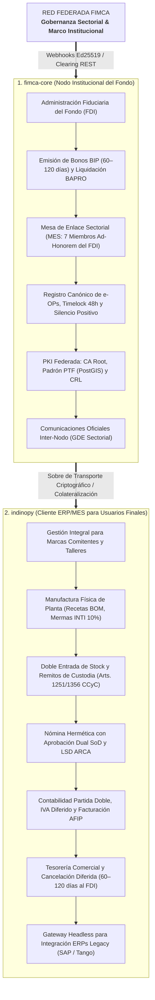
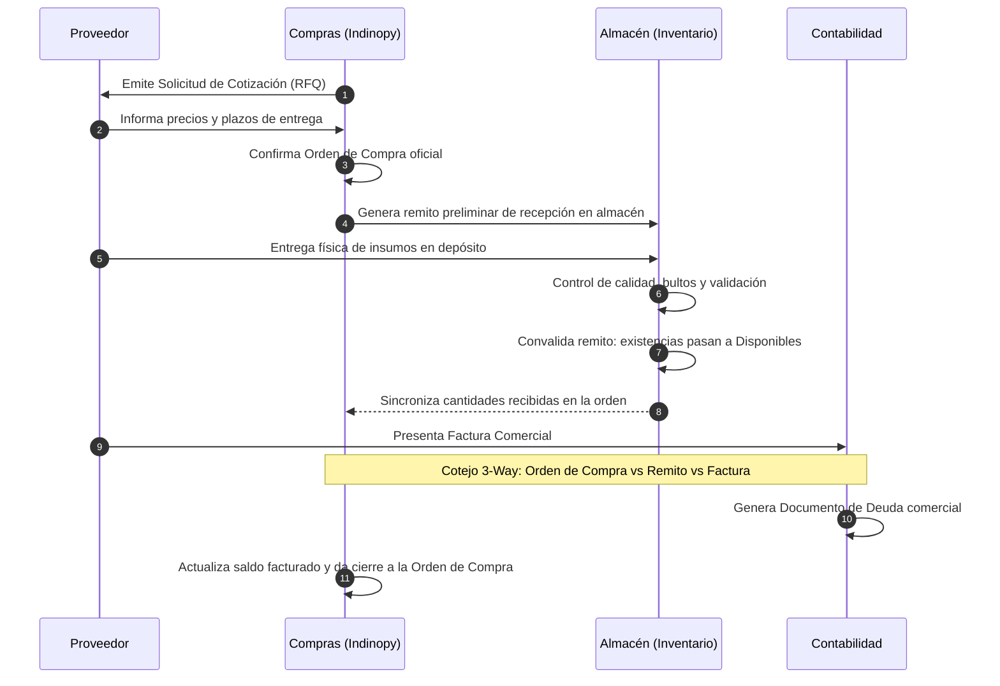
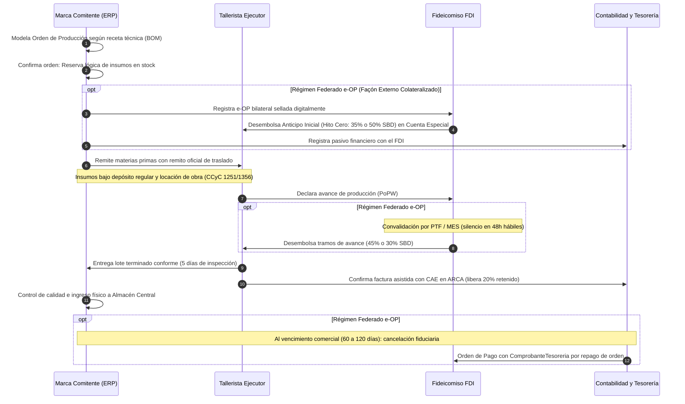
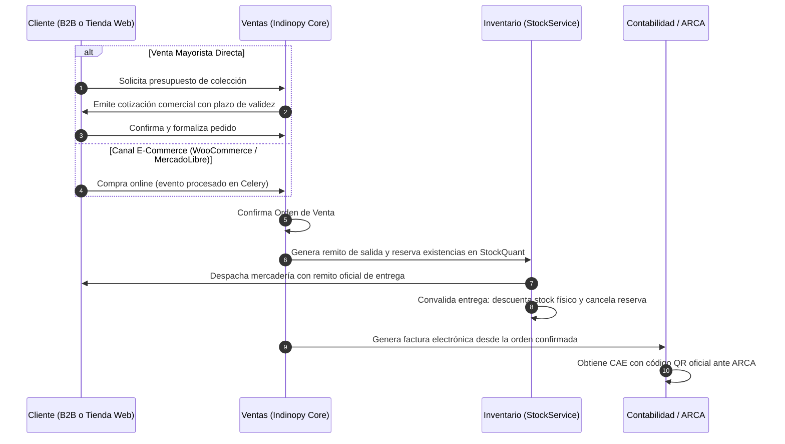
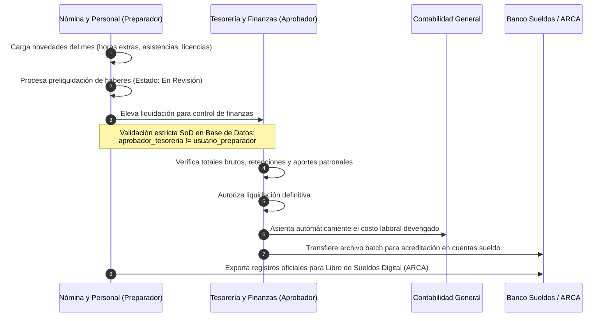
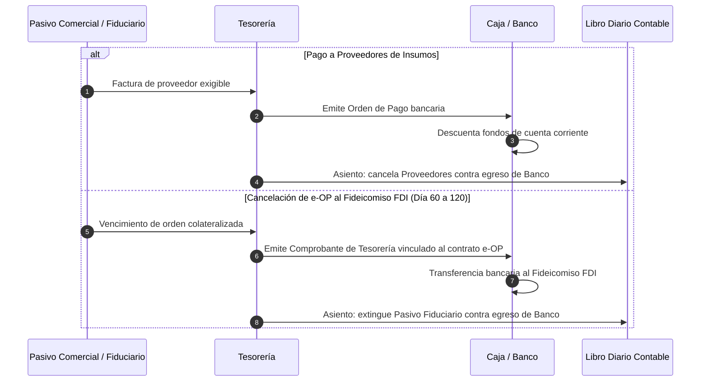
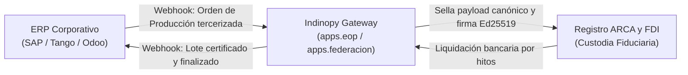

# Arquitectura Funcional — Indinopy ERP/MES

**Estado:** Documento de Especificación Consolidado  
**Alcance:** Visión Funcional, Matriz de Roles (SoD), Módulos del Sistema, Ciclos Documentales y Modo Headless

Este documento consolida la arquitectura funcional completa de **Indinopy**, integrando los principios operativos de manufactura, la topología de red, la matriz de segregación de funciones (SoD), los diagramas de flujo documental y los mecanismos de integración con sistemas externos.

---

## 1. Visión Funcional: ¿Qué problema resuelve el software?

Indinopy no es solo un ERP administrativo, sino una plataforma de **gobernanza comunitaria y financiera** para la manufactura de calzado, cuero e indumentaria. Su arquitectura está diseñada para resolver tres problemas estructurales:

1. **Falta de crédito dinámico:** Transforma la Orden de Producción (e-OP) en un activo financiero (título de crédito causal y ejecutable) auditable y transable.
2. **Burocracia y Discrecionalidad:** Reemplaza el expediente analógico y la intermediación discrecional por **auditoría fiduciaria objetiva, contratos automatizados de custodia (Escrow y Timelocks en Celery/PostgreSQL)** y convalidación en territorio por los Promotores Territoriales (PTF).
3. **Purgatorio Fiscal e Informalidad:** Conecta interfaces con ARCA para automatizar el alta tributaria (Monotributo Productivo con micro-retención del 2%), habilitar la facturación asistida en un clic y retener aportes únicamente al momento del cobro bancario real, evitando la acumulación de pasivos en períodos de inactividad.

### 1.1. Dualidad Arquitectónica del Ecosistema: `fimca-core` vs. `indinopy`

El ecosistema tecnológico no es un monolito confuso, sino que se divide estrictamente en **dos aplicaciones autónomas e interconectadas**:

1. **`fimca-core` (La Autoridad y el Fondo):** Es el software de backend institucional que opera el Fideicomiso (FDI), el Banco agente de clearing y la Mesa de Enlace Sectorial (MES). No maneja el inventario privado ni la nómina de las fábricas. Su función es ser la **cámara de compensación, el oráculo de precios de convenio y el árbitro de la red**.
2. **`indinopy` (El Cliente Fabril):** Es la suite de software que corre en cada empresa (SaaS o local). Gestiona la vida interna de la fábrica (insumos, corte, sueldos, ventas) y, cuando una orden es federada, la empaqueta y dialoga con `fimca-core` para obtener financiamiento y garantías.

---

### 1.2. Encuadre Operativo: La Marca como Núcleo Integral (Producción Mixta, Nómina y Finanzas)

El sistema está concebido para dar soporte en primera instancia a la **Marca manufacturera** en toda su complejidad operativa, y en segunda instancia al **Tallerista satélite**:

1. **La Marca como Núcleo Operativo (con planta propia o façón tercerizado):** Centraliza el diseño, los recetarios técnicos (BOM), el pañol de insumos y el capital comercial. Puede operar con planta física propia (corte, embalaje y operarios directos) o bien bajo un modelo deslocalizado donde terceriza etapas en talleres a façón. En ambos casos, administra inventario por partida doble, nómina y tesorería comercial.
2. **Producción Mixta (Planta Propia + Façón):** Las Órdenes de Producción gestionan etapas combinadas: corte y armado internos en planta comitente, y etapas tercerizadas (ej. aparado a façón) remitidas en custodia bajo los Arts. 1251 y 1356 del Código Civil y Comercial de la Nación, colateralizadas ante el Fideicomiso de Desarrollo Industrial (FDI).
3. **Impermeabilidad Laboral (Blindaje Art. 30 LCT):** La nómina de la marca (`apps.nomina`) es estrictamente hermética e inaccesible para los talleres. Los operarios y destajistas de los talleres externos jamás figuran en los libros de sueldos de la marca comitente.
4. **Desdoblamiento Financiero:** La tesorería de la marca no le anticipa liquidez operativa de su propio bolsillo al tallerista durante la fabricación; el FDI asume el fondeo del Hito Cero y de los hitos de avance, y la marca programa únicamente la cancelación fiduciaria a término (de 60 a 90 días, con tope máximo de 120 días) una vez entregado el lote.
5. **Integración Gradual del Taller:** El tallerista opera mediante una interfaz ligera (Portal web progresivo con ficha técnica de trabajo y firma Ed25519) sin necesidad de infraestructura de servidores propia, o mediante un nodo federado autónomo si se trata de un taller consolidado o cooperativa.

---

## 2. Matriz de Roles, Permisos y Segregación de Funciones (SoD)

La arquitectura segrega los permisos de forma estricta según el actor que interactúa en la plataforma, tanto a nivel de infraestructura como en los procesos internos de la empresa.

### 2.1. Roles a Nivel Infraestructura (La Red Federada)

Permisos asignados a los nodos y actores que interactúan en la infraestructura de clave pública (PKI):

| Tipo de Actor / Nodo | Rol en la Red | Permisos y Capacidades |
| :--- | :--- | :--- |
| **Mesa de Enlace Sectorial (MES)** | Comité Fiduciario Territorial | Opera como comité del FDI bajo su Reglamento de Gestión. Valida matrices paritarias con INTI, gestiona la Bolsa de Trabajo y dirime controversias en su plenario arbitral. |
| **Promotor Territorial (PTF)** | Auditor y Tutor de Campo | Posee aplicación móvil con enclave seguro. Asiste al taller en la carga de la orden, constata el avance físico en planta y emite la certificación de la Prueba de Trabajo Productivo (PoPW). |
| **Nodo Comitente (Marca)** | Emisor de Órdenes | Crea e-OPs y remite materias primas. **Bloqueo duro:** No puede auto-aprobarse hitos ni ordenar pagos directos desde el fideicomiso. |
| **Nodo Tallerista** | Receptor y Ejecutor | Recibe e-OPs entrantes, firma la aceptación del trabajo, declara avances y emite el comprobante fiscal asistido con CAE. |
| **Fideicomiso (FDI)** | Administrador Fiduciario | Emite Bonos de Inversión Productiva (BIP a 60-120 días), custodia las garantías y transfiere los anticipos y liquidaciones a las Cuentas Especiales. |
| **Agente Bancario Oficial** | Entidad de Liquidación | Opera las Cuentas Especiales de Compensación y Liquidación Manufacturera (Art. 14° Ley de e-OP), 100% exentas del Impuesto al Cheque (Ley 25.413). |

### 2.2. Roles Organizacionales Internos (ERP Marca / Comitente)

Para evitar fraudes internos y errores operativos, Indinopy implementa segregación de funciones (*Segregation of Duties - SoD*) mediante perfiles de usuario (`django.contrib.auth.models.Group`):

#### A. Alta Gerencia y Apoderados
* **Director General (CEO):** Acceso de lectura global a tableros de control consolidados (Finanzas, Producción, Comercialización). No opera transacciones cotidianas.
* **Apoderado Legal / Titular de Firma:** Único rol con acceso a la clave privada Ed25519 de la empresa alojada en enclave seguro. Su función es suscribir digitalmente la e-OP y autorizar el compromiso crediticio ante el Registro y el FDI.

#### B. Módulo de Producción y Suministros
* **Jefe de Producción:** Modela las recetas técnicas (BOM), costea tiempos estándar y planifica lotes dejando las órdenes en estado preliminar. No posee facultades para obligar financieramente a la firma.
* **Jefe de Compras (`apps.compras`):** Gestiona solicitudes de cotización (RFQ) y emite Órdenes de Compra a proveedores de cuero, avíos y materias primas ante alertas de quiebre de stock.
* **Supervisor de Pañol e Inventario (`apps.inventario`):** Registra ingresos de compras y genera remitos oficiales de traslado a producción en locación de obra y depósito regular (Arts. 1251 y 1356 CCyC).

#### C. Módulo Comercial y Canales
* **Jefe de Ventas (`apps.ventas`):** Administra canales comerciales, listas de precios y sincronización omnicanal con plataformas de comercio electrónico.
* **Vendedor:** Perfil acotado a la toma de pedidos, consulta de disponibilidad en tiempo real y remisión de despachos, sin acceso a costos industriales ni balances.

#### D. Módulo Administrativo y Financiero
* **Tesorero / Finanzas (`apps.tesoreria`):** Administra cajas y cuentas bancarias. Audita las liquidaciones fiduciarias del FDI y emite las Órdenes de Pago para la cancelación del crédito al FDI al vencimiento convenido mediante `ComprobanteTesoreria.escrow_asociado`.
* **Analista Contable (`apps.contabilidad`):** Administra el Libro Diario por partida doble estricta, conciliaciones bancarias, libros de IVA Digital y regímenes de retención y percepción (SICORE/SIFERE).

#### E. Módulo de Nómina y Recursos Humanos (Segregación Dual SoD)
* **Jefe de Personal (`apps.nomina`):** Administra legajos, novedades variables (horas extras, presentismo) y confecciona preliquidaciones de haberes, recibos de sueldo y archivos para el Libro de Sueldos Digital (LSD) de ARCA. **Bloqueo duro:** No puede autorizar la orden de pago bancario de haberes.
* **Aprobador de Tesorería:** Rol financiero que audita y convalida en segunda instancia la liquidación (`aprobador_tesoreria != usuario_preparador`), disparando en una sola transacción atómica el asiento de costo laboral en contabilidad y la orden de egreso bancario en tesorería.

---

## 3. Arquitectura de Módulos del Sistema

Indinopy articula sus operaciones a través de siete módulos acoplados por servicios:

1. **Compras (`apps.compras`):** Solicitudes de Cotización (RFQ), Órdenes de Compra a proveedores, seguimiento de tarifas y conciliación documental *3-Way Matching*.
2. **Producción (`apps.produccion` y `apps.eop`):** Ciclo de vida de la Orden de Producción (gestión interna de fábrica o e-OP fiduciaria federada), recetas técnicas (BOM) y seguimiento físico de etapas.
3. **Inventario (`apps.inventario`):** Gestión de existencias por partida doble (`StockQuant`). Emisión de remitos de recepción, traslado a custodia en talleres externos y despacho comercial.
4. **Ventas (`apps.ventas` e `apps.integraciones`):** Presupuestos comerciales, pedidos mayoristas y conectores desacoplados para canales de venta digital (WooCommerce, MercadoLibre).
5. **Contabilidad y Fiscal (`apps.contabilidad` y `apps.afip`):** Libro Diario por partida doble, facturación electrónica con CAE y código QR oficial de ARCA, cuentas corrientes y reportes de Convenio Multilateral.
6. **Tesorería (`apps.tesoreria`):** Administración de cajas, cuentas bancarias, custodia fiduciaria de anticipos y cancelación comercial de órdenes de producción.
7. **Nómina (`apps.nomina`):** Gestión de legajos, novedades mensuales, liquidación de haberes, recibos oficiales bajo Ley N° 20.744 y exportación al Libro de Sueldos Digital de ARCA.

---

## 4. Documentos Centrales del Circuito

| Documento | Módulo Emisor | Función Operativa / Legal | Efecto en Inventario / Caja |
| :--- | :--- | :--- | :--- |
| **Solicitud de Cotización (RFQ)** | `compras` | Consulta de precios, plazos y validez técnica a proveedores. | No vinculante. Sin efecto en stock ni deuda. |
| **Orden de Compra (PO)** | `compras` | Compromiso formal de adquisición de insumos o servicios. | Genera comprobante borrador de recepción en almacén. |
| **Presupuesto Comercial** | `ventas` | Propuesta económica estimada a clientes mayoristas. | No vinculante. No reserva stock físico. |
| **Nota de Pedido / Orden de Venta** | `ventas` | Pedido formal de venta confirmado. | Genera remito y **reserva existencias en `StockQuant`**. |
| **Remito de Traslado a Producción** | `inventario` | Envío de materias primas a taller bajo locación de obra. | Mueve stock a ubicación de façón bajo custodia (inembargable por Arts. 1251 y 1356 CCyC). |
| **Remito de Recepción** | `inventario` | Ingreso físico de insumos comprados o lotes confeccionados. | Incrementa stock disponible y actualiza avance en OC/OP. |
| **Remito de Entrega** | `inventario` | Despacho logístico de producto terminado al cliente final. | Descuenta existencias físicas y extingue la reserva lógica. |
| **e-OP (Orden de Producción Electrónica)** | `produccion` / `eop` | Título valor causal con fuerza ejecutiva (Art. 6° Ley e-OP). | Compromete insumos y activa el régimen fiduciario del FDI. |
| **Factura A / B / C** | `contabilidad` | Comprobante fiscal electrónico con CAE emitido ante ARCA. | Devenga derecho a cobro o deuda comercial y genera débito/crédito fiscal. |
| **Recibo de Sueldo (Ley 20.744)** | `nomina` | Comprobante legal de liquidación de haberes y retenciones. | Devenga costo laboral y pasivos previsionales en contabilidad. |
| **Orden de Pago (OP)** | `tesoreria` | Mandato de egreso bancario o efectivo. | Descuenta saldo en cuenta bancaria y extingue pasivos documentados. |

---

## 5. Diagramas Secuenciales de Flujo Operativo

### 5.1. Circuito de Compras y Abastecimiento (3-Way Matching)

Garantiza que no se abone ninguna factura de proveedor sin que coincida exactamente con la orden de compra emitida y la recepción física en depósito:

### 5.2. Circuito de Producción y Custodia de Materiales

Distingue entre la manufactura interna directa y el circuito federado con financiamiento fiduciario del FDI:

### 5.3. Circuito de Ventas y Omnicanalidad Desacoplada

La arquitectura desacopla las ventas web mayoristas y minoristas mediante una capa adaptadora para evitar bloqueos transaccionales:

### 5.4. Circuito de Nómina con Segregación Dual de Funciones (SoD)

Garantiza cumplimiento estricto de control interno: quien prepara la liquidación no puede autorizar el pago bancario de los sueldos:

### 5.5. Circuito de Tesorería Comercial y Cancelación Fiduciaria

---

## 6. Primitivas Criptográficas y Seguridad Legal

El sistema no confía en un estado arbitrario de base de datos. Cada orden y remito se protege mediante primitivas criptográficas auditables:

1. **SHA-256 (Payload Canónico):** Toda e-OP genera un documento JSON con claves ordenadas alfabéticamente que se sella con un resumen hash inmutable. Cualquier alteración posterior de importes o plazos rompe la verificación de integridad.
2. **Árboles de Merkle (BOM):** La receta técnica de insumos se estructura en un árbol de Merkle, permitiendo verificar consumos estándar y tolerancias de mermas sin divulgar el recetario industrial completo.
3. **Firmas Digitales Ed25519:** Los apoderados de las empresas y los Promotores Territoriales firman digitalmente desde sus dispositivos móviles con clave privada en enclave seguro.
4. **Resguardo Legal en Remitos:** Todo remito de traslado a talleres incorpora de forma automatizada las cláusulas de Locación de Obra (Art. 1251 CCyC), Depósito Regular (Art. 1356 CCyC), Separación Concursal (Art. 138 Ley 24.522) y Cobertura de la Póliza Colectiva de Stock (Art. 20 inc. 4 Ley de e-OP), otorgando blindaje jurídico contra embargos sobre materiales ajenos en proceso de transformación.

---

## 7. Integración con Sistemas Heredados: Modo Headless

Para aquellas empresas industriales que ya utilizan sistemas corporativos consolidados (SAP, Tango Gestión, Odoo o Microsoft Dynamics) para su facturación comercial y contabilidad general, Indinopy implementa el **Modo Headless (API Gateway)**:

1. **Desactivación de Módulos Locales:** Mediante variables de configuración (`NODE_ROLE`), la empresa desactiva ventas, compras y contabilidad en su instancia de Indinopy.
2. **El Sistema Externo como Maestro:** El ERP heredado continúa gestionando clientes, proveedores, compras generales y stock comercial.
3. **Inyección por API REST:** Cuando en el sistema principal se crea una orden de manufactura que requiere façón externo o financiamiento fiduciario, se emite un webhook hacia la API de Indinopy (`POST /api/v1/headless/e-op/`).
4. **Indinopy como Pasarela Criptográfica:** Recibe la orden, valida la receta técnica, gestiona la firma digital del apoderado, calcula el hash SHA-256 y registra el título en la plataforma fiduciaria para acceder a los beneficios del régimen (Hito Cero, Puerto Seguro laboral y Crédito Fiscal Presunto).
5. **Retorno Sincronizado:** Al convalidarse la entrega final del lote y liberarse la retención de cierre fiscal, Indinopy notifica al sistema externo mediante webhook para que ingrese el stock físico definitivo a sus registros contables tradicionales.

Esta arquitectura garantiza que la adhesión al Régimen FIMCA no exija la sustitución traumática de los sistemas informáticos preexistentes de las marcas consolidadas.

---

## 8. Reglas de Integridad Estricta del Sistema

1. **Partida Doble Universal:**
   - En **Inventario**, ningún insumo o par de calzado se crea ni destruye arbitrariamente: todo movimiento exige una ubicación física de origen y una de destino (`StockQuant`).
   - En **Contabilidad**, ningún comprobante se asienta si la suma del Debe no es idéntica a la suma del Haber (`Asiento` inmutable).
2. **Reserva Lógica vs Movimiento Físico:**
   - La confirmación de una orden (de venta o de producción) reserva existencias lógicamente para prevenir la sobreventa o el desabastecimiento; la baja física real ocurre únicamente al convalidar el remito correspondiente.
3. **Segregación Dual de Funciones (SoD):**
   - El operador que confecciona liquidaciones salariales u órdenes de pago no puede autorizar el desembolso financiero respectivo (`usuario_preparador != aprobador_tesoreria`).
4. **Atomicidad en Capa de Servicios:**
   - Las operaciones complejas que involucran múltiples módulos se encapsulan taxativamente en la capa de servicios (`@transaction.atomic`), garantizando que ante cualquier falla técnica la base de datos retorne intacta a su estado anterior sin inconsistencias ni saldos huérfanos.
