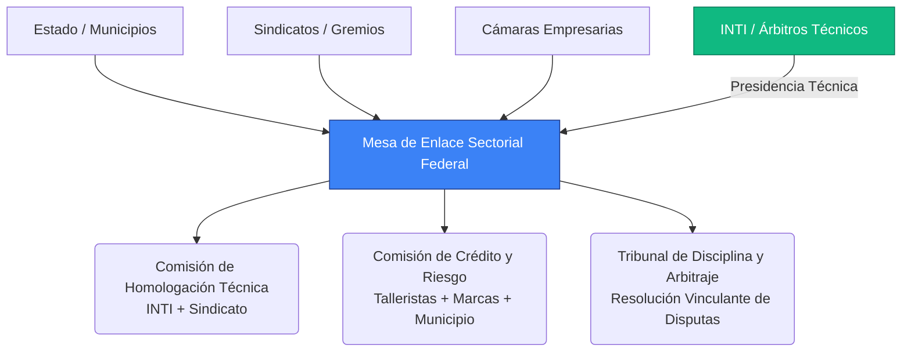
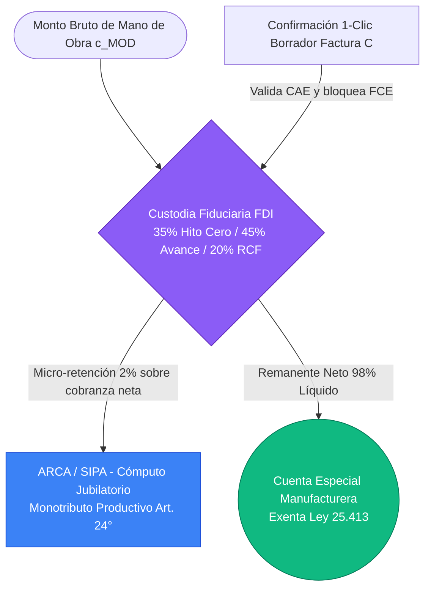

# Addenda I: Complemento Estratégico al Proyecto FIMCA y a la Ley de Salvataje Nacional

*Secciones Reforzadas con Incorporación de Reformas Complementarias*

> **Nota de uso:** Este documento consolida la Addenda I original y todas las reformas complementarias incorporadas a las comisiones especializadas de la MES, el FDI, la Bolsa de Trabajo, la Red CIFO y el Banco de Maquinaria. El orden de secciones sigue el reordenamiento normativo acordado. El estilo y la doctrina son continuación directa del texto base.

## ANEXO II: Arquitectura Jurídica de la Orden de Producción Electrónica (e-OP) como Título Valor Causal

### Justificación

La consagración legal de la Orden de Producción Electrónica (e-OP) mediante el **Anteproyecto de Ley de e-OP** y su reglamentación por el Banco Central de la República Argentina (BCRA), la Comisión Nacional de Valores (CNV) y la Agencia de Recaudación y Control Aduanero (ARCA) es la piedra angular que sostiene todo el sistema de financiamiento manufacturero. Mientras que la **Ley de Salvataje Nacional** provee el alivio de emergencia preexistente y el **Régimen FIMCA** constituye el régimen autónomo de formalización, inclusión socioproductiva y gobernanza territorial sectorial, la **Ley de e-OP** crea el título valor causal y su arquitectura fiduciaria en el mercado de capitales.

### A. Clasificación Jurídica de la e-OP y Fuerza Ejecutiva (Arts. 1°, 3°, 6°, 8° y 9° de la Ley de e-OP)

En armonía con el Título I del Anteproyecto de Ley de e-OP, la Orden de Producción Electrónica registrada en el **Registro Público de e-OPs en el ámbito de ARCA (Art. 10°)** se estructura bajo las siguientes bases dogmáticas y procesales:

* **Título Valor Causal, Nominativo y Divisible (Arts. 1° y 3°):** La e-OP es un título de crédito causal regido por los Artículos 1815, 1820, 1834, 1839 y concordantes del Código Civil y Comercial de la Nación (CCyC), aplicando supletoriamente las normas del pagaré comercial (Decreto-Ley 5965/63). **La sola suscripción bilateral de la e-OP en la plataforma oficial instrumenta, prueba y perfecciona de pleno derecho el contrato de locación de obra industrial (Art. 1251 CCyC)**, desplazando el hecho generador del crédito desde la entrega tardía del bien hacia el momento mismo de inicio de la producción.

* **Título Ejecutivo Autosuficiente y Acción contra el Moroso (Art. 6°):** La constancia registral fehaciente de la e-OP emitida por el Registro Público constituye **título ejecutivo autosuficiente en los términos del Artículo 521 inciso 7 del Código Procesal Civil y Comercial de la Nación (CPCCN)** y códigos procesales provinciales, sin necesidad de protesto, reconocimiento de firma ni preparación de la vía ejecutiva. Ante el incumplimiento de pago de la marca comitente al vencimiento comercial de los hitos certificados, el FDI ejecuta su **Reserva Líquida de Garantía del 5%** y promueve la acción ejecutiva directa contra la marca, con inoponibilidad de defensas personales sobre tramos convalidados (Art. 8°). Asimismo, **la suscripción bilateral de la e-OP por parte del tallerista ejecutor constituye un reconocimiento expreso, voluntario e incondicional de deuda líquida y exigible** por los fondos percibidos en el Hito Cero (sujeto a condición resolutoria de cumplimiento de los hitos productivos); ante abandono culpable o incumplimiento injustificado del taller, la contingencia de liquidez es absorbida transitoriamente por la **Reserva por Mora Operativa (0,8% del $c_{\text{MOD}}$)** y el FDI queda habilitado para promover la **vía ejecutiva directa contra el taller moroso** previa intimación por diez (10) días hábiles, además de su inhabilitación en el SETP.

* **Incompatibilidad Expresa con la Factura de Crédito Electrónica — Bloqueo de FCE (Art. 9°):** Para impedir la doble titulación ejecutiva sobre un mismo lote manufacturado, el Artículo 9° de la Ley de e-OP modifica la Ley N° 27.440 incorporando el **Artículo 7° bis**, por el cual los sistemas de ARCA **bloquean de pleno derecho la derivación de comprobantes respaldados por una e-OP hacia el Registro de Facturas de Crédito Electrónicas (FCE)**, registrándose al cierre fiscal (RCF) exclusivamente como factura electrónica de liquidación ordinaria y cancelatoria.

### B. Infraestructura Abierta e Interoperabilidad Federal (Arts. 10°, 14° y 23° de la Ley de e-OP)

La emisión, convalidación y seguimiento de la e-OP se asienta sobre el **Registro Público Oficial de e-OPs administrado por ARCA (Art. 10°)** bajo estándares de datos abiertos, pudiendo articularse en los nodos territoriales (talleres, marcas y sedes de la MES) con la red federada de **Indinopy ERP/MES** (plataforma de software libre y código abierto).

A través de estándares abiertos, el sistema garantiza la inmutabilidad criptográfica de los compromisos industriales (recetas BOM con hash determinista de árbol de Merkle y firmas con presunción legal de autoría del Art. 7°) e **interopera mediante APIs seguras con la infraestructura estatal, bursátil y bancaria**:

1. **Con ARCA (Arts. 9°, 10°, 23° y 24°):** Opera el Registro Público de e-OPs resguardando el secreto comercial de los montos ($c_{\text{MOD}}$ y $c_{\text{BOM}}$) conforme a la Ley 25.326. Gracias a la modificación del **Art. 5° inc. b de la Ley de IVA (Art. 23° inc. 2)**, se difiere el perfeccionamiento del hecho imponible del IVA respecto del Hito Cero y los Hitos de Avance hasta la entrega definitiva del lote conforme y liberación de la **Retención de Cierre Fiscal (RCF del 20%)**. Asimismo, mediante la dispensa legal del secreto fiscal (Art. 101 Ley 11.683, Art. 23° inc. 4), ARCA intercambia datos automatizados para emitir el **Certificado de Diligencia Debida Laboral (CDD / CDD-P)**, precarga de oficio el **Borrador Asistido de Factura C** (Art. 24° inc. 5) y bloquea automáticamente la FCE.
2. **Con el FDI, BCRA y CNV (Arts. 14° a 19°):** Las e-OPs registradas se transmiten al **Fideicomiso de Desarrollo Industrial (FDI)** para la custodia fiduciaria escalonada (35%/45%/20% o 50%/30%/20% con SBD) y su titulización mediante **Bonos de Inversión Productiva (BIP)** (60 a 180 días) con calificación SVS en la CNV y elegibilidad en la línea LFIP del BCRA. Los desembolsos se acreditan en las **Cuentas Especiales de Compensación y Liquidación Manufacturera (Art. 14°)**, **100% exentas del Impuesto al Cheque (Ley 25.413)** y sin scoring patrimonial bancario tradicional, rigiéndose por el **Sistema de Evaluación de Trayectoria Productiva (SETP)**.
3. **Con INTI y RENAPER (Arts. 7°, 12°, 13° y 27°):** Con RENAPER para validar la identidad biométrica en el alta del Monotributo Productivo y firmas digitales; y con el **INTI** para el cruce automatizado con las matrices semestrales de tiempos estándar y costos paritarios (Art. 27°) y la solicitud de peritajes técnicos prejudiciales en 5 días hábiles (Art. 13°).

### C. Custodia Fiduciaria Escalonada (35 / 45 / 20) e Hito Cero (Art. 12° de la Ley de e-OP)

Conforme al Artículo 12° de la Ley de e-OP, los fondos de cada orden se administran bajo la modalidad de **Custodia Fiduciaria Escalonada** en el FDI y se liquidan en tres tramos matemáticos estrictos que totalizan siempre el 100% del valor neto de mano de obra ($c_{\text{MOD}}$):
- **Hito Cero (Anticipo de Arranque Operativo): 35%** del $c_{\text{MOD}}$ —o **50%** cuando el producto cuente con **Sello Buen Diseño (SBD)** oficialmente certificado—.
- **Hitos de Avance (Prueba de Trabajo Productivo - PoPW): 45%** del $c_{\text{MOD}}$ —o **30%** en órdenes con **SBD**—, liberables contra declaración jurada de avance, georreferenciación satelital cifrada y remito parcial (convalidación a las 48 horas hábiles sin objeción).
- **Hito Final — Retención de Cierre Fiscal (RCF): 20%** del $c_{\text{MOD}}$, liberado instantáneamente contra la emisión de la Factura electrónica ordinaria con CAE validado por ARCA (y bloqueo de FCE).

Para habilitar el desembolso directo e inmediato del **Hito Cero (35% o 50% con SBD)** sin scoring bancario tradicional (evaluado por el SETP, con cupos iniciales garantizados de "arranque en frío" según el Art. 2° inc. 12), el Artículo 12° inciso 1 exige verificar **copulativamente tres condiciones**:

1. **Suscripción y Registro Bilateral:** Firma digital de comitente y ejecutor registrada en la plataforma oficial de ARCA.
2. **Acreditación Fidedigna de Entrega de Insumos:** Ingreso físico de las materias primas a la planta del ejecutor (o del **Lote Inicial Crítico** ≥ 20% del $c_{\text{BOM}}$ en esquemas de Logística Justo a Tiempo) documentado mediante **remito electrónico oficial (tipos A, B o C) o remito físico oficial (tipo R)** con consignación expresa del **UUID de la e-OP** (Art. 20° inc. 20.2).
3. **Vigencia del Seguro Obligatorio de Stock en Custodia (Art. 20 bis):** Cobertura asegurativa automática e inmediata otorgada por la **Póliza Colectiva Maestra de Stock en Custodia ($c_{\text{BOM}}$)** administrada por el FDI y financiada con la alícuota de stock ($c_{\text{STK}}$ de hasta el 0,5% del $c_{\text{BOM}}$) abonada por la comitente al registrar la orden.

En el mismo acto, la entidad bancaria oficial habilita sin costo la **Cuenta Especial de Compensación y Liquidación Manufacturera (Art. 14°)** vinculada al CUIT/CUIL del ejecutor, inembargable frente a débitos bancarios preexistentes, con encuadramiento especial en CENDEU y **exenta del Impuesto al Cheque (Ley 25.413)**.

### D. Requisitos de la Comunicación BCRA (Anexo Regulatorio I de la Ley de e-OP)

En plena alineación con la **Minuta de Comunicación "A" [XXXX] del Anexo Regulatorio I** del Anteproyecto de Ley de e-OP, el Banco Central de la República Argentina (BCRA) dispone:

1. **Admisión como Activo de Descuento, Colateral y Cómputo en la LFIP:** Las entidades financieras podrán descontar, aceptar en caución y computar como garantía crediticia válida a las e-OPs inscriptas en el Registro Público de ARCA (instrumentadas sobre locación de obra industrial, Art. 1251 CCyC). Dichas operaciones de descuento y anticipo, así como la suscripción de Bonos BIP, serán elegibles para su cómputo dentro de la **Línea de Financiamiento para la Inversión Productiva (LFIP)** de MiPyMEs.

2. **Ponderación de Riesgo Crediticio Preferencial del 20%:** Las e-OPs que cuenten con respaldo y garantía fiduciaria del FDI recibirán un tratamiento prudencial preferencial en las normas sobre Capitales Mínimos y Previsiones del BCRA, aplicándoseles una **ponderación de riesgo crediticio del veinte por ciento (20%)**.

3. **Reglamentación de las Cuentas Especiales de Compensación y Liquidación Manufacturera (Art. 14°):** Las entidades bancarias habilitarán estas cuentas sin costo de apertura ni mantenimiento, con operatoria por CBU/CVU, QR y Echeqs sin descubierto, indisponibilidad frente a débitos o compensaciones bancarias por pasivos preexistentes (Art. 1685 CCyC y Art. 147 LCT), y **exención total del Impuesto sobre los Créditos y Débitos Bancarios (Ley N° 25.413)** para todos los movimientos originados en desembolsos de e-OPs activas y pagos laborales/previsionales asociados.

4. **Encuadramiento Normativo Especial en CENDEU (Art. 14° inc. 4):** El BCRA establecerá un tratamiento especial en la Central de Deudores del Sistema Financiero (CENDEU) para las Cuentas Especiales Manufactureras, de modo que las discrepancias técnicas periciales (Art. 13°) o las demoras operativas transitorias amparadas por la cobertura fiduciaria del FDI no generen reclasificaciones negativas automáticas que obstaculicen la continuidad productiva del tallerista.

## ANEXO III: Estimación de Impacto Fiscal y Equilibrio Recaudatorio (Título IV de la Ley de e-OP)

### Justificación

Toda propuesta legislativa con disposiciones tributarias (Art. 52 CN) debe cuantificar con rigor su impacto fiscal. A diferencia de esquemas basados en subsidios estatales directos a los aportes patronales, el diseño del **Título IV del Anteproyecto de Ley de e-OP (Arts. 22°, 23° y 24°)** estructura un modelo donde **el gasto tributario directo está estrictamente acotado por ley de presupuesto**, mientras que **la regularización laboral y previsional genera recaudación neta genuina en la fuente** desde el primer hito liquidado, arrojando un **resultado fiscal superavitario por ampliación permanente de la base formal**.

### A. Universo de Beneficiarios y Parámetros del Programa Piloto (Art. 29°)

| Parámetro | Escenario Base (Año 1 / Piloto 18 meses) | Fuente / Referencia Normativa |
| :---- | :---- | :---- |
| Cupo máximo Programa Piloto (18 meses) | Hasta 5.000 e-OPs activas simultáneas o USD 100M en custodia ($c_{\text{MOD}}$) | Art. 29° Ley de e-OP |
| Talleres activos estimados en la cadena (Conurbano) | 15.000 unidades | CIAI / SRT / estimación sectorial |
| Unidades adheridas (Año 1 — 30% adhesión) | 4.500 talleres y microtalleres | Proyección conservadora |
| Volumen anual estimado de mano de obra formalizada ($c_{\text{MOD}}$) | $ 180.000 millones anuales | ~4.500 unidades × $ 3,33M mensuales promedio |
| Composición del universo adherido | 60% talleres empleadores (CDD / CDD-P) y 40% Monotributo Productivo | Estimación sectorial |

### B. Costo Fiscal Directo y Acotado para el Estado Nacional (Art. 23° y Art. 14° inc. 5)

Conforme al Título IV de la Ley de e-OP, el Estado Nacional **no eroga subsidios presupuestarios para pagar cargas patronales**. El costo fiscal (gasto tributario) se circunscribe exclusivamente a tres componentes controlados:

| Componente de Gasto Tributario | Regla Normativa (`proyecto_ley_eop.md`) | Estimación Anual (Escenario Base) | Control Presupuestario |
| :---- | :---- | :---- | :---- |
| **1. Crédito Fiscal Presunto de IVA (10%)** | **Art. 23° inc. 1:** 10% sobre el $c_{\text{MOD}}$ contratado con Monotributistas Productivos o talleres en transición bajo CDD-P (que no trasladan IVA). | **$ 14.400 millones** (aplicado sobre el ~80% del $c_{\text{MOD}}$ que opera bajo Monotributo Prod. o CDD-P en el Año 1). | **Acotado por cupo fiscal anual** fijado por el Congreso en la Ley de Presupuesto. |
| **2. Exención del Impuesto al Cheque (Ley 25.413)** | **Art. 14° inc. 5 y Art. 23° inc. 3:** Exención del 1,2% sobre débitos y créditos en Cuentas Especiales Manufactureras y Bonos BIP. | **$ 2.160 millones** (1,2% sobre $ 180.000M de flujo formalizado que antes circulaba 100% en efectivo informal). | Costo teórico nulo en términos reales (reemplaza uso de efectivo no bancarizado). |
| **3. Diferimiento Técnico del IVA** | **Art. 23° inc. 2 (Mod. Art. 5° inc. b Ley IVA):** El IVA no se devenga en el Hito Cero (35%) ni en Avances (45%), sino al entregarse el lote y liberarse la RCF (20%). | **Efecto financiero neutro** dentro del ejercicio (diferimiento temporal de 60 a 90 días, sin quita de alícuota). | Neutralidad intertemporal asegurada por la RCF del 20%. |
| **Costo Fiscal Bruto Total Acotado** | — | **$ 16.560 millones anuales** | **< 0,02% del PBI** |

### C. Ingresos Fiscales y Previsionales Genuinos por Ampliación de la Base Formal (Arts. 22° y 24°)

En el plano previsional y tributario, el sistema no pierde recursos sino que **recauda en la fuente sobre una masa productiva que antes era 100% subterránea**:

1. **Condonación de Pasivos Históricos Incobrables (Art. 22° inc. 22.2 bis.a):** El Régimen Estatutario Permanente de Regularización Laboral condona las multas y deudas previsionales pretéritas de los talleres informales (créditos que el fisco jamás hubiera percibido por insolvencia o clandestinidad) y reconoce hasta 60 meses de servicios al SIPA sobre base SMVM para los trabajadores, destrabando su ingreso inmediato a la formalidad.
2. **Recaudación Previsional Genuina en Talleres con Personal (Retención de hasta el 15% — Art. 22° inc. 22.2 bis.b):** Sobre el flujo corriente de las e-OPs de talleres con trabajadores dependientes (estimado en el 60% del volumen total = $ 108.000 millones anuales de $c_{\text{MOD}}$), el FDI **retiene automáticamente en la fuente de cada hito hasta el 15% bruto** para ingresar de oficio los aportes y contribuciones al SIPA, INSSJP, obra social y ART. Esto genera un ingreso previsional genuino e inmediato estimado en **$ 16.200 millones anuales**.
3. **Recaudación en Monotributo Productivo (Micro-retención del 2% — Art. 24° inc. 2):** Sobre el flujo corriente de prestadores individuales autónomos (40% del volumen = $ 72.000 millones anuales), el FDI practica la **micro-retención automática del 2% sobre cobranzas netas** con destino al SIPA, sumando **$ 1.440 millones anuales** de nueva recaudación previsional.
4. **Ampliación de Base Imponible en IVA y Ganancias por Cierre Fiscal Obligatorio (RCF del 20%):** Al exigir la emisión de la Factura oficial con CAE para liberar el 20% final (RCF), la totalidad del lote terminado ingresa al circuito blanco de comercialización de la marca comitente. La trazabilidad del lote formaliza ventas minoristas y mayoristas que generan débito fiscal de IVA (21%) e Impuesto a las Ganancias corporativo adicional por un piso conservador estimado en **$ 18.000 millones anuales**.

### D. Balance Fiscal Consolidado y Financiamiento Extrapresupuestario de la Gobernanza (Art. 16° inc. 4)

| Concepto del Balance Fiscal (Año 1) | Monto Anual Estimado | Impacto Presupuestario |
| :---- | :---- | :---- |
| **(-) Costo Fiscal Bruto (Crédito Presunto IVA 10% + Exención Ley 25.413)** | -$ 16.560 millones | Topeado por Ley de Presupuesto |
| **(+) Recaudación Previsional en la Fuente (Retención hasta 15% CDD-P + 2% Monotributo Prod.)** | +$ 17.640 millones | Ingreso directo a SIPA / Seguridad Social |
| **(+) Mayor Recaudación IVA y Ganancias por Trazabilidad de Lotes (RCF)** | +$ 18.000 millones | Ingreso directo a ARCA / Coparticipación |
| **(=) Resultado Fiscal y Previsional Neto Consolidado** | **+$ 19.080 millones (Superavitario)** | **Superávit fiscal neto desde el Año 1** |

Adicionalmente, **toda la infraestructura operativa, técnica, laboral y asegurativa del sistema se autofinancia de forma 100% extrapresupuestaria** a través del **Canon Fiduciario ($c_{\text{FDI}}$)** abonado exclusivamente por las marcas comitentes al registrar cada e-OP (Art. 4° inc. 4.c y Art. 16° inc. 4):
* **0,5% del $c_{\text{MOD}}$:** Financia el **Fondo de Afectación Específica Laboral (FAEL)** y su seguro de caución (Art. 22° inc. 22.6).
* **0,2% del $c_{\text{MOD}}$:** Financia al **INTI** (matrices paritarias semestrales y peritajes en 5 días) y al **Programa de Formalización Empresaria Tutelada (PFET)** (Art. 27° y Art. 24 bis).
* **0,8% del $c_{\text{MOD}}$:** Financia los costos operativos del fiduciario y la **Reserva por Mora Operativa del FDI**.
* **Hasta 0,5% del $c_{\text{BOM}}$ ($c_{\text{STK}}$):** Financia íntegramente la **Póliza Colectiva Maestra de Stock en Custodia** (Art. 20 bis).

## SECCIÓN II (bis): Arquitectura Institucional de la Mesa de Enlace Sectorial (MES) como Comité Técnico y Territorial del FDI

### Justificación y Naturaleza Fiduciaria

La Mesa de Enlace Sectorial (MES) es el órgano de conducción y tutela socioproductiva de la cadena de valor en el marco del **Régimen FIMCA**. Desde el punto de vista de la técnica legislativa y del derecho fiduciario argentino (Arts. 1666 a 1700 del CCyC y Ley N° 26.831), mientras el **Fiduciario Financiero** (entidad pública o mixta autorizada por la CNV conforme al Art. 15° de la Ley de e-OP) ejerce la administración fiduciaria patrimonial y **ARCA** opera el Registro Público de e-OPs (Art. 10°), **la MES y sus comisiones especializadas se constituyen jurídicamente como los Comités Técnicos, de Fomento y de Seguimiento Territorial dentro del Contrato y Reglamento de Gestión del Fideicomiso de Desarrollo Industrial (FDI)**, oficiando asimismo como el órgano consultivo sectorial permanente al que aluden los Artículos 1° y 27° de la Ley de e-OP.

Esta arquitectura dual garantiza dos objetivos simultáneos: (1) frente al mercado de capitales (CNV, BCRA e inversores de los Bonos BIP), el flujo cambiario y la liquidación de las e-OPs operan con certeza algorítmica y objetividad registral; y (2) frente al territorio productivo, las decisiones de fomento industrial, validación de matrices paritarias junto al INTI, asignación de cupos iniciales en el SETP y resolución de disputas cuentan con conducción comunitaria paritaria. Esta sección establece el estatuto orgánico de la MES y sus comisiones dentro del FDI.

> **Figura 3.** Gobernanza de la MES con Separación Funcional de Comisiones. El modelo de conducción compartida asegura la legitimidad técnica, la imparcialidad crediticia y la resolución arbitral de disputas.

### A. Composición y Representación

La Mesa de Enlace Sectorial se integrará con siete (7) miembros titulares con mandato de dos (2) años renovable, con la siguiente representación:

| Nodo | Representantes | Designación |
| :---- | :---- | :---- |
| Talleristas y aparadores | 2 titulares + 2 suplentes | Elección directa por padrón sectorial |
| Marcas y comitentes | 2 titulares + 2 suplentes | Designación por cámara sectorial adherida |
| INTI | 1 titular + 1 suplente | Designación institucional |
| Sindicato | 1 titular + 1 suplente | Designación por organización gremial con personería |
| Municipio/Provincia | 1 titular + 1 suplente | Designación por autoridad jurisdiccional adherida |

* **Nodo Productivo (Talleristas, Aparadores y Diseñadores):** Dos (2) representantes titulares y dos (2) suplentes, elegidos por voto directo de los empadronados sectoriales del distrito. A los efectos de garantizar una representación equilibrada que contemple las asimetrías de escala de la cadena, las bancas se dividirán de forma obligatoria mediante dos sub-padrones concurrentes:  
  * Un (1) representante titular y un (1) suplente en representación exclusiva del sub-padrón de **Prestadores Eventuales Individuales** (trabajadores bajo modalidad de Monotributo Productivo Automatizado).  
  * Un (1) representante titular y un (1) suplente en representación exclusiva del sub-padrón de **Unidades Productivas Consolidadas** (talleres y pymes manufactureras constituidas bajo la figura de SAS con personal registrado).  
* **Nodo de Mercado (Marcas comitentes):** Dos (2) representantes titulares y dos (2) suplentes, designados por la cámara sectorial empresaria adherida al régimen.  
* **Nodo Técnico (INTI):** Un (1) representante titular y un (1) suplente, de designación institucional directa.  
* **Nodo de Tutela Laboral (Sindicato):** Un (1) representante titular y un (1) suplente, designado por la organización gremial de rama con personería gremial vigente.  
* **Nodo de Árbitro Jurisdiccional (Municipio):** Un (1) representante titular y un (1) suplente, designado por la autoridad de la Secretaría de Producción local.

El quórum para sesionar es de cinco (5) miembros. Las decisiones ordinarias se adoptan por mayoría simple. No obstante, se requerirá una Mayoría Agravada de cinco (5) votos positivos para las siguientes materias reservadas:

* La modificación o actualización de los pisos de precio base por minuto/hora de confección para las Órdenes de Producción (e-OP).

* El dictamen de aplicación de sanciones graves o elevación al Consejo Superior del pedido de exclusión definitiva de una marca comitente de FIMCA.

* La reasignación de partidas excepcionales del Fondo de Fomento del FDI local ante situaciones de emergencia o baches estacionales de la cadena.

> **Cláusula de protección del nodo productivo:** Cualquier votación sobre estas materias reservadas requerirá de forma obligatoria el voto concurrente de al menos un (1) representante del nodo de Talleristas y Aparadores, garantizando que el capital concentrado o la burocracia circunstancial no resuelvan por encima del interés directo de los trabajadores de base.

### B. Separación de Funciones: Comisiones Especializadas del Fideicomiso (FDI)

A fin de evitar que quienes se benefician de una decisión sean quienes la adoptan, la MES opera dentro de la estructura del FDI a través de comisiones especializadas con competencias separadas e indelegables:

* **Comisión de Homologación Técnica (Comité Técnico del FDI):** integrada por el representante del INTI y el representante sindical. Sus competencias exclusivas son: (1) Dictaminar sobre elegibilidad de tecnología importada bajo el criterio de "Tecnología Conveniente". (2) Intervenir junto al INTI en la elaboración y actualización semestral de las matrices técnicas de tiempos estándar y costos directos paritarios (Art. 27° Ley de e-OP) y en el seguimiento de la Prueba de Trabajo Productivo (PoPW). Sus dictámenes técnicos son vinculantes para la Comisión de Crédito. (3) Auditoría de Origen y Pre-Calificación en el **SETP (Sistema de Evaluación de Trayectoria Productiva)** y de las Unidades de Crédito Productivo (UCP): recibir, procesar y validar de forma trimestral las declaraciones de las marcas comitentes respecto a la tracción exportadora de otros sectores nacionales, emitiendo el dictamen técnico de pre-calificación de las UCP previo a su elevación a la Secretaría de Comercio de la Nación para su homologación final.

* **Comisión de Crédito, Riesgo y Fomento Territorial (Comité de Fomento y Elegibilidad del FDI):** integrada por los representantes de talleristas y de marcas, con el representante de la Secretaría de Producción Municipal como árbitro con voto de desempate definitivo. Mientras la validación formal y el desembolso ordinario de las e-OPs dentro de cupo se ejecutan de forma automatizada en un plazo máximo de 48 horas hábiles (Art. 11° inc. 1 Ley de e-OP), esta comisión tiene competencia exclusiva para: (1) asignar y ampliar los cupos iniciales de "arranque en frío" en el SETP para talleres y comitentes ingresantes (Art. 2° inc. 12); (2) aprobar las líneas de fomento territorial del Régimen FIMCA (equipamiento del Banco de Maquinaria, becas CIFO y microcréditos de Hábitat Productivo); y (3) autorizar la redistribución solidaria de lotes ante fuerza mayor. Ningún miembro puede participar en la votación de un expediente en el que tenga interés directo o indirecto. El representante municipal presidirá esta comisión y actuará como garante de la paz social y el arraigo local.

### C. Plazos Máximos Vinculantes

La burocracia es el enemigo silencioso de la cadena de valor. Se establecen los siguientes plazos máximos, cuyo vencimiento sin resolución opera el silencio administrativo positivo:

* **Validación de Orden de Producción (e-OP):** 48 horas hábiles desde la presentación.

* **Dictamen de Tecnología Conveniente:** 15 días hábiles desde la solicitud.

* **Certificación de hito productivo:** 24 horas hábiles desde la notificación del taller.

* **Mediación de conflicto:** 10 días hábiles desde la presentación de la parte reclamante.

El incumplimiento reiterado de estos plazos es causal de remoción, con resolución en asamblea extraordinaria convocada dentro de los 5 días. Para los casos de bloqueo deliberado por motivos políticos, el sistema informático de ARCA dará por aprobada la OP por Silencio Administrativo Positivo, garantizando que ninguna interna partidaria frene la producción del tallerista.

**Protocolo de e-OP Espejo y Duplicación Express:** Cuando se registre una e-OP que constituya una réplica técnica de una orden certificada de forma positiva en los doce (12) meses anteriores, y donde las únicas modificaciones residan en el volumen físico de unidades a producir o en la actualización nominal del monto totalizado, el instrumento adquirirá la condición de *'Vía Rápida' (Fast-Track)*. El sistema informático centralizado exceptuará a la orden de todo proceso de re-homologación técnica por el INTI o auditoría de escala por la MES, procediéndose a la convalidación e interoperabilidad digital de forma inmediata y automatizada dentro de un plazo técnico máximo de dos (2) horas desde su carga, supeditado exclusivamente al cruce de consistencia de la capacidad productiva disponible en el legajo del taller.

**Régimen de e-OP Multitaller y Descentralización de Lotes**

* **Estructura de Consorcio Productivo:** En aquellos casos donde la escala de producción de una marca comitente requiera la intervención simultánea de múltiples unidades productivas para un mismo lote estacional, la plataforma digital permitirá la emisión de una única e-OP Unificada con formato de Consorcio Productivo. El emisor asociará de forma desagregada los CUIT o CUIL de los talleristas intervinientes, asignando a cada legajo de forma taxativa el segmento técnico del proceso (corte, aparado, costura, armado o vulcanizado) o el volumen físico parcial de unidades bajo su responsabilidad.  
* **Clearing Financiero Desacoplado:** El procesamiento de los fondos de fomento y adelantos líquidos operará bajo la modalidad de Escrow digital atomizado. El sistema del FDI liquidará de forma automatizada e independiente el porcentaje correspondiente al Hito Cero a las cuentas de clearing inembargables de cada tallerista incorporado, conforme al presupuesto de su servicio específico. La certificación de avances de obra y la consecuente liberación de fondos por hitos se tramitará de manera desacoplada; el cumplimiento y validación técnica de un tallerista gatillará su clearing de pago en 24 horas hábiles, sin que las eventuales demoras de los demás eslabones de la OP madre congelen su flujo de caja.  
* **Mecanismo de Redistribución Solidaria de Lotes:** Si durante el ciclo de producción uno de los talleres asociados sufriera una parálisis operativa fortuita o retraso por causales de fuerza mayor debidamente homologadas por el Promotor Territorial (PTF), la Comisión de Homologación Técnica de la MES local estará facultada para fragmentar el lote remanente y reasignarlo de forma automatizada a talleres linderos de la red que demuestren capacidad ociosa verificada en la Bolsa de Trabajo. El clearing final de repago de la orden se liquidará de forma estrictamente proporcional a la cantidad de unidades terminadas y certificadas por cada taller participante, preservando el giro comercial de la marca y la paz social del territorio.

### D. Régimen Gradual de Disciplina Comunitaria

Ante incumplimientos recurrentes al Código de Conducta Comunitario, retrasos injustificados en la liberación de hitos financieros en Escrow, o intentos de imposición de precios de miseria, la MES local aplicará el siguiente Régimen Gradual de Disciplina, previo a la instancia de exclusión total de FIMCA:

1. **Apercibimiento Digital con Alerta en la Bolsa:** Publicación de la falta en el legajo digital de la marca dentro de la Bolsa de Trabajo Sectorial por el término de treinta (30) días, funcionando como advertencia para el resto de los talleres de la red.

2. **Quita de Puntos en el SETP y Unidades de Crédito Productivo (UCP):** Penalización en el **Sistema de Evaluación de Trayectoria Productiva (SETP, Art. 2° inc. 12 Ley de e-OP)** y baja de hasta el cincuenta por ciento (50%) de las Unidades de Crédito Productivo (UCP) acumuladas en el período, provocando la pérdida automática de la prioridad en los cupos aduaneros de Importación Temporaria.

3. **Congelamiento Temporal del Giro de Stock:** Suspensión por el término de quince (15) días hábiles de la autorización aduanera para retirar lotes terminados de los talleres de locación de obra adheridos, forzando la conciliación obligatoria en la MES bajo apercibimiento de ejecución de la Reserva Líquida de Garantía (5%) depositada en el FDI.

### E. Del Régimen de Previsibilidad de Entrega y Responsabilidad Productiva del Taller

#### 1. Garantía de Cumplimiento de Plazos de Entrega

Los talleristas, SAS y unidades productivas registradas en la Bolsa de Trabajo Sectorial asumen el compromiso vinculante de cumplimiento de los cronogramas de entrega estipulados en la Orden de Producción digital (e-OP), considerándose el factor tiempo como un elemento crítico de la competitividad del régimen.

#### 2. Causales de Exclusión por Fuerza Mayor y Régimen de Logística Justo a Tiempo (Art. 5° bis de la Ley de e-OP)

No se aplicará penalización, quita de incentivos ni demérito en el **SETP (Sistema de Evaluación de Trayectoria Productiva)** cuando la demora responda a causales de fuerza mayor o de abastecimiento debidamente acreditadas:

1. **Mora de la Comitente en Logística Justo a Tiempo (Art. 5° bis Ley de e-OP):** En órdenes con cronograma de abastecimiento secuencial (Logística Justo a Tiempo), la falta de entrega en término de materias primas, cueros, matrices, avíos o semielaborados por parte de la marca comitente: (a) **suspende de pleno derecho y prorroga automáticamente los plazos de confección** del tallerista día por día sin penalidad en el SETP (y registra un demérito automático en el SETP para la marca); (b) posterga el vencimiento comercial de pago de la comitente hasta un **tope máximo improrrogable de treinta (30) días corridos** (sin superar nunca el vencimiento de los Bonos BIP ni los 180 días desde la emisión), con interés compensatorio a exclusivo cargo de la marca; (c) transcurridos **más de cinco (5) días hábiles de mora**, obliga a la marca a abonar al tallerista una **compensación diaria por capacidad instalada ociosa (parada de planta / standby) equivalente a un (1) jornal diario del Salario Mínimo Vital y Móvil (8 horas del valor horario vigente) por día hábil de demora** por puesto afectado; y (d) vencidos **quince (15) días hábiles de mora continua**, confiere al tallerista el **derecho a declarar la resolución del contrato de pleno derecho**, percibiendo el 100% del valor de mano de obra presupuestado para los hitos iniciados o ejecutados y ejerciendo el derecho de retención del Art. 2587 del CCyC.

2. **Siniestros o contingencias de infraestructura:** Cortes del suministro energético, roturas fortuitas de maquinaria pesada sin repuestos inmediatos, o razones de fuerza mayor de carácter socio-ambiental o de salud pública en el núcleo productivo del taller, contando las materias primas en custodia con la cobertura automática de la **Póliza Colectiva Maestra de Stock en Custodia ($c_{\text{BOM}}$, Art. 20 bis)**.

#### 3. Protocolo de Alerta de Asistencia Recíproca ante Cuellos de Botella

Si el tallerista detecta de forma anticipada una imposibilidad técnica o de capacidad instalada para cumplir con el vencimiento del hito, deberá activar la Alerta de Asistencia Recíproca en la plataforma digital con una antelación mínima de setenta y dos (72) horas.

* **Redistribución Solidaria de Lotes:** La Comisión de Homologación Técnica de la MES local estará facultada para fragmentar el lote remanente y reasignarlo de forma automatizada a talleres linderos con capacidad ociosa verificada.

* **Liquidación Proporcional:** El pago final de la e-OP se liquidará de forma estrictamente proporcional a la cantidad de pares o prendas terminadas y certificadas por cada taller participante, preservando la paz social del territorio.

#### 4. Penalidades por Negligencia de Entrega, Abandono o Desvío de Stock (Arts. 6°, 12° inc. 1, 20° y 20 bis de la Ley de e-OP)

Ante incumplimientos por negligencia manifiesta, abandono culpable o desvío de materias primas en custodia de transformación, se aplican de forma inmediata los mecanismos de la Ley de e-OP y de la MES:

1. **Restitución de Insumos y Póliza Colectiva de Stock (Arts. 20° inc. 20.4 y 20 bis):** La marca comitente conserva expedita la acción de restitución inmediata y separación de las materias primas no transformadas (Art. 138 Ley 24.522) o la percepción de la indemnización por reposición a través de la **Póliza Colectiva Maestra de Stock en Custodia ($c_{\text{BOM}}$)** contratada por el FDI, mientras que la contingencia de liquidez del anticipo es absorbida transitoriamente por la **Reserva por Mora Operativa (0,8% del $c_{\text{MOD}}$)**.

2. **Vía Ejecutiva Directa contra el Taller Moroso (Art. 6° in fine):** Dado que la suscripción de la e-OP por el tallerista constituye un **reconocimiento expreso, voluntario e incondicional de deuda líquida y exigible** por el Hito Cero percibido, el FDI se subroga y queda habilitado para promover la **acción ejecutiva directa contra el tallerista moroso** (previa intimación fehaciente por 10 días hábiles) por el capital anticipado no transformado más accesorios, o compensarlo mediante retenciones de hasta el treinta por ciento (30%) sobre liquidaciones futuras.

3. **Inhabilitación en el SETP y Pérdida de Visibilidad:** El tallerista incumplidor sufre la inhabilitación preventiva inmediata en el **Sistema de Evaluación de Trayectoria Productiva (SETP)** y la baja de su insignia en la Bolsa de Trabajo, sin perjuicio de las sanciones penales por estafa (Art. 172 CP) o falsedad documental (Arts. 293 y 296 CP) previstas en el Artículo 28° de la Ley de e-OP.

#### 5. Cláusula de Salvaguarda Financiera y Acción Civil por Dolo

Ante la comprobación fehaciente de fraude documental, desvío deliberado de materias primas fiscalizadas o simulación reiterada de e-OP con el objeto de vaciar los adelantos financieros del Hito Cero, y si el tallerista o unidad productiva suspendiera de forma permanente su actividad en la Bolsa para evadir el repago mediante retenciones automáticas, la MES local procederá de inmediato:

1. A la baja automática y definitiva del Monotributo Productivo y exclusión perpetua de los beneficios del Proyecto FIMCA.  
2. A la caducidad inmediata del beneficio de inembargabilidad de los activos particulares de los socios si se tratara de una SAS, activando la responsabilidad solidaria e ilimitada por dolo comunitario.  
3. A la remisión de los antecedentes técnicos y biométricos a la justicia ordinaria competete para iniciar las acciones penales y de recuperación patrimonial pertinentes, resguardando la integridad del capital del Fideicomiso de Desarrollo Industrial (FDI).

### F. Red de Centros de Innovación y Formación de Oficios (CIFO)

#### 1. Objeto, Financiamiento y Acceso Comunitario

Se crea la Red de Centros de Innovación y Formación de Oficios (CIFO) con el objeto de calificar recursos humanos e instituir una política de seguridad ciudadana preventiva mediante la inclusión sociolaboral de la juventud. Su financiamiento operativo provendrá del tres por ciento (3%) de los recursos del FDI local, constituyendo un fondo de afectación específica e inembargable.

* **Principio de Acceso Popular sin Prerrequisitos:** Los CIFOs tendrán carácter de puente comunitario irrestricto. Queda taxativamente prohibida la exigencia de acreditaciones educativas previas —como el ciclo secundario completo— para el ingreso. El único requisito de admisión es la voluntad de inserción productiva.

#### 2. Gobernanza Co-Gestionada: Trípode Institucional

La dirección y operación de cada CIFO regional se articulará de forma obligatoria mediante un esquema tripartito:

1. **El Gremio de Rama (Sindicato):** Responsable de los estándares de calificación, condiciones de salud laboral y provisión de los maestros instructores del oficio, resguardando la transmisión del saber práctico de las bases.

2. **La Articulación Empresaria y de Diseño:** Comité integrado por talleristas, PyMEs de confección, diseñadores y comercializadores homologados, encargados de definir los requerimientos de mano de obra en tiempo real según la demanda de la Bolsa de Trabajo.

3. **El Soporte Técnico e Infraestructura Pública:** El Municipio cederá en comodato los espacios físicos para las aulas, mientras que el INTI aportará la homologación tecnológica y certificará los títulos oficiales de Idoneidad en el Oficio.

#### 3. Beca de Estímulo y Lote Escuela

Los alumnos percibirán una Beca de Estímulo Productivo del FDI desde el primer día. Los Lotes Escuela —prendas o calzados resultantes de sus prácticas— contarán con el Sello de Buen Diseño y se canalizarán a través de la Bolsa de Trabajo para compras del Estado o marcas aliadas. El cincuenta por ciento (50%) de la renta neta se distribuirá entre los estudiantes como premio directo al cumplimiento.

#### 4. Bolsa de Inserción Automatizada

Los egresados de los CIFO obtendrán de forma automática su alta en el Monotributo Productivo o el Puente SAS y se incorporarán con rango de Prioridad 1 (Destacado de Oficio) en el directorio digital de la Bolsa de Trabajo. Las PyMEs o marcas comitentes que contraten a estos egresados mediante el registro de una e-OP obtendrán una bonificación de prioridad técnica en el sistema de asignación de fondos del FDI, reduciendo en un diez por ciento (10%) el plazo máximo de acreditación horaria de sus certificados de hito productivo en la cuenta de clearing, garantizando la liberación de la liquidez de la orden en un entorno prioritario de la jornada financiera 

### G. Banco Comunitario de Maquinaria y Bienes de Capital

#### 1. Objeto de Movilización de Activos Productivos

Se crea el Banco Comunitario de Maquinaria y Bienes de Capital para relevar, reacondicionar y asignar en comodato productivo las maquinarias industriales —inyectoras, aparadoras, cortadoras y afines— que se encuentren fuera del circuito operativo, acelerando la capitalización de unidades productivas emergentes y optimizando el uso de los recursos del FDI.

#### 2. Censo, Cesión Voluntaria e Incentivo Fiscal

* **Relevamiento por Promotores (PTF):** Los PTF, en coordinación con las Secretarías de Producción Municipal y las Cámaras Sectoriales, confeccionarán el padrón distrital de maquinaria industrial en desuso o paralizada.

* **Incentivo de Extinción de Pasivos Preexistentes:** Los titulares de bienes ociosos que los cedan en comodato obligatorio por treinta y seis (36) meses a la Red CIFO o a SAS registradas en la Bolsa, accederán a la condonación total de sus pasivos tributarios y multas preexistentes de ARCA vinculados a la actividad industrial anterior.

#### 3. Puesta a Punto y Calibración Soberana

Las maquinarias ingresadas al Banco serán derivadas a los talleres-escuela de los CIFO de cercanía. Su reparación y puesta a punto constituirá el módulo práctico fundamental de los alumnos avanzados, con supervisión del INTI y los maestros del Sindicato. Los insumos requeridos serán financiados por el fondo operativo de fomento del FDI local.

#### 4. Asignación por Récord de Cumplimiento

Una vez certificada la aptitud técnica por el INTI, el Banco de Maquinaria asignará el equipamiento en comodato con opción a transferencia definitiva de dominio a los egresados Prioridad 1 de los CIFO y a los talleres de la Bolsa que demuestren un récord impecable de entrega en sus primeras tres (3) e-OP, erradicando el scoring patrimonial bancario como limitante del crecimiento.

### H. Régimen de Licenciamiento, Garantías y Mantenimiento de Tecnología Conveniente

#### 1. Criterio de Homologación

Los bienes de capital incorporados al régimen mediante financiamiento del FDI o asignación del Banco de Maquinarias deberán responder estrictamente al estándar de Tecnología Conveniente, priorizando aquella maquinaria cuya ingeniería permita el mantenimiento soberano, la sustitución local de componentes y la operabilidad intensiva en mano de obra, rechazando tecnologías con bloqueos de software o patentes restrictivas de reparación externa.

#### 2. Apertura de Licencias y Planos de Despiece

Los proveedores de maquinaria homologados deberán entregar junto al equipamiento:

1. Las licencias de software de control operativo bajo modalidades de código abierto o acceso técnico irrestricto sin costo de renovación anual.

2. Los planos de despiece mecánico, diagramas electrónicos y manuales de mantenimiento preventivo completamente traducidos y pesificados.

#### 3. Red de Servicios Técnicos Comunitarios mediante los CIFO

Las garantías contractuales, la calibración técnica periódica y el mantenimiento correctivo de la totalidad del parque industrial adherido a FIMCA será ejercida de forma descentralizada por la Red CIFO de cada distrito. Los talleres y SAS adheridos abonarán un canon de mantenimiento pesificado y unificado de forma directa a la cuenta de fomento del FDI local, eliminando los sobrecostos de la intermediación corporativa privada.

#### 4. Cobertura por Parálisis Productiva Fortuita

Ante una avería crítica que paralice el taller y cuya resolución demande más de cuarenta y ocho (48) horas hábiles:

1. **Asignación de Muletto Técnico:** El Banco de Maquinarias otorgará en comodato temporal de urgencia una máquina de reemplazo en un plazo máximo de 24 horas.

2. **Compensación por Lucro Cesante:** El fondo de riesgo del FDI liquidará a favor de los trabajadores del taller afectado una compensación económica diaria equivalente al valor promedio de las e-OP caídas durante el lapso de parálisis forzosa.

## SECCIÓN II (ter): Parámetros Financieros del Fideicomiso de Desarrollo Industrial (FDI) y Bonos BIP (Arts. 15° a 19° de la Ley de e-OP)

### Justificación

Una herramienta financiera sin parámetros reglados es una intención sin sustento. Conforme al Título III del Anteproyecto de Ley de e-OP (Arts. 15° a 19°), el FDI constituye un **Fideicomiso Financiero** regulado por los Artículos 1666 a 1700 del CCyC y la Ley N° 26.831 de Mercado de Capitales, con patrimonio fiduciario separado e inembargable de pleno derecho (Art. 1685 CCyC). Esta sección detalla los parámetros cuantitativos, reservas y reglas de titulización bursátil que aseguran su solvencia ante el BCRA y la CNV.

### A. Parámetros Operativos y Cuantitativos Oficiales (Ley de e-OP)

| Parámetro / Métrica | Valor en Ley de e-OP | Referencia y Fundamento Legal |
| :---- | :---- | :---- |
| **Tramos de Desembolso ($c_{\text{MOD}}$)** | **35%** Hito Cero / **45%** Avance (PoPW) / **20%** RCF (o **50% / 30% / 20%** con Sello Buen Diseño - SBD) | Art. 12° Ley de e-OP (Suma exacta del 100% en ambos esquemas) |
| **Reserva Líquida de Garantía Comitente** | **5%** del monto nominal acumulado de e-OPs activas y en ejecución simultánea | Art. 16° inc. 3 (Responde exclusivamente por el riesgo comercial de impago de la propia comitente) |
| **Canon Fiduciario Total ($c_{\text{FDI}}$)** | **Alícuota operativa:** hasta **1,5%** de $c_{\text{MOD}}$ (0,5% FAEL, 0,2% INTI/PFET, 0,8% adm. y Reserva por Mora Operativa) + **Alícuota de stock ($c_{\text{STK}}$):** hasta **0,5%** de $c_{\text{BOM}}$ (Póliza Colectiva Maestra) | Art. 4° inc. 4.c y Art. 16° inc. 4 (A cargo exclusivo de la empresa comitente; prohibición de traslado al taller) |
| **Facilidad de Liquidez Contingente** | Hasta el **5%** del programa global de emisión de Bonos BIP autorizado por la CNV | Art. 16° inc. 6 (Línea revolvente para absorber descalces por logística justo a tiempo, peritajes INTI o RCF) |
| **Plazo de Vencimiento Comercial y Bonos BIP** | e-OPs a **60, 90 o 120 días corridos** (prórroga máx. 30 días por logística JIT); Bonos BIP de **60 a 180 días corridos** | Art. 4° inc. 6, Art. 5° bis inc. 2 y Art. 17° (Calce financiero estricto entre cartera subyacente y series de BIP) |
| **Tasa de Interés Compensatorio** | **Tasa BADLAR privada + spread fiduciario de hasta 300 puntos básicos** (a cargo de la comitente al vencimiento) | Art. 16° inc. 5 |
| **Programa Piloto (18 meses)** | Cupo máximo simultáneo de **5.000 e-OPs** o **USD 100.000.000** en custodia ($c_{\text{MOD}}$) | Art. 29° (Con informe de evaluación de impacto bienal ante el Congreso) |

### B. Fuentes de Liquidez, Reservas y Emisión de Bonos de Inversión Productiva (BIP)

Conforme a los Artículos 16° a 19° de la Ley de e-OP, la sustentabilidad y el fondeo del FDI descansan en fuentes de mercado de capitales y garantías líquidas autoliquidables:

1. **Colocación de Bonos de Inversión Productiva (BIP) con Calificación SVS (Arts. 17° y 19°):**
   * **Régimen de Oferta Pública Abreviada:** El FDI emite valores de deuda fiduciaria negociables bajo el régimen de la Ley 26.831 denominados **Bonos de Inversión Productiva (BIP)**, respaldados por carteras homogéneas de e-OPs vigentes, con plazos de **60 a 180 días corridos** calzados con el vencimiento comercial de las órdenes. La CNV habilita un régimen abreviado de oferta pública y tramos minoristas en ALyCs con láminas mínimas reducidas (Anexo Regulatorio II).
   * **Etiquetado Social, Verde y Sustentable (SVS):** Los Bonos BIP califican como Instrumentos SVS bajo la **Resolución General CNV N° 917/2021**, acreditando la formalización laboral en planta y trazabilidad productiva, contando obligatoriamente con el **dictamen vinculante de un Revisor Externo Independiente** inscripto ante la CNV.
   * **Exención Impositiva (Art. 23° inc. 3):** Los rendimientos, actualizaciones y ganancias de capital de los Bonos BIP están **100% exentos del Impuesto a las Ganancias** (personas humanas y beneficiarios del exterior) y del **Impuesto sobre los Créditos y Débitos Bancarios (Ley 25.413)**.

2. **Línea de Financiamiento para la Inversión Productiva (LFIP del BCRA — Art. 16° inc. 2):** Canalización de fondeo de entidades financieras mediante el descuento de e-OPs y suscripción de BIP computables en los cupos MiPyME regulados por el BCRA, con ponderación de riesgo crediticio preferencial del 20%.

3. **Reserva Líquida de Garantía Comitente del 5% (Art. 16° inc. 3):** Cada empresa comitente integra una reserva líquida equivalente al **5% del monto nominal acumulado de sus e-OPs activas**, afectada de manera exclusiva e irrevocable a cubrir su propio riesgo comercial de impago, la cual se devuelve o computa a su favor al cancelar cada orden.

4. **Denominación y Habilitación Legal de Cláusulas de Ajuste (Art. 18°):** Las e-OPs y las series de Bonos BIP pueden denominarse en **Unidades de Cuenta Industrial (UCI)** (indexadas al IPIM del INDEC o al indicador salarial del convenio colectivo de la rama), en **Unidades de Valor Adquisitivo (UVA)**, en moneda de curso legal o en moneda extranjera (Art. 765 CCyC mod. DNU 70/2023), contando con habilitación legal expresa de ajuste para órdenes cuyo plazo supere los noventa (90) días corridos.

### C. Auditoría, Transparencia e Inembargabilidad

El FDI está sujeto a auditoría anual independiente por una firma externa designada por concurso, con publicación obligatoria del estado patrimonial, el índice de incobrabilidad real y el volumen de OP financiadas dentro de los 90 días del cierre de cada ejercicio.

Ningún activo del FDI puede ser embargado, cedido ni afectado en garantía de deudas ajenas a la cadena de valor. Esta inembargabilidad se establece expresamente en la ley constitutiva del fideicomiso.

## SECCIÓN III (bis): Criterios Objetivos para la Homologación de "Tecnología Conveniente"

### Justificación

El filtro de "Tecnología Conveniente" es una herramienta de soberanía, no un mecanismo de protección corporativa. Su eficacia depende de criterios objetivos que impidan que los productores locales de maquinaria utilicen la MES para bloquear tecnología competidora bajo el paraguas del interés nacional.

### A. Definición Objetiva de "No Disponible Localmente"

**Criterios Objetivos de Exclusión:** Se considera que una tecnología no está disponible localmente cuando la oferta industrial nacional no cumple de forma simultánea las siguientes tres condiciones estrictas:

* **Plazo de entrega:** El proveedor nacional no puede entregar el bien en un plazo igual o inferior a noventa (90) días corridos desde la orden de compra formal.  
* **Garantía:** El proveedor nacional no ofrece una cobertura de garantía técnica mínima de doce (12) meses sobre el bien y sus componentes o repuestos críticos.  
* **Precio:** El precio del bien de origen nacional equivalente supera en más del treinta por ciento (30%) el valor del bien importado puesto en planta (CIF), calculado con flete, seguro y derechos de importación en condiciones ordinarias.

**Instancia de Validación Obligatoria:** A los fines de coordinar este automatismo con las facultades de la Comisión de Homologación Técnica de la MES, ante toda solicitud de importación con arancel cero, el representante del **INTI** dispondrá de un plazo máximo improrrogable de quince (15) días hábiles para emitir su informe técnico.

**Operatividad del Silencio Administrativo Positivo:** Si la oferta nacional incumpliera aunque sea una de las tres condiciones objetivas mencionadas en el apartado anterior, o si el representante del INTI omitiera la emisión de su dictamen técnico dentro del plazo establecido de quince (15) días hábiles, el beneficio de arancel cero operará de pleno derecho por ministerio de la ley por vía de Silencio Administrativo Positivo, procediéndose a la emisión automática del certificado de liberación aduanera por la plataforma centralizada

### B. Registro Público de Homologaciones

Toda decisión de la Comisión de Homologación Técnica sobre elegibilidad de tecnología importada se publica en el portal digital de la MES y en el Boletín Oficial dentro de las 48 horas de su adopción, con los fundamentos técnicos del INTI que la sustentan. Esta publicidad genera jurisprudencia sectorial, reduce la arbitrariedad y permite que los propios productores nacionales conozcan las condiciones que deben mejorar para recuperar el mercado.

### C. Plazo Máximo Duro y Silencio Positivo

A los fines de neutralizar el desabastecimiento financiero y garantizar la agilidad absoluta del flujo logístico de la cadena, se establecen los siguientes plazos máximos perentorios, cuyo vencimiento sin pronunciamiento expreso activará el mecanismo centralizado de Silencio Administrativo Positivo:

1. **Validación Tecnológica de la Orden de Producción (e-OP):** Cuarenta y ocho (48) horas hábiles desde su carga en la plataforma digital. Este plazo express rige de forma exclusiva sobre el instrumento financiero informático de arranque. Transcurridas las 48 horas sin mediar objeción por la Comisión de Crédito, el sistema de ARCA dará por aprobada e interoperable la e-OP por Silencio Positivo, impidiendo que bloqueos deliberados de carácter político o partidario frenen la liquidación de fondos del Hito Cero hacia el taller.  
2. **Certificación de Hitos Productivos de Avance:** Veinticuatro (24) horas hábiles desde la notificación digital de finalización de tramo realizada por el tallerista mediante la aplicación móvil.  
3. **Instancia de Mediación de Conflictos Comerciales y de Cumplimiento:** Diez (10) días hábiles desde la presentación formal del reclamo por cualquiera de las partes de la e-OP (marcas comitentes o talleristas) ante la MES local. Este plazo prolongado aplicará con exclusividad para la resolución de disputas de fondo respecto a calidad de entregas, diferencias de matriz de costos, o readecuaciones salariales retroactivas derivadas del régimen de control del Veto Ex-Post

## SECCIÓN IV (bis): El Monotributo Productivo — Pieza Central de la Formalización Individual (Art. 24° de la Ley de e-OP)

### Justificación

El aparador de barrio, el cortador a destajo y la costurera que cobra en efectivo son el eslabón más vulnerable y más numeroso de la cadena. Mientras que el acompañamiento del PFET y las figuras societarias optativas (Art. 24 bis) están pensados para talleres empleadores consolidados (>5 trabajadores), el **Monotributo Productivo (Art. 24° de la Ley de e-OP)** es un **régimen de permanencia individual** que resuelve el problema del prestador autónomo con herramientas propias que no tiene razón práctica para sostener una cuota fija mensual bajo el sistema tributario tradicional.

### A. Alta Automatizada, Micro-Retención del 2% y Borrador Asistido: El Circuito (Art. 24°)

El Monotributo Productivo está concebido con un alcance estrictamente delimitado (Art. 22° inc. 22.5.b y Art. 24°): aplica **exclusivamente a las personas humanas que prestan servicios manuales o artesanales de transformación manufacturera de forma individual con medios propios** (aparadores de barrio, cortadores, modelistas), distinguiéndose tanto de los talleres con empleados (regidos por el CDD/CDD-P) como del trabajo a domicilio sin medios propios (regido por la Libreta Digital de Trabajo a Domicilio de la Ley N° 12.713, Art. 22° inc. 22.5.a).

El régimen se activa por el flujo real del trabajo y opera sin fricción burocrática:

1. **Asociación en la e-OP y Alta de Oficio con RENAPER (Art. 24° inc. 1):** La registración de la primera e-OP que asigne tareas al CUIL del prestador posibilita su alta de oficio en la plataforma de ARCA mediante validación de identidad con DNI digital ante el RENAPER y consentimiento expreso del titular, sin trámites presenciales ni costo fijo de mantenimiento.
2. **Micro-retención del 2% sobre Cobranzas Netas Computable al SIPA (Art. 24° inc. 2):** El sistema sustituye la cuota fija mensual por una **micro-retención automática del dos por ciento (2%) sobre las cobranzas netas efectivas** que el FDI liquide en su Cuenta Especial de Compensación y Liquidación Manufacturera, destinada a la seguridad social. Dicha retención opera como pago a cuenta: cada mes en que las retenciones acumuladas alcancen o superen el componente previsional de la Categoría A del Monotributo General, se computa **un (1) mes de servicios con aportes en el Sistema Integrado Previsional Argentino (SIPA)** para el régimen jubilatorio ordinario (pudiendo el prestador integrar voluntariamente la diferencia o acumular el saldo para su consolidación semestral o anual dentro del mismo ejercicio fiscal). La cobertura médica básica se garantiza mediante el subsistema público o adhesión optativa a obra social.
3. **Exclusión de Sobrecostos para la Marca y el Taller:** Esta micro-retención del 2% se practica en la fuente sobre la liquidación del propio prestador; en simultáneo, la marca comitente que lo contrata goza del **Crédito Fiscal Presunto de IVA del 10%** sobre el valor neto de la mano de obra ($c_{\text{MOD}}$) conforme al Artículo 23° inciso 1.
4. **Acreditación Neta en Cuenta Especial Exenta y Facturación por Borrador Asistido (Art. 24° inc. 5):** El FDI deriva el 2% al SIPA a través de ARCA y acredita el **98% neto** en la Cuenta Especial del prestador (100% exenta del Impuesto al Cheque, Ley 25.413). Al entregarse el lote conforme, para liberar el **20% final de la Retención de Cierre Fiscal (RCF)**, **ARCA genera y precarga de oficio el Borrador Asistido de Factura C** en la plataforma oficial: el prestador solo confirma con un clic para obtener el CAE instantáneo y cobrar su saldo final, sin necesidad de parametrizar puntos de venta ni cargar datos contables, y quedando bloqueada de pleno derecho la emisión de FCE (Art. 7° bis Ley 27.440).

> **Figura 4.** Arquitectura de Formalización del Monotributo Productivo (Art. 24° Ley de e-OP). La micro-retención del **2% sobre cobranzas netas** se descuenta de forma automatizada y se imputa al cómputo de meses con aportes en el SIPA, mientras que el cierre fiscal (RCF del 20%) se resuelve con un solo clic mediante el **Borrador Asistido de Factura C** precargado por ARCA.

### B. Cero Deuda en Inactividad y No Retroactividad (Art. 24° inc. 3)

En los períodos en que no existan e-OPs activas ni liquidaciones de cobro, **no se devenga deuda líquida ni cargo tributario alguno** (Art. 24° inc. 3). Sin categorización punitiva, sin declaraciones juradas manuales y sin acumulación de pasivos en meses sin producción.

> **Cláusula de no retroactividad:** el alta en el Monotributo Productivo no genera deudas por períodos anteriores no registrados. El Estado renuncia expresamente a toda acción de determinación de oficio, recategorización retroactiva o ejecución fiscal fundada en actividad informal previa a la adhesión al régimen.

Esta cláusula debe comunicarse con la misma jerarquía que el beneficio principal y figurar en los primeros 100 caracteres de cualquier pieza dirigida al sector.

### C. Permanencia Individual, Retención de Cierre Fiscal (RCF del 20%) y Exención de Mora (Art. 12° inc. 3 y Art. 24° inc. 4)

El Monotributo Productivo es un **régimen de permanencia para el prestador individual y no presupone ni impone la constitución de persona jurídica** (SAS, SRL ni cooperativa). Conforme al Artículo 24° inciso 4 de la Ley de e-OP, cuando el prestador supere el límite máximo de facturación anual de la categoría del Monotributo General en que se encuentre, ARCA lo notificará con al menos treinta (30) días corridos de anticipación y asistirá su recategorización a la escala siguiente del régimen simplificado, sin exigir jamás su migración societaria.

* **Liquidación de la Retención de Cierre Fiscal (RCF del 20%) mediante Borrador Asistido (Art. 12° inc. 3):** Conforme a la estructura universal de desembolsos (35% Hito Cero / 45% Avances / **20% RCF**, o 50% / 30% / 20% con SBD), el tramo final retenido en custodia fiduciaria estanca para el cierre fiscal es estrictamente del **veinte por ciento (20%)** del $c_{\text{MOD}}$. El 80% restante ya fue percibido por el prestador durante el arranque y avance físico (PoPW).
* **Exención del Cargo de Mora BADLAR para Monotributistas Productivos (Art. 12° inc. 3 párrafo segundo):** Mientras que para los talleres del régimen general la demora superior a 15 días hábiles en emitir la factura de cierre devenga un cargo a tasa BADLAR, la ley establece expresamente que **a los prestadores individuales del Monotributo Productivo no les resulta aplicable dicho cargo por mora**, manteniéndose su 20% de RCF resguardado en custodia fiduciaria estanca con recordatorios periódicos hasta que confirmen con un clic el **borrador precargado de Factura C** en la aplicación.

La legislación garantiza el derecho autónomo del prestador a percibir del FDI los desembolsos y acumular puntaje propio en el **Sistema de Evaluación de Trayectoria Productiva (SETP, Art. 2° inc. 12)**, emancipando al eslabón productivo de base y dotando a su trabajo de valor financiero real.

### D. Mecanismo de "Suspensión Activa de Oficio" contra la Acumulación de Pasivos Cíclicos

La viabilidad territorial del Monotributo Productivo radica en que el tributo debe acompañar el flujo real de la economía popular y no los tiempos burocráticos del Estado. El mayor desincentivo para la formalización del eslabón de base (aparadores, costureros a destajo) es el riesgo a quedar atrapados en un sistema de cuotas fijas mensuales que continúan devengando deudas, intereses y multas durante los períodos de inactividad o caída del consumo.

Para resolver este cuello de botella estructural, el presente régimen institucionaliza la "Suspensión Activa de Oficio", un mecanismo automatizado por software soberano que opera bajo las siguientes pautas:

* **Gatillo por Inactividad de e-OP:** Si transcurren quince (15) días corridos desde la finalización y liquidación definitiva de la última Orden de Producción Digital (e-OP) vinculada al CUIL del prestador del servicio manual, sin que el sistema registre la asignación de un nuevo lote activo, la plataforma procesará de oficio y de forma inmediata la mutación de su estado fiscal hacia la condición de Suspensión Activa.  
* **Congelamiento Absoluto de la Carga Tributaria:** Mientras el trabajador permanezca en estado de Suspensión Activa, se interrumpe de pleno derecho la exigencia de cualquier tipo de régimen informativo, declaración jurada o cuota regulatoria. El mantenimiento del CUIT en este estado no generará bajo ningún concepto deudas fiscales, previsionales, recargos ni intereses resarcitorios ante los organismos de recaudación. La obligación fiscal se reduce a cero (0) si la producción física es cero (0).  
* **Reactivación de Oficio en Milisegundos:** El estado de suspensión se levantará automáticamente en el instante exacto en que cualquier MiPyME o SAS registrada en el sistema ingrese una nueva e-OP que incorpore el CUIL del trabajador. La reactivación se ejecuta por flujo informático, devolviendo al aportante la plena capacidad de emisión de comprobantes sectoriales sin requerir trámites presenciales, claves fiscales ni nuevas validaciones biométricas.