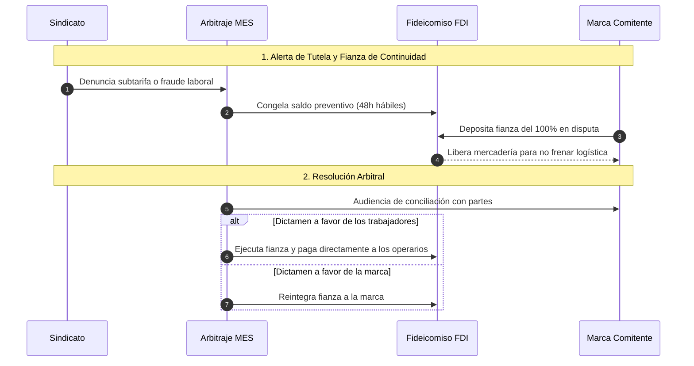
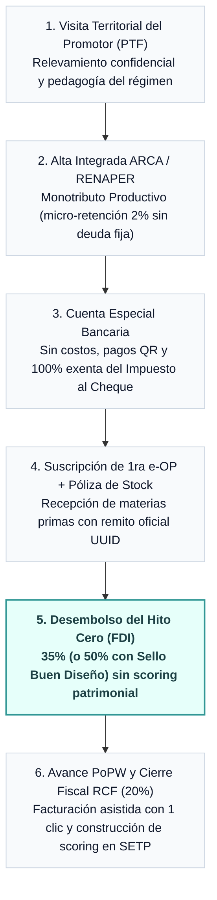

# Addenda II: Resistencias del Sector, Organización del Pueblo y Gobernanza Territorial

*Diligencia Debida Laboral, Puerto Seguro (CDD), Fondo FAEL, Trabajo a Domicilio (Ley 12.713), SETP e IA Algorética*

> **Nota de uso:** Esta Addenda II consolida el texto original y la totalidad de las reformas y adiciones incorporadas: reemplazos de las Secciones VIII.A y VIII.C.2, y las nuevas Secciones VIII.E a VIII.O. El orden de secciones sigue el reordenamiento normativo acordado. El estilo y la doctrina son continuación directa del texto base.

## SECCIÓN VIII: De las Resistencias del Sector Informal a la Organización del Pueblo

### Introducción Doctrinaria

Una propuesta que no contempla las razones por las cuales sus destinatarios pueden resistirla no es una propuesta honesta: es un decreto de escritorio que choca con la realidad y se rompe. La doctrina de la Comunidad Organizada reconoce que la libertad no se impone; se construye desde la confianza. Y la confianza, en el taller de barrio, no la genera una sigla nueva ni un formulario digital: la genera el compañero que ya adhirió y le cuenta cómo le fue.

Esta sección identifica las resistencias reales del tallerista informal, establece las respuestas que el régimen debe incorporar para neutralizarlas, crea la Bolsa de Trabajo Sectorial como puente entre la formalización y el mercado, y articula el conjunto con las organizaciones libres del pueblo que ya operan en el territorio.

### A. Análisis de Resistencias del Tallerista Informal y Respuestas del Régimen

#### Resistencia 1: Desconfianza Histórica en el Estado

La experiencia concreta del aparador de barrio con el Estado no es abstracta. Es la inspección municipal que llegó a pedir coima, la notificación de AFIP por deuda que no entendió cómo se generó, la tarifa que subió mientras el precio de la hora de trabajo se congelaba. Veinte años operando en efectivo no son una elección ideológica: son la consecuencia racional de un sistema que históricamente cobró más de lo que dio.

Presentarle a ese trabajador un régimen nuevo con siglas distintas activa de inmediato el mecanismo de autodefensa: "esto también me va a salir caro". Esa resistencia no se vence con un folleto del gobierno. Se vence con un par de la cuadra que ya adhirió y puede mostrar, con números reales y en el mismo idioma, que esta vez es diferente.

**Respuesta del régimen:** 

El primer contacto del régimen con el tallerista informal no es institucional ni burocrático: es territorial y comunitario. Se establece la figura del Promotor Territorial de Formalización (PTF), trabajador del propio sector con al menos doce (12) meses de antigüedad en el régimen, designado por la MES local con honorario mensual equivalente a dos (2) Salarios Mínimos, Vitales y Móviles, financiado con recursos del FDI. El PTF recorre el territorio, habla el mismo idioma, conoce los mismos problemas y puede mostrar su propia experiencia de adhesión. No es un funcionario: es un par. La meta cuantificable del programa es que cada Promotor acompañe la adhesión de al menos diez (10) talleristas por trimestre en su zona de actuación.

#### Resistencia 2: El Miedo a Perder la Flexibilidad y el Blindaje de Autonomía Laboral

El aparador informal puede trabajar para tres comitentes distintos en la misma semana, cobrar el viernes y reorganizar su agenda el lunes según la demanda. En su imaginario, la formalización significa atarse a un único empleador, perder esa movilidad y quedar expuesto si la relación se deteriora. A su vez, para la marca comitente, contratar a un tallerista autónomo despierta el temor histórico a juicios laborales por presunción de relación de dependencia encubierta.

**Respuesta del régimen (Art. 22 incisos 1 y 5 de la Ley de e-OP):** 

En estricta concordancia con el **Artículo 22 inc. 1 del Anteproyecto de Ley de e-OP**, la contratación de servicios de manufactura instrumentada mediante una e-OP registrada constituye un **contrato de locación de obra celebrado entre partes económica, jurídica y operativamente independientes (Art. 1251 CCyC)**, articulándose expresamente con el **nuevo Artículo 23 de la Ley de Contrato de Trabajo N° 20.744 (modificado por el Artículo 89 de la Ley N° 27.742 — Ley Bases)**: la locación de obra formalizada en la e-OP, la emisión de comprobantes fiscales electrónicos oficiales y los cobros canalizados a través de las **Cuentas Especiales de Compensación y Liquidación Manufacturera** operan de pleno derecho como **acreditación legal fehaciente de autonomía prestacional**, desvirtuando cualquier presunción de relación de dependencia laboral o subordinación técnica entre el tallerista autónomo y la marca comitente. El prestador bajo **Monotributo Productivo (Art. 24°)** puede mantener múltiples e-OPs activas simultáneamente con distintos comitentes y organizar libremente su capacidad productiva.

* **Régimen Diferenciado para el Trabajo a Domicilio (Ley N° 12.713 — Art. 22 inc. 5):** Para evitar zonas grises o precarización fraudulenta, la ley distingue con precisión quirúrgica al taller o artesano autónomo con herramientas propias e iniciativa independiente (regido por el Monotributo Productivo y el Art. 23 LCT mod. Ley 27.742) de la costurera o aparador que realiza tareas manuales **en su propio domicilio particular sobre insumos provistos por la comitente sin estructura empresaria, local físico ni personal dependiente**. Para este último supuesto, rige plenamente el estatuto protectorio de la **Ley N° 12.713** a través de la **Libreta Digital de Trabajo a Domicilio** instrumentada en la plataforma de ARCA, la cual garantiza tarifas nunca inferiores a las fijadas por las comisiones paritarias del trabajo a domicilio o convenio de rama, retención e ingreso automático de cargas a la seguridad social y ART por el FDI, y responsabilidad solidaria directa e inderogable de la empresa comitente (Art. 4° Ley 12.713).

#### Resistencia 3: El Costo Inmediato frente al Beneficio Diferido

El tallerista informal razona en el corto plazo porque su situación financiera no le permite hacer otra cosa. El historial crediticio que construirá en el **SETP**, la jubilación futura en el SIPA y el acceso al FDI son beneficios reales pero diferidos. La **micro-retención del 2% sobre las cobranzas netas** (Art. 24° inc. 2 Ley de e-OP) que descuenta el sistema es plata que antes entraba entera al bolsillo.

**Respuesta del régimen:** 

El régimen garantiza dos beneficios tangibles e inmediatos desde el primer día de adhesión: (1) el cobro anticipado del **Hito Cero del 35% (o 50% con SBD)** antes de empezar a producir; y (2) la incorporación automática a la **Bolsa de Trabajo Sectorial** (Sección VIII.B). El tallerista registrado aparece en el directorio público verificado de la cadena, accesible para todas las marcas y comitentes adheridos al sistema, con nuevos clientes potenciales desde el día uno, sin intermediarios y sin pagar comisión a ninguna plataforma privada. La formalización paga desde el primer lote.

#### Resistencia 4: El Temor a la Deuda Retroactiva

Muchos talleristas evitan cualquier contacto con sistemas de registro porque asumen que en el momento en que aparecen en una base de datos, el Estado les reclamará todo lo que no tributaron. Este miedo es frecuentemente más poderoso que cualquier beneficio prometido, y no es infundado: existen antecedentes de regímenes de blanqueo que generaron consecuencias impositivas no anticipadas para quienes adhirieron.

**Respuesta del régimen:** 

La Cláusula de No Retroactividad es la garantía más importante del Monotributo Productivo y debe comunicarse con la misma jerarquía que el beneficio principal:

> "La inscripción en el Monotributo Productivo no genera deuda, cargo ni reclamación alguna por períodos anteriores a la fecha de alta automática. El Estado renuncia expresamente a toda acción de determinación de oficio, recategorización retroactiva o ejecución fiscal fundada en actividad informal previa a la adhesión al régimen."

Esta renuncia del Estado es la condición de confianza sin la cual ningún otro beneficio tiene credibilidad. Debe figurar en los primeros 100 caracteres de cualquier pieza de comunicación dirigida al sector.

#### Resistencia 5: La Desconfianza en la MES — El Municipio como Árbitro Político Territorial

Si el tallerista percibe que la MES está dominada por las marcas y los comitentes, la va a ver como otro mecanismo de disciplinamiento patronal con nombre nuevo. A fin de disolver esta tensión de control territorial y evitar la creación de estructuras burocráticas artificiales o duplicadas en los distritos, la MES local opera como un cuerpo único de siete miembros ad-honorem dentro del Reglamento de Gestión del FDI, donde el Municipio asume el rol de Garante de Estabilidad Territorial y Árbitro de la Agenda de Crédito y Fomento. La gobernanza local se armoniza bajo las siguientes atribuciones institucionales:

* **Presidencia y Desempate en la Agenda de Crédito y Fomento:** El representante de la Secretaría de Producción del Municipio preside esta agenda de trabajo de la MES local. Su voto constituye el mecanismo de desempate definitivo ante disidencias entre las marcas comitentes y los talleristas, garantizando que los cupos iniciales en el SETP y las líneas del Banco de Maquinaria se asignen bajo criterios de paz social, arraigo local y preservación del empleo en el distrito.

* **Ventanilla Única Municipal de Formalización y Habilitación de Oficio:** Al registrarse una e-OP que dé el alta automática en el Monotributo Productivo, el Municipio otorgará de forma automática y en un plazo máximo de 48 horas hábiles la Exención de Tasas Locales (Seguridad e Higiene, Abasto y Circulación) y la Habilitación Simplificada de Oficio del taller de barrio.

* **Co-Administración de la Compensación Federal:** A cambio de la exención de tasas locales por el término de diez (10) años establecida en el Pacto Fiscal Productivo, el Estado Nacional transferirá de manera directa y automática a las arcas municipales los fondos para infraestructura industrial territorial (pavimentación de accesos logísticos, luminarias LED para corredores productivos y polos tecnológicos territoriales), financiados por la asignación específica de los Derechos de Exportación sobre recursos no renovables.

### B. Bolsa de Trabajo Sectorial — Registro Nacional de Capacidades Productivas

#### Fundamento

La Bolsa de Trabajo Sectorial no es un directorio pasivo: es el mercado organizado de la cadena de valor, gobernado por la Comunidad y no por el algoritmo de una plataforma privada. Su lógica es simple: el tallerista que se formaliza gana visibilidad; la marca que busca capacidad productiva encuentra un proveedor verificado con trazabilidad garantizada por la MES. El mercado funciona mejor cuando la información es transparente y el acceso es equitativo.

#### Condición de Acceso

La inscripción en la Bolsa de Trabajo Sectorial es automática y gratuita para todo tallerista con alta vigente en el Monotributo Productivo y al menos una (1) e-OP certificada por la MES en los últimos doce (12) meses. La formalización es el requisito de entrada, y el beneficio de mercado que la formalización trae consigo.

#### Contenido del Perfil Público del Tallerista

Cada tallerista registrado en la Bolsa cuenta con un perfil productivo público que incluye:

* Especialidad declarada y verificada (aparado, corte, costura, vulcanizado, marroquinería, u otro proceso de la cadena).

* Capacidad productiva disponible expresada en unidades por semana, auditada sobre la base de las e-OP certificadas por la MES en el período inmediato anterior.

* Zona de actuación y radio de logística (municipio y localidad).

* Historial de e-OP completadas con calificación bidireccional: el comitente califica al taller y el taller califica al comitente.

* Certificaciones de capacitación obtenidas en los programas del INTI o del Sindicato.

* Indicador de puntualidad en la entrega de hitos, calculado automáticamente por el sistema sobre la base del registro de e-OP certificadas.

El perfil no incluye ningún dato patrimonial, domicilio personal ni información sensible del tallerista. La Bolsa es una herramienta de mercado, no un instrumento de control.

#### Sistema de Evaluación de Trayectoria Productiva (SETP)

La calificación en el ecosistema se instrumenta legalmente a través del **Sistema de Evaluación de Trayectoria Productiva (SETP)**, definido en el Artículo 2° inciso 12 de la Ley de e-OP como un sistema de calificación objetiva y bidireccional administrado conjuntamente por el Registro Público de ARCA y el FDI, que opera como base de datos de comportamiento comercial bajo el resguardo de la **Ley N° 25.326 de Protección de Datos Personales** (con pleno derecho de acceso, rectificación y cancelación para los sujetos calificados).

El SETP opera en las dos direcciones: el comitente evalúa al tallerista al cierre de cada e-OP (calidad técnica, cumplimiento de plazos de entrega, trazabilidad) y el tallerista evalúa al comitente (puntualidad en las liquidaciones, cumplimiento del cronograma de insumos bajo Logística Justo a Tiempo, respeto de las condiciones pactadas). Ambas calificaciones determinan la celeridad de aprobación de órdenes y la ampliación progresiva de los cupos operativos de financiamiento en el FDI, equiparando el poder de información entre quien contrata y quien produce. Para talleres o comitentes sin historial previo (arranque operativo), el SETP garantiza cupos iniciales mínimos de ingreso.

Una calificación promedio de comitente inferior a 3 sobre 5 en los últimos seis meses, o la acumulación de deméritos por mora en la provisión de insumos (Art. 5° bis inc. 4), genera una alerta automática en la MES y en el FDI que puede derivar en la reducción de su cupo operativo o en una instancia de mediación.

#### Sub-Bolsa de Formación y Oficios en Extinción

Dentro de la Bolsa de Trabajo Sectorial se crea una sección específica destinada a la preservación y difusión de los oficios de la cadena. Un oficio que no se transmite es capacidad productiva que se pierde para siempre, y la cadena del calzado contiene técnicas —aparado a mano, patronaje artesanal, marroquinería de alta gama— en riesgo de extinción por falta de relevo generacional.

* **Registro de Maestros Artesanos:** talleristas con más de diez (10) años de oficio acreditado y al menos cinco (5) e-OP certificadas pueden inscribirse como Maestros Artesanos. Este reconocimiento no tiene costo, no genera obligaciones adicionales y otorga una distinción visible en su perfil de la Bolsa.

* **Pasantías Productivas Remuneradas:** los Maestros Artesanos pueden publicar en la Sub-Bolsa ofertas de pasantía para jóvenes de entre 16 y 24 años. La pasantía tiene una duración de entre uno (1) y seis (6) meses, es remunerada con recursos del Fondo de Asistencia para la Transformación Digital MiPyME y no genera relación de dependencia.

* **Sello de Buen Diseño Argentino (SBD):** las PyMEs de diseño y talleristas asociados cuyos productos cuenten con la distinción oficial del SBD obtendrán una insignia de visibilidad prioritaria en el directorio público de la Bolsa y accederán a un tramo de anticipo del Hito Cero incrementado hasta el cincuenta por ciento (50%) del presupuesto total del servicio.

* **Mapa de Oficios del Conurbano:** la MES publica y actualiza trimestralmente un mapa georreferenciado de las especialidades disponibles en cada municipio, identificando los oficios con menor densidad de oferta y mayor riesgo de extinción.

> **Figura 5: Ecosistema de la Bolsa de Trabajo Sectorial y el SETP.** Grafo que representa la interacción del mercado de la Comunidad Organizada. Oferta y demanda se cruzan mediadas por el **Sistema de Evaluación de Trayectoria Productiva (SETP, Art. 2° inc. 12 Ley de e-OP)**, regulado bajo la Ley 25.326 de Protección de Datos Personales, donde tanto las marcas como los talleristas son evaluados objetivamente en su cumplimiento recíproco.

### C. Articulación con las Organizaciones Libres del Pueblo

#### Fundamento Doctrinario

La doctrina de la Comunidad Organizada enseña que el Estado no crea la organización del pueblo: la reconoce, la acompaña y la potencia. Las cámaras empresarias, las asociaciones de microemprendedores, los gremios y los sindicatos preexisten a este régimen y tienen algo que el Estado no puede comprar: legitimidad territorial, confianza de sus representados y conocimiento concreto del territorio. Un régimen que los ignora construye sobre el vacío. Un régimen que los convierte en socios activos construye sobre cimientos que el tiempo y el consenso ya consolidaron.

#### 1. Rol de las Cámaras Empresarias y Asociaciones de Microemprendedores

Las cámaras sectoriales y las asociaciones de microemprendedores son reconocidas como organismos de primer contacto y acompañamiento. Sus funciones específicas son:

* **Difusión territorial del régimen:** las cámaras y asociaciones adheridas reciben materiales de comunicación en lenguaje llano, capacitación para sus equipos técnicos y acceso prioritario a los PTF para organizar jornadas de información en sus sedes.

* **Representación ante la MES:** toda cámara o asociación con personería jurídica vigente y al menos veinte (20) socios activos en la cadena puede postular un representante como observador con voz en las sesiones de la MES local, sin derecho a voto.

* **Ventanilla de Adhesión Descentralizada:** las cámaras y asociaciones adheridas pueden actuar como ventanillas descentralizadas para el registro de e-OP y la tramitación del alta en el Monotributo Productivo. El Estado le delega la interfaz con el tallerista a quien ya tiene su confianza.

* **Fondo de Asistencia Técnica para Organizaciones:** se crea una línea específica dentro del Fondo de Asistencia para la Transformación Digital MiPyME destinada a financiar la digitalización de cámaras y asociaciones del sector, incluyendo el acceso a la plataforma de registro de e-OP y a la Bolsa de Trabajo Sectorial.

#### 2. Rol de los Gremios y Sindicatos — De la Traba Preventiva a la Tutela de Urgencia Ex-Post

Los sindicatos con personería gremial son reconocidos como garantes de la dignidad laboral y socios estratégicos de la formalización. A fin de preservar el principio de agilidad absoluta del régimen —que exige la validación automática de la e-OP en un plazo máximo de 48 horas hábiles—, el sindicato no intervendrá de forma preventiva en la carga del instrumento, sino que ejercerá su función de tutela mediante un Régimen de Auditoría Posterior y Medida de Tutela de Urgencia Ex-Post.

* **Auditoría Posterior en Territorio (Ex-Post):** el representante sindical tendrá acceso en tiempo real al tablero digital de la MES local para verificar el volumen de unidades encargadas y el valor pactado. Junto a los PTF, realizará fiscalizaciones en los talleres durante el proceso de producción o al momento de la certificación de hitos, constatando que las condiciones de salud y seguridad sean dignas y que el precio no vulnere los pisos del convenio colectivo de rama.

* **Acción de Tutela de Urgencia Ex-Post y Alerta de Escrow:** Si el sindicato detecta fraude impositivo, subcontratación precarizada o valores por debajo del piso de convenio, interpondrá la Acción de Tutela de Urgencia ante la MES local. Esta presentación producirá el congelamiento preventivo automático de la liberación del último tramo del pago digital en la cuenta de Escrow del FDI por un plazo máximo duro de cuarenta y ocho (48) horas hábiles, término en el cual el Plenario Arbitral de la MES local —actuando como tribunal arbitral territorial bajo el Reglamento de Gestión del FDI— deberá sustanciar el descargo de la empresa y dictar resolución definitiva. Este acto de resguardo preventivo en ningún caso suspenderá el trabajo físico del tallerista ni anulará su derecho al cobro.

* **Cláusula de Sustitución de Garantía Líquida por Continuidad Operativa:** A fin de resguardar el flujo logístico de la cadena y evitar el lucro cesante derivado de la pérdida de la ventana comercial estacional, la pyme o marca comitente afectada por la medida judicial-administrativa podrá solicitar la liberación inmediata del lote de mercadería retenido en el taller. Para ello, deberá constituir una garantía líquida o depósito de fianza de urgencia en la cuenta del FDI local equivalente al ciento por ciento (100%) del monto salarial o de precio en disputa certificado por el sindicato. Una vez verificado el depósito preventivo por goteo informático, el stock quedará liberado de oficio para su retiro y comercialización, manteniéndose el congelamiento del clearing financiero estrictamente sobre la fianza hasta que el Tribunal de Arbitraje dictamine la resolución final.

**Atribuciones y poderes coercitivos del Veto Ex-Post:**

1. **Obligación de Readecuación Retroactiva:** La sustanciación de la medida forzará la convocatoria urgente a conciliación en la MES. De ratificarse el incumplimiento por la vía institucional, la marca comitente quedará obligada a readecuar el precio de la e-OP de forma retroactiva y transferir la diferencia económica al taller. Si el taller persistiera en el incumplimiento salarial con sus trabajadores, la MES estará facultada a ejecutar la cuenta Escrow para liquidar los haberes de oficio de forma directa a las cuentas de los operarios.

2. **Liberación de Mercadería Condicionada:** Ante la ausencia de la fianza de urgencia regulada en esta ley, la PyME o marca comitente no podrá retirar el stock del taller ni comercializar el calzado hasta tanto no se verifique el depósito efectivo de la readecuación salarial en la cuenta de clearing de la OP o se dicte el silencio administrativo por vencimiento de plazo.

3. **Sanción de Exclusión de FIMCA:** Ante la reiteración de tres (3) resoluciones condenatorias firmes originadas por denuncias ex-post de una misma marca, el sindicato solicitará formalmente al Consejo Superior de la MES Federal la suspensión total o definitiva de los beneficios fiscales y arancelarios de FIMCA para dicha empresa.

4. **Protección del Taller y Reasignación de Capacidad:** Si la marca comitente decide rescindir de forma persecutoria o retaliativa los contratos futuros con el tallerista damnificado, el sindicato tendrá la facultad de exigir a la MES la reasignación prioritaria de nuevas e-OP provenientes de marcas cumplidoras inscritas en la Bolsa de Trabajo, utilizando los mecanismos del algoritmo de asignación solidaria.

5. **Periodo de Liquidación de Stock en Curso:** La exclusión de FIMCA no implicará la rescisión automática de las e-OP en curso. La empresa excluida deberá completar el ciclo productivo bajo estricta auditoría presencial del PTF, pero se le prohibirá la emisión de nuevas e-OP hasta la regularización total de los pasivos que motivaron la sanción.

> **Figura 6: Acción de Tutela de Urgencia y Veto Ex-Post.** Diagrama de secuencia que detalla la intervención sindical ante abusos. El mecanismo garantiza que el conflicto no frene la logística productiva de la marca, obligándola a inmovilizar una fianza líquida (Escrow) para poder retirar su mercadería mientras el Tribunal de Arbitraje resuelve la disputa de fondo.

**Como socios de la formalización:**

* Los sindicatos son los primeros aliados naturales del programa de PTF. Pueden proponer candidatos de entre sus afiliados con experiencia en el sector, garantizando que el primer contacto del régimen llegue desde una organización en la que el tallerista ya confía.

* Los sindicatos pueden organizar, con financiamiento del INTI y del Fondo de Asistencia Técnica, cursos de certificación de oficio vinculados a la Sub-Bolsa de Formación. El trabajador que obtiene la certificación gremial de su especialidad ingresa a la Bolsa con el distintivo de oficio certificado.

* **Las federaciones sindicales de rama** son convocadas formalmente a suscribir el Pacto Fiscal Productivo junto con las cámaras empresarias y las jurisdicciones provinciales y municipales, comprometiéndose a acompañar activamente la regularización de las relaciones laborales informales.

#### 2 bis. Régimen de Diligencia Debida Laboral, Puerto Seguro y Fondo FAEL

Para neutralizar de raíz tanto la precarización laboral como la litigiosidad solidaria imprevisible que disuade a las marcas formales de contratar talleres nacionales, el **Artículo 22° del Anteproyecto de Ley de e-OP** institucionaliza una arquitectura de tutela laboral de triple capa:

1. **Certificado de Diligencia Debida Laboral (CDD) y Puerto Seguro (Safe Harbor — Art. 22 incisos 1, 2 y 3):**
   * La empresa comitente conserva el deber de control del segundo párrafo del Artículo 30 de la LCT, pero cuenta con un instrumento reglado e indiscutible para cumplirlo y acreditarlo: el **Certificado de Diligencia Debida Laboral (CDD)** mensual emitido automáticamente por la plataforma de ARCA al verificar (a) la presentación del F.931 con la dotación mínima según matrices del INTI; (b) cobertura de ART vigente; (c) pago bancarizado de salarios verificado en SIPA (bajo dispensa del secreto fiscal del Art. 23° inc. 4); y (d) regularidad fiscal del taller.
   * **Rampa de Ingreso y CDD Provisorio (CDD-P, meses 1 a 12 — Art. 22 inc. 3):** Durante los primeros 12 meses de formalización del taller (prorrogables hasta 18 meses), con el Alta Temprana de la dotación (que otorga amnistía de multas, condonación del 100% de deuda previsional histórica, exclusión de REPSAL y reconocimiento de hasta 60 meses de aportes SIPA a los trabajadores) y la **retención automática por el FDI de hasta el 15% de cada hito** para ingresar las cargas sociales en origen, la plataforma emite el **CDD Provisorio (CDD-P)**.
   * **Efecto Jurídico del Puerto Seguro:** La tenencia vigente del CDD o CDD-P constituye **presunción legal *iuris tantum* de cumplimiento acabado, oportuno y diligente del deber de control del segundo párrafo del Artículo 30 de la LCT**, impidiendo que la comitente sea condenada solidariamente por omisión de fiscalización. Asimismo, respecto del primer párrafo del Art. 30 LCT, la locación de obra en la e-OP, la facturación electrónica y el cobro por Cuentas Especiales operan conforme al **Artículo 23 de la LCT (mod. Art. 89 Ley N° 27.742)** desvirtuando presunciones de dependencia laboral directa. En talleres multimarca (Art. 22 inc. 8), cualquier responsabilidad subsidiaria se prorratea estrictamente según el porcentaje de mano de obra de cada comitente.

2. **Rescate Laboral Inmediato sin Excusión Dilatoria: Fondo de Afectación Específica Laboral (FAEL — Art. 22 incisos 3 apartado b y 6):**
   * Ante la mora salarial, insolvencia o quiebra de un taller empleador, el trabajador dependiente **no queda desamparado ni sometido a un largo juicio con previa excusión de los bienes del tallerista**.
   * Se crea en el ámbito del FDI el **Fondo de Afectación Específica Laboral (FAEL)**, con patrimonio fiduciario separado, financiado mediante el aporte obligatorio e indivisible del **cero coma cinco por ciento (0,5%) del monto neto de mano de obra** integrado dentro del canon fiduciario a cargo exclusivo de las marcas comitentes, complementado por una **póliza de seguro de caución de contingencias laborales** (con cobertura mínima del 1% del volumen total de mano de obra activa).
   * Mediando acreencia salarial o indemnizatoria líquida homologada en sede administrativa (SECLO o autoridades provinciales), sentencia judicial o liquidación firme tras 15 días hábiles de intimación fehaciente al tallerista moroso, **el FAEL cancela de inmediato el crédito laboral al trabajador sin dilación de previa excusión patrimonial**, subrogándose luego el fiduciario contra el tallerista incumplidor. Solo en caso de agotamiento transitorio del FAEL, responde la comitente como garante subsidiaria directa (también sin beneficio de excusión previa y en proporción a su mano de obra contratada).

3. **Protección del Trabajo a Domicilio (Ley N° 12.713 — Art. 22 inc. 5):**
   * Cuando las tareas manuales de confección o aparado sean realizadas por personas humanas en su propio hogar sobre insumos provistos por la dadora de trabajo, sin estructura empresaria ni personal dependiente, rige de pleno derecho el estatuto especial de la **Ley N° 12.713** instrumentado mediante la **Libreta Digital de Trabajo a Domicilio** en la plataforma de ARCA.
   * El sistema garantiza tarifas nunca inferiores a las comisiones paritarias de salarios del trabajo a domicilio, practica e ingresa automáticamente las retenciones de seguridad social y ART a través del FDI, y mantiene incólume la **responsabilidad solidaria directa de la comitente (Art. 4° Ley 12.713)**, diferenciando claramente esta figura del tallerista autónomo con medios propios inscripto en el Monotributo Productivo (Art. 24°).

#### 3. Principio de Libre Asociación como Garantía del Sistema

El régimen no exige a ningún tallerista, marca, comitente, cámara ni sindicato que pertenezca a una organización específica para acceder a sus beneficios. La libre asociación es un derecho, no una condición de acceso. Un tallerista que opera de forma completamente independiente accede al Monotributo Productivo, a la Bolsa de Trabajo y al FDI en las mismas condiciones que uno que es socio activo de la cámara más grande del sector. Lo que el régimen hace con las organizaciones es potenciarlas como canales de difusión y acompañamiento, no convertirlas en porteros del sistema.

#### 4. Protocolo de Incorporación de Nuevas Organizaciones

Toda organización civil, empresaria, gremial o sindical que desee incorporarse al régimen como aliada del proceso de formalización debe:

1. Acreditar personería jurídica vigente o inscripción en el registro de organizaciones de la economía popular de la jurisdicción correspondiente.

2. Declarar ante la MES local el número aproximado de socios o representados activos en la cadena de valor del sector.

3. Suscribir un Acta de Adhesión al Código de Conducta del régimen, que establece la prohibición de utilizar el acceso al sistema para prácticas discriminatorias, monopólicas o de exclusión de talleristas no afiliados.

El proceso de incorporación es gratuito, no requiere aprobación discrecional de ningún funcionario y se completa en un plazo máximo de cinco (5) días hábiles desde la presentación de la documentación.

#### 5. Centralización Normativa de Tecnología Conveniente

La confección, actualización y publicación de las Tablas de Elegibilidad de Bienes de Capital y Tecnología Conveniente supeditas al beneficio de arancel cero serán de competencia exclusiva e indelegable del **Consejo Superior de la MES Federal**, con asistencia técnica vinculante del **INTI**. Las Mesas de Enlace Sectoriales locales de carácter distrital no podrán emitir criterios de exclusión particulares ni alterar los parámetros objetivos de las tablas federales, garantizando la perfecta homogeneidad regulatoria en el territorio y evitando asimetrías competitivas entre municipios.

### D. La Rampa de Inclusión para Talleres No Bancarizados y el Hito Cero

#### 1. El Problema de la Exclusión Inicial por Falta de Historial y Arranque Operativo en el SETP

Para aquellas unidades productivas informales que carecen de antecedentes crediticios o que se encuentran completamente fuera del circuito bancario, el régimen prevé un mecanismo de ingreso (arranque operativo en el **Sistema de Evaluación de Trayectoria Productiva — SETP**, Art. 2° inc. 12 de la Ley de e-OP) que anula la exigencia de scoring patrimonial tradicional, balances o avales inmobiliarios.

#### 2. Protocolo del Hito Cero (Anticipo de Arranque Operativo — 35% o 50% con SBD)

1. **Condiciones Copulativas de Desembolso (Art. 12° inc. 1):** Al suscribirse bilateralmente la e-OP en la plataforma oficial de ARCA, acreditarse la recepción física de las materias primas (o Lote Inicial Crítico ≥ 20% en Logística Justo a Tiempo) mediante remito oficial con UUID de la e-OP, y activarse de oficio la **Póliza Colectiva Maestra de Stock en Custodia de Insumos (Art. 20 bis)**, el FDI habilita automáticamente el Hito Cero.

2. **Desembolso Exacto sin Historial Bancario:** El Hito Cero libera de manera directa e inmediata el **treinta y cinco por ciento (35%)** del valor neto del servicio de mano de obra presupuestado a la Cuenta Especial del tallerista, elevándose al **cincuenta por ciento (50%)** en órdenes cuyos productos cuenten con el **Sello Buen Diseño (SBD)** oficialmente certificado (en cuyo caso los Hitos de Avance se adecuan del **45% al 30%**, manteniéndose el Hito Final de Cierre Fiscal en el **20%** para totalizar siempre el 100%).

#### 3. Apertura de la Cuenta Especial de Compensación y Liquidación Manufacturera (Art. 14°)

En el mismo acto en que ARCA y RENAPER procesan el alta simplificada, la entidad bancaria oficial procede a la apertura sin costo de apertura ni mantenimiento de una **Cuenta Especial de Compensación y Liquidación Manufacturera** vinculada al CUIT/CUIL del ejecutor, dotada de operatoria CBU/CVU, QR y Echeqs sin descubierto, inembargabilidad frente a débitos bancarios preexistentes (Art. 1685 CCyC y Art. 147 LCT), encuadramiento especial en CENDEU y **exención del 100% del Impuesto sobre los Créditos y Débitos Bancarios (Ley N° 25.413)**.

#### 4. Tutoría de Inserción del Promotor Territorial (PTF)

Durante las primeras tres (3) e-OP operadas por el tallerista novato, el PTF ejercerá una función de tutoría técnica: acompañará al tallerista en la suscripción de la e-OP, la declaración de avances mediante la **Prueba de Trabajo Productivo (PoPW)** y la confirmación con un clic del **Borrador Asistido de Factura C** precargado por ARCA, alimentando las primeras calificaciones positivas del taller en el **SETP**.

#### 5. Consolidación de la Trayectoria en el SETP y Retención de Cierre Fiscal (RCF del 20%)

La entrega a término de los lotes de las primeras e-OP generará un récord positivo de cumplimiento dentro del **Sistema de Evaluación de Trayectoria Productiva (SETP, Art. 2° inc. 12)** y de la Bolsa de Trabajo. Este historial complementa y reemplaza al scoring financiero clásico para ampliar cupos operativos y habilitar al tallerista —a partir de la cuarta operación exitosa— a aplicar a las líneas de equipamiento del Banco de Maquinaria y del FDI.

Una operación se considera **exitosa y completada** a todos los efectos del SETP —incluyendo la liberación del **Hito Final del 20%**— únicamente cuando se verifican de forma acumulativa: (1) la entrega física del lote conforme (transcurrido el plazo de 5 días hábiles de observación o resuelto el peritaje técnico del INTI en 5 días hábiles, Arts. 11° y 13°); y (2) la emisión del comprobante fiscal electrónico oficial con CAE ante ARCA (con **bloqueo automático de FCE** conforme al Art. 7° bis de la Ley 27.440). El FDI retiene el tramo final del pago (**20%**) bajo el estado de **Retención de Cierre Fiscal (RCF)** hasta que se valide el CAE (mediante la confirmación en un clic del borrador asistido de Factura C para monotributistas productivos, sin cargo de mora BADLAR). De este modo, **no hay cobro final ni puntaje en el SETP sin factura oficial**.

> **Figura 7: El Camino de la Confianza (PTF, Hito Cero del 35%/50% y SETP).** Diagrama de flujo que ilustra la rampa de inclusión financiera y fiscal. El Promotor Territorial (PTF) actúa como puente humano para que el tallerista obtenga el alta automática en el Monotributo Productivo, la Cuenta Especial exenta del Impuesto al Cheque y el desembolso del Hito Cero (35% o 50% con SBD), construyendo su trayectoria verificable en el SETP.

### E. Idoneidad y Elección del Promotor Territorial de Formalización (PTF)

#### 1. Fundamento Doctrinario

Bajo las premisas de la Comunidad Organizada, la incorporación del sector informal no se ejecuta mediante la intimación burocrática o la inspección policial del Estado, sino por la vía de la persuasión basada en la conducción y el ejemplo de los pares. La idoneidad del PTF no emana de una credencial administrativa abstracta, sino de su calificación en el oficio y de su legitimidad reconocida por los propios trabajadores de las bases.

#### 2. Requisitos Exigibles para la Elección

Para ser seleccionado por la MES local como Promotor Territorial, se establece el cumplimiento estricto de los siguientes requisitos:

* **Antigüedad en el Oficio:** acreditar un mínimo de doce (12) meses de actividad regularizada y vigente bajo el Monotributo Productivo o la SAS en la rama del calzado, cuero o indumentaria.

* **Récord Operativo:** haber completado satisfactoriamente un mínimo de tres (3) Órdenes de Producción con hitos certificados de forma positiva por la MES en el último ejercicio anual.

* **Aval Comunitario de Base:** presentar la postulación con el aval explícito y la firma de al menos cinco (5) talleristas activos inscriptos en el régimen de su zona de actuación.

* **Capacitación Técnica y Doctrinaria:** cursar y aprobar el programa obligatorio de formación técnica dictado de forma conjunta por el INTI y el Sindicato, que comprende herramientas de gestión digital, normativas de salud e higiene, y metodologías de mediación comunitaria.

#### 3. Permanencia sujeta a Gestión

El PTF percibirá un honorario mensual equivalente a dos (2) Salarios Mínimos, Vitales y Móviles financiados por los recursos de organización del FDI. Su estabilidad estará condicionada a la meta auditable de acompañar e ingresar de forma efectiva a un piso de diez (10) talleristas informales por trimestre en su radio asignado, rindiendo cuentas de forma mensual ante la Secretaría de Producción Municipal y la MES local.

### F. Canal de Denuncias y Reclamos de la Comunidad Organizada

#### 1. Objeto del Canal Tuitivo

Para salvaguardar la integridad del régimen y evitar prácticas de abuso de posición dominante por parte de marcas concentradas, extorsión burocrática por personal fiscal, corrupción o mal desempeño de los Promotores Territoriales (PTF), se institucionaliza el Canal de Denuncias de la Comunidad Organizada. Este dispositivo actuará como un fuero de protección inmediata para el eslabón más débil de la cadena de valor manufacturera.

#### 2. Canales de Recepción y Mecanismo de Alerta

El sistema operará bajo una modalidad descentralizada, bimodal y de acceso irrestricto:

* **Canal Digital Integrado:** Módulo específico y de acceso simplificado dentro de la interfaz de la plataforma digital de registro de e-OP. Este entorno operará bajo protocolos criptográficos de software soberano y auditoría externa permanente por parte de las Universidades Públicas del Conurbano, garantizando el absoluto desacople y bloqueo de acceso a datos sensibles por parte del personal de inspección de la Agencia de Recaudación y Control Aduanero (ARCA). Permitirá la carga de alertas y evidencia digital (audios, capturas de pantalla y geolocalización) en tiempo real.

* **Buzón Físico Territorial:** Terminales de recepción de denuncias lacradas y numeradas de forma correlativa, ubicadas físicamente en las sedes de las Ventanillas Únicas de las Secretarías de Producción Municipal y en las filiales de los Sindicatos de rama adheridos (SETIA y afines), garantizando el acceso a la protección del régimen para aquellos talleristas que se encuentren en zonas de vulnerabilidad de conectividad.

#### 3. Blindaje e Inmunidad del Tallerista Reclamante

Ante la presentación de una denuncia por imposición de precios por debajo de convenio, retención indebida de pagos en el mecanismo Escrow, solicitudes de dádivas o coimas por funcionarios públicos, o amenazas de rescisión de contratos, el sistema ejecutará las siguientes acciones de protección:

* Se activará de forma automática el protocolo de Reserva de Identidad y Protección Productiva.

* La radicación del reclamo otorgará una Inmunidad Fiscal Temporaria de Oficio por un plazo de ciento ochenta (180) días hábiles prorrogables, período en el cual ninguna delegación de ARCA podrá iniciar nuevas fiscalizaciones presenciales, requerimientos o clausuras sobre el taller denunciante.

* La **Mesa de Enlace Sectorial** (MES) local dispondrá de inmediato una medida cautelar de inmovilización de las e-OP activas de la marca comitente o empresa denunciada, prohibiendo el retiro de stock, la interrupción del flujo de insumos o la quita de carga de trabajo del taller afectado mientras dure la investigación, sin que esto genere en ningún caso derecho a indemnización, multa, reclamo por daños o lucro cesante por parte de la marca o empresa infractora.

Cuando la denuncia sea contra un inspector o funcionario de ARCA/AFIP por pedido de dádivas o coimas, la MES local no solo emite la Inmunidad Fiscal para el taller, sino que gatilla una **Orden de Restricción Administrativa de Emergencia**:

* **Bloqueo de Credencial y Cese de Cercanía:** Se notifica de inmediato a la delegación del organismo y a la justicia penal la suspensión preventiva de la orden de inspección firmada por ese funcionario. El inspector queda inhabilitado para ingresar al cuadrante geográfico o zona de fomento industrial donde se encuentra el taller denunciante. Se le dicta una "perimetral administrativa".

#### 4. Plazos Duros de Resolución y Elevación

La MES local tendrá un plazo máximo e improrrogable de diez (10) días hábiles desde la carga o recepción del reclamo para emitir dictamen de resolución o celebrar la correspondiente audiencia de conciliación obligatoria entre las partes.

Vencido dicho plazo sin pronunciamiento de la instancia local, la denuncia se elevará por vía de urgencia automatizada mediante el sistema al Consejo Superior de la MES Federal, el cual resolverá en sesión extraordinaria dentro de los cinco (5) días hábiles subsiguientes. De confirmarse la infracción, el Consejo Federal aplicará de forma inmediata la sanción de quita definitiva de los beneficios fiscales y aduaneros de FIMCA a la empresa o marca infractora, además de la remisión de las actuaciones a la justicia penal de turno.

#### 5. Penalización Inmediata al Agente Extorsionador y Responsabilidad Institucional

En caso de denuncias por extorsión burocrática o exigencia de dádivas por parte de personal de agencias de recaudación (ARCA/AFIP):

* **Gatillo de Sumario y Suspensión Informática:** La MES local comunicará en un plazo máximo de veinticuatro (24) horas a la Dirección de Auditoría Interna del organismo recaudador el ID de la denuncia. El organismo estará obligado a suspender preventivamente el usuario del agente en el sistema informático central, impidiéndole firmar nuevas actas o fiscalizaciones mientras dure el proceso.  
* **Cláusula de Solidaridad de Distrito (Castigo a la Delegación):** Si se acumulan más de tres (3) denuncias firmes con dictamen de la MES contra agentes de una misma delegación o Distrito Fiscal en un año calendario, la MES Federal suspenderá la ventanilla de validación cruzada con esa seccional. Esto significa que **se congelan los fondos de incentivo y jerarquización por recaudación de toda esa dependencia**, forzando al director de la delegación a limpiar internamente su propia fuerza de inspectores para no perder sus plus salariales.

### G. Canal de Arbitraje y Armonización de Tensiones Colectivas

#### 1. Fundamento: La Conducción del Conflicto en la Comunidad Organizada

La doctrina enseña que las tensiones entre el Trabajo, el Capital y el Estado son inevitables en el proceso productivo. El error del liberalismo es dejar que el fuerte devore al débil en el mercado; el error de la burocracia colectivista es pretender anular las diferencias por decreto. Desde nuestra concepción, el conflicto no se esconde: se conduce. Este Canal de Arbitraje se instituye como la instancia máxima de conciliación interna de la cadena, obligando a las facciones a sentarse a negociar bajo el principio de co-dependencia forzosa.

#### 2. Tribunal Arbitral Territorial (Instancia Local)

Ante cualquier parálisis operativa en un Nodo Regional motivada por disputas políticas entre intendencias, sindicatos o cámaras empresarias, se autoconvocará de forma inmediata el Tribunal Arbitral Territorial, integrado por:

* **Presidencia:** el representante del INTI, como autoridad técnica neutral e indiscutible de la soberanía tecnológica.

* **Vocales:** dos (2) representantes del sector privado elegidos por sorteo trimestral del padrón de la Bolsa de Trabajo (un tallerista y una marca comitente) que no tengan interés directo en el distrito en conflicto.

Este tribunal operará con un plazo perentorio de setenta y dos (72) horas hábiles para dictar una resolución de conciliación obligatoria productiva.

#### 3. Protocolo de Blindaje ante Internas Políticas

1. **Gatillo de Silencio Positivo por Bloqueo:** si el representante municipal o gremial de la MES local se negase a firmar la validación de una e-OP por motivos ajenos a los criterios técnicos del manual, el sistema de ARCA —transcurridas las 48 horas de plazo duro— dará por aprobada la OP por Silencio Administrativo Positivo. La interna partidaria pierde la capacidad de veto por omisión; la producción del tallerista no se frena por una disputa de cartel.

2. **Cláusula de Suspensión de la Compensación Federal:** si un Municipio traba de forma deliberada las Habilitaciones de Oficio de 48 horas o reintroduce de facto tasas de circulación sobre los talleristas adheridos, el Consejo Superior ejecutará la Suspensión Automática de las Transferencias de Obra Pública Industrial asignadas a ese distrito.

#### 4. Recurso de Alzada y Cláusula de Paz Social ante la MES Federal

Si la conciliación local fracasa y la tensión amenaza la continuidad del giro de la cadena en una región, las partes quedan obligadas a someterse al Recurso de Alzada ante la MES Federal (Consejo Superior):

* **Sometimiento Obligatorio:** ninguna cámara, sindicato ni municipio adherido a FIMCA podrá recurrir a la justicia ordinaria ni dictar medidas de fuerza sectoriales (paros de producción o bloqueos de stock) sin agotar previamente esta instancia.

* **Poderes de Intervención del Consejo Superior:** ante rebeldía o parálisis institucionalizada de un nodo local, la MES Federal tiene la facultad de intervenir el Nodo Regional, remover a la totalidad de los representantes políticos y gremiales locales por incumplimiento de las funciones de la Comunidad Organizada, y asumir la liquidación directa de los adelantos del FDI a través de las cuentas de clearing del Banco Provincia.

*En este modelo, el actor político o sectorial que intente partidizar el hambre o el trabajo de los talleres de barrio, paga el costo operativo de quedar excluido de la gobernanza de la industria nacional.*

### H. Integración con el Sello de Buen Diseño Argentino (SBD)

#### 1. El Diseño Nacional como Factor de Valor Agregado

La reconstrucción industrial de la cadena no se agota en la escala cuantitativa de la producción; se sostiene en la calidad, la identidad cultural y la innovación de su matriz. Para evitar que la Bolsa de Trabajo Sectorial se traduzca en una competencia bajista por precio que precarice indirectamente al tallerista, el régimen incorpora al Sello de Buen Diseño Argentino (SBD) como el estándar oficial de distinción técnica y estética de la cadena.

#### 2. Mecanismos de Incentivo al Diseño Federal

1. **Insignia de Prioridad en la Bolsa de Trabajo:** las PyMEs de diseño, marcas comitentes y talleristas asociados cuyos productos cuenten con la distinción oficial del SBD obtendrán de forma automática una insignia de visibilidad prioritaria y destaque en el directorio público de la Bolsa de Trabajo Sectorial, unificando este beneficio con lo estipulado en las condiciones de la Sub-Bolsa de Formación.

2. **Gatillo de Financiamiento Preferencial:** las e-OP que involucren modelos distinguidos con el SBD accederán a un tramo de anticipo del Hito Cero incrementado hasta el cincuenta por ciento (50%) del presupuesto total del servicio, financiando de forma directa la innovación conjunta con instituciones del sistema científico-tecnológico y exceptuando a dicha operación del tope general de arranque.

### I. Protocolo de Mitigación de Desafíos y Fraudes Informáticos

#### 1. Justificación del Blindaje Digital

El pasaje de un sistema de confianza analógico a una plataforma financiera basada en la tokenización de la e-OP introduce riesgos de ciberseguridad, simulación de operaciones y fraude documental. Para dar previsibilidad técnica al arco político y garantizar la transparencia del FDI, se instituye el Protocolo de Seguridad de la Información y Validación Cruzada.

#### 2. El Fraude de la "Simulación de e-OP" y el Registro de Comitentes Verificados

1. **Filtro de Historial de Facturación Real:** ninguna marca o PyME comitente podrá emitir una e-OP con derecho a financiamiento del FDI si no se encuentra inscrita en el Registro de Marcas Comitentes Homologadas de la MES. El sistema cruzará de forma automatizada mediante API con ARCA que la empresa demuestre un historial de facturación real y regular en los doce (12) meses anteriores, acorde al volumen de producción que intenta encargar.

2. **Topes Operativos de Arranque:** las marcas o comitentes de reciente constitución que no cuenten con historial de facturación consolidado tendrán un tope técnico duro en el volumen de e-OP financiables simultáneamente, el cual no podrá superar el equivalente a dos (2) Salarios Mínimos, Vitales y Móviles por hito, hasta tanto completen con éxito sus primeras tres (3) certificaciones físicas de producción en territorio.

#### 3. Trazabilidad Tecnológica y Firmas Digitales Descentralizadas

Cada hito productivo declarado por el tallerista mediante la aplicación móvil contendrá metadatos inviolables de georreferenciación y validación biométrica a través del RENAPER. El sistema registrará la firma digital de la MES local en una arquitectura de datos transparente y auditable en tiempo real por todos los miembros del Consejo Superior, garantizando la absoluta inalterabilidad de la e-OP como activo seguro para el descuento o factoring del fondo productivo.

#### 4. Adecuación del Rol Bancario, Unidades de Cuenta Industrial y CENDEU

1. **Unidad de Cuenta Industrial (UCI) y Cláusulas de Ajuste Habilitadas (Art. 18°):** El valor nominal de la e-OP y las series de Bonos BIP podrán denominarse en **Unidades de Cuenta Industrial (UCI)** indexadas al Índice de Precios Internos al Por Mayor (IPIM) del INDEC o al indicador salarial del convenio colectivo de la rama, en **Unidades de Valor Adquisitivo (UVA)**, en moneda de curso legal o en moneda extranjera (Art. 765 CCyC mod. DNU 70/2023), declarándose legalmente habilitadas las cláusulas de ajuste para órdenes cuyo plazo de ejecución supere los noventa (90) días corridos.

2. **Cuentas Especiales de Compensación y Liquidación Manufacturera (Art. 14°):** Las entidades bancarias oficiales habilitan estas cuentas sin costo de apertura ni mantenimiento, operando mediante transferencias CBU/CVU, pagos QR y Echeqs sin descubierto, con inembargabilidad frente a débitos o compensaciones bancarias por pasivos preexistentes (Art. 1685 CCyC y Art. 147 LCT) y **exención total del Impuesto sobre los Créditos y Débitos Bancarios (Ley N° 25.413)**.

3. **Encuadramiento Especial en CENDEU (Art. 14° inc. 4):** El BCRA establece un tratamiento normativo especial en la Central de Deudores del Sistema Financiero (CENDEU) para las Cuentas Especiales Manufactureras, de modo que las discrepancias técnicas periciales (Art. 13°) o las demoras operativas transitorias amparadas por la cobertura fiduciaria del FDI no generen reclasificaciones negativas automáticas que obstaculicen la continuidad productiva.

#### 5. Régimen de Insumos en Locación de Obra, Separación Concursal y Privilegio Especial

En virtud del Título IV de la Ley de e-OP, el blindaje de los materiales y del trabajo del taller se estructura sobre bases civiles, comerciales y concursales sólidas:

* **Locación de Obra y Depósito Regular con Acción de Separación (Art. 20°):** Las materias primas, telas, cueros, matrices y avíos provistos por el comitente revisten el carácter de provisión de materiales en **locación de obra (Arts. 1251 y 1256 inc. a CCyC)** y **depósito regular para transformación (Art. 1356 CCyC)**, permaneciendo bajo dominio exclusivo del comitente y circulando con remito oficial con UUID de la e-OP. En caso de concurso preventivo o quiebra del tallerista, dichos insumos no integran su masa concursal y el comitente goza del **derecho directo e inmediato a la restitución y separación de bienes de terceros amparado en el Artículo 138 de la Ley de Concursos y Quiebras (Ley N° 24.522)**, contando además con la cobertura automática de la **Póliza Colectiva Maestra de Stock en Custodia de Insumos (Art. 20 bis)**.
* **Privilegio Especial y Derecho de Retención ante Concurso de la Comitente (Art. 21°):** En caso de concurso preventivo o quiebra de la marca comitente: (1) los pagos y desembolsos de e-OPs gozan de **presunción legal *iuris tantum* de acto ordinario a título oneroso frente al período de sospecha (Art. 119 *in fine* de la Ley N° 24.522)**; y (2) los créditos adeudados a los talleristas por manufactura prestada y los créditos de recupero del FDI gozan de **Privilegio Especial sobre el lote físico elaborado en los términos del Artículo 241 inciso 1 y Artículo 242 de la Ley N° 24.522**, así como del **derecho de retención preferencial del Artículo 2587 del CCyC**, con preferencia frente a acreedores quirografarios y prendas constituidas con posterioridad al registro de la e-OP.

### J. Régimen para Responsables Inscriptos, Acompañamiento Tutelado y Carácter Optativo Societario

#### 1. Diagnóstico: El Purgatorio Fiscal y las Identidades Prestadas

El régimen general actual suele castigar el crecimiento desordenado del microemprendimiento. El tallerista o diseñador que salta bruscamente al Régimen General sin acompañamiento o que intenta eludir topes mediante CUITs de familiares padece dos distorsiones estructurales:

* **El Préstamo de Identidades Fiscales (CUIT Prestados):** para no saltar de categoría o para eludir embargos antiguos, algunos productores utilizan CUITs de terceros, asumiendo riesgos penales y atomizando artificialmente sus talleres.

* **El Proveedor que no Factura:** el eslabón que provee servicios exige el cobro en efectivo sin comprobante, impidiendo que la PyME comitente deduzca sus costos reales en Ganancias y privándola de crédito fiscal en el IVA.

#### 2. Permanencia en el Monotributo Productivo, Programa Tutelado y Diferimiento del IVA

1. **Permanencia Individual en el Monotributo Productivo y Carácter Estrictamente Optativo de la SAS/SRL (Arts. 24° inc. 4 y 24 bis):** En estricto cumplimiento de los Artículos 24° inciso 4 y 24 bis de la Ley de e-OP, **el Monotributo Productivo es un régimen de permanencia para el prestador individual y no presupone ni impone jamás la obligación de migrar a una SAS, SRL ni cooperativa**. Si el prestador individual supera el tope de la Categoría A, ARCA lo notifica con 30 días de anticipación y asiste su recategorización dentro de las escalas del Monotributo General. La constitución de una persona jurídica (**SAS o SRL**) es **estrictamente optativa y voluntaria**, aplicándose el acompañamiento del **Programa de Formalización Empresaria Tutelada (PFET, Art. 24 bis)** exclusivamente a aquellos **talleres empleadores que hayan completado el CDD Definitivo (Art. 22 inc. 2) y superen los cinco (5) trabajadores registrados** en forma estable durante al menos 6 meses. Cuando estos talleres empleadores superen el tope máximo del Monotributo, ARCA les asigna un asistente contable tutelar gratuito por 12 meses (convenios con colegios profesionales financiado con el **0,2% de la mano de obra** del canon fiduciario, Art. 27°) y, si el tallerista opta voluntariamente por constituir una SAS o SRL para limitar su responsabilidad patrimonial, el PFET le facilita modelos estatutarios estandarizados y transfiere íntegramente su historial del **SETP** y su **CDD** al nuevo CUIT societario (Art. 24 bis inc. 4).

2. **Diferimiento del Hecho Imponible del IVA (Art. 23° inc. 2 — Mod. Art. 5° inc. b Ley de IVA):** Para los talleres que tributen en el Régimen General (sean personas humanas o hayan optado por constituir una SAS/SRL), el Artículo 23° inciso 2 de la Ley de e-OP modifica el Artículo 5° inciso b) de la Ley de IVA estableciendo que **el hecho imponible del IVA se perfecciona exclusivamente con la entrega definitiva del lote conforme documentada con remito oficial y la consecuente liberación de la Retención de Cierre Fiscal (RCF del 20%)**, no devengándose IVA sobre el Hito Cero (35%/50%) ni sobre los Hitos de Avance (45%/30%).

3. **Crédito Fiscal Presunto de IVA del 10% (Art. 23° inc. 1):** Cuando la empresa comitente contrate lotes amparados en e-OPs con prestadores del Monotributo Productivo (Art. 24°) o con talleres empleadores en transición bajo CDD-P (Art. 22 inc. 3) cuya facturación (Factura C) no traslade IVA, la comitente computará un **Crédito Fiscal Presunto de IVA equivalente al diez por ciento (10%) sobre el valor neto de la mano de obra contratada**, imputable en su declaración jurada mensual de IVA una vez liberada la RCF (sujeto al cupo fiscal anual fijado en la Ley de Presupuesto). A su vez, como el taller emite Factura oficial con CAE al cierre, la comitente deduce el 100% del gasto documentado en el Impuesto a las Ganancias.

4. **Retención de Cierre Fiscal (RCF del 20%), Borrador Asistido y Bloqueo de FCE (Arts. 9°, 12° inc. 3 y 24° inc. 5):** Para erradicar la falta de facturación, el FDI mantiene el **20% final** en custodia bajo el estado de **Retención de Cierre Fiscal (RCF)** hasta que ARCA valida la emisión de la factura electrónica ordinaria con CAE (mediante la confirmación en un clic del **Borrador Asistido de Factura C** para monotributistas productivos) y **bloquea automáticamente la emisión de Factura de Crédito Electrónica (FCE)** conforme al Artículo 7° bis incorporado a la Ley 27.440.

#### 3. Misión de Acompañamiento del PTF y del PFET en el Territorio

1. **Detección y Asistencia Voluntaria:** Los Promotores Territoriales de Formalización (PTF) relevan en su radio de actuación a aquellos talleres empleadores consolidados (>5 trabajadores) o productores que utilizan identidades fiscales prestadas, informándoles sobre el acceso al **Régimen Permanente de Regularización Laboral (CDD-P, Art. 22 inc. 3)** y al **Programa de Formalización Empresaria Tutelada (PFET, Art. 24 bis)**.

2. **Informe Técnico de Acompañamiento:** A solicitud voluntaria del tallerista empleador que desee acogerse al PFET o constituir optativamente una SAS o SRL, el PTF y el asistente contable tutelar elevan el legajo ante la MES local y el Registro de ARCA.

3. **Efectos de Tutela y Continuidad Operativa (Art. 24 bis inc. 4):** La adhesión voluntaria al PFET y la inscripción en el régimen garantizan:
* La **asistencia contable y jurídica gratuita durante doce (12) meses** (financiada con el 0,2% de la mano de obra del canon fiduciario, Art. 27°) y, en caso de optar el tallerista por constituir una SAS o SRL, la inscripción ágil con **transferencia íntegra e inmediata de su puntaje en el SETP y de su Certificado de Diligencia Debida (CDD)** al nuevo CUIT societario.  
* La aplicación del paraguas protectorio de la Ley de Salvataje Nacional (suspensión preventiva de ejecuciones sobre maquinaria productiva) y la condonación del 100% de deudas previsionales históricas bajo el Art. 22 inc. 3 de la Ley de e-OP.

4. **Principio de No Persecución, Secreto Tuitivo y No Retroactividad:** El Dictamen de Transición Asistida elevado por el PTF y homologado por la MES tiene carácter estrictamente confidencial y de tutela productiva.

* Prohibición de Denuncia Fiscal: Queda taxativamente prohibido el uso de los datos relevados en territorio para iniciar fiscalizaciones retroactivas, labrar actas de infracción o cursar intimaciones de oficio por vías administrativas o judiciales respecto a deudas tributarias devengadas en la etapa informal.  
* Inmunidad por el Pasado Informal: Consistente con el principio de irretroactividad del programa, la información contenida en el legajo tiene como único objeto habilitar el puente hacia la formalidad digitalizada, rigiendo un secreto profesional absoluto para el PTF y los miembros de la Mesa. La estructura comunitaria tiene vedada por ley cualquier función de juzgamiento, penalización o delación ante los organismos de recaudación centralizados.

### K. De la Administración Estratégica del Comercio, el SETP y las Unidades de Crédito Productivo (UCP)

#### 1. Criterio de Administración Estratégica del Comercio Exterior

En consonancia con la doctrina de soberanía económica y la visión de la Comunidad Organizada, la administración del comercio exterior ejercida por el Consejo Superior de la MES Federal y ejecutada por la Secretaría de Comercio de la Nación no operará como un freno restrictivo, sino como un mecanismo de incentivo y articulación solidaria intersectorial.

#### 2. Articulación con el SETP y Sistema de Unidades de Crédito Productivo (UCP)

1. **Mecanismo de Incentivo e Integración con el SETP:** El Consejo Superior, en coordinación operativa con la Secretaría de Comercio, articulará el **Sistema de Evaluación de Trayectoria Productiva (SETP, Art. 2° inc. 12 Ley de e-OP — regulado bajo la Ley 25.326 de Protección de Datos Personales)** con el régimen de **Unidades de Crédito Productivo (UCP)** para las marcas comitentes homologadas. Aquellas empresas con calificación ejemplar en el SETP que utilicen sus plataformas de logística o redes de negocios internacionales para promover la exportación de productos nacionales de otros sectores acumularán Unidades de Crédito Productivo (UCP) de forma automática en el tablero digital de la MES.

2. **Priorización Aduanera por Tracción Solidaria:** los UCP acumulados y el puntaje en el SETP funcionarán como un acelerador de beneficios ante el FDI y la Aduana. Una empresa con calificación elevada en el SETP y UCP obtendrá: (a) prioridad absoluta y automatizada en la asignación de los cupos de Importación Temporaria con arancel cero para sus propios insumos y bienes de capital; y (b) acceso preferencial y bonificado a las misiones de negocios internacionales organizadas en bloque por el Consejo Superior.

3. **Objetivación del Beneficio:** este esquema trasciende la histórica discrecionalidad de escritorio de los sistemas analógicos de licencias (DJAI, SIRA). La regla de asignación de los UCP y del SETP es matemática y auditable en tiempo real: la marca que más tracciona la producción nacional global, más rápido accede a los beneficios arancelarios del régimen para su propio sector.

#### 3. Protocolo de Acceso al Registro de Marcas Homologadas

Para gozar de los derechos de emisión de e-OP con descuento en el FDI, prioridad en Importación Temporaria y acumulación de UCP, las marcas comitentes deberán tramitar su inscripción digital ante la Ventanilla Única de la Secretaría de Comercio y el Registro Público de ARCA, cumpliendo de forma concurrente con:

* **Verificación de Solvencia e Historial:** validación automatizada de antecedentes de facturación comercial real en los doce (12) meses anteriores cruzados vía API con ARCA (o sujeción a los cupos iniciales de arranque operativo en el SETP conforme al Art. 2° inc. 12).

* **Integración de la Reserva Líquida de Garantía (5%) y Canon Fiduciario (Art. 16° incs. 3 y 4):** integración de la **Reserva Líquida de Garantía obligatoria equivalente al cinco por ciento (5%) del monto nominal acumulado de sus e-OPs activas** ante el FDI, más el pago del canon fiduciario (hasta 1,5% de la mano de obra y hasta 0,5% del valor de insumos para seguro de stock).

* **Compromiso Antitrust Territorial y Matrices INTI:** firma digital y adhesión explícita al Código de Conducta Comunitario y respeto a las **matrices técnicas paritarias semestrales del INTI (Art. 27°)**, que establecen la prohibición absoluta de abuso de posición dominante y fijación de precios por debajo de las escalas paritarias.

#### 4. Atribuciones Orgánicas de la Secretaría de Comercio de la Nación

1. **Auditoría Superior del Score:** monitorear el correcto funcionamiento de las API de integración cruzada entre ARCA y el tablero del Consejo Superior de la MES Federal para la asignación transparente y objetiva de los UCP.

2. **Garantía de Acceso al Mercado Libre de Cambios (MLC) por Encadenamiento:** coordinar ante el BCRA el acceso prioritario al MLC para las marcas homologadas, limitándose estrictamente a los volúmenes de insumos y materias primas declarados en la receta de materiales (BOM) certificada por el INTI, impidiendo el desabastecimiento de la manufactura local.

3. **Conducción de la Diplomacia Comercial de Escala:** utilizar la estructura del servicio exterior y las representaciones diplomáticas de la Nación para traccionar las ofertas consolidadas de la Bolsa de Trabajo en mercados extranjeros, transformando la defensa de la producción nacional en una política de inserción inteligente y sistemática en el comercio global.

### L. De la IA Algorética y la Conducción Tecnológica de la Cadena

#### 1. Fundamento Doctrinario y Magisterial

En consonancia con el principio de subordinación de la técnica al hombre establecido en la doctrina nacional, y recogiendo los mandatos de la Encíclica Magnifica Humanitas y el magisterio social de S.S. Francisco, la Inteligencia Artificial (IA) se incorpora al presente régimen no como un factor de descarte laboral o concentración tecnocrática, sino como una herramienta de Planificación Algorética para la Justicia Distributiva. Su objeto es liberar al trabajador de la carga burocrática y equilibrar las asimetrías de información del mercado.

#### 2. Aplicaciones Operativas de la IA en Planta

La arquitectura digital de la MES Federal integrará modelos de IA de código abierto y auditoría pública bajo las siguientes funciones específicas:

1. **Monitoreo de Precios Justos y Alerta de Explotación:** el sistema computará las variables de insumos indexados y los pisos convencionales de rama para actuar como un auditor predictivo. Toda e-OP cuyos valores pretendan vulnerar el costo ético del trabajo será observada por el sistema, notificando en tiempo real al Sindicato y al Municipio para la activación de la auditoría posterior.

2. **Optimización Solidaria de la Bolsa de Trabajo:** el algoritmo de asignación priorizará la distribución de contratos a aquellos talleres registrados que demuestren menor rotación o capacidad ociosa en el trimestre, transformando la eficiencia del código en un vehículo de estabilidad económica familiar y arraigo territorial.

3. **Interfaz de Inclusión para el PTF:** los dispositivos de los PTF contarán con asistentes de lenguaje natural integrados con ARCA y las Ventanillas Únicas Municipales. Su función exclusiva será disolver la brecha digital, traduciendo de forma oral y llana las necesidades del tallerista informal en procesos de formalización, alta de SAS y costeo de e-OP, operando bajo estricto secreto tuitivo y principio de no retroactividad.

#### 3. Supremacía de la Conducción Humana Comunitaria

Se ratifica el principio ético de que ninguna decisión vinculante, sanción, exclusión de marca o baja de un tallerista podrá ser ejecutada de manera unilateral por un sistema automatizado. La IA se define estrictamente como una herramienta consultiva y de soporte técnico. La soberanía de la conducción productiva reside de forma indelegable en los miembros humanos del Consejo Superior de la MES Federal y sus Nodos Regionales, garantizando que el corazón de la política industrial siga respondiendo a la sensibilidad de la Comunidad Organizada.

#### 4. Detección Automatizada de Fragmentación Artificial (Talleres Espejo)

El sistema de IA Algorética del régimen auditará de forma continua los metadatos de georreferenciación, direcciones IP y códigos de validación de las transacciones de las e-OP de los Prestadores Eventuales Individuales. Ante la detección sistemática de operaciones simultáneas radicadas en una misma coordenada física que denoten la existencia de una unidad productiva centralizada bajo máscara de prestadores independientes, la plataforma suspenderá de oficio la aprobación express de las órdenes vinculadas y cursará una alerta de inspección al Promotor Territorial (PTF) y al Nodo de Tutela Laboral (Sindicato) por presunto fraude a la escala del Puente SAS y evasión del convenio colectivo de trabajo. 

### M. De la Competitividad de Costos, Neutralidad en Cascada y Desacople Energético

#### 1. Objeto de Escala para Grandes Marcas Comitentes

A los fines de transformar el presente régimen en una plataforma atractiva para el gran capital comercial y las marcas líderes del mercado masivo, las disposiciones de esta sección se orientan a desarmar los costos ocultos de la intermediación informal, garantizando la neutralidad impositiva, el puerto seguro laboral (CDD / CDD-P del Art. 22°) y la previsibilidad de los insumos críticos mediante la planificación comunitaria.

#### 2. Neutralización de la Cascada Impositiva y Crédito Fiscal Presunto

1. **Exención Intermedia de Ingresos Brutos (IIBB) y Sellos (Art. 25°):** las provincias que adhieran al presente régimen dispondrán la exención total del Impuesto a los Ingresos Brutos y de Sellos sobre las transferencias de e-OPs, los anticipos del FDI, las emisiones de Bonos BIP y los servicios de confección a façón respaldados por una e-OP activa, bloqueando cualquier retención bancaria automática (SIRCREB) sobre las Cuentas Especiales Manufactureras. El tributo provincial se liquidará exclusivamente en la etapa de venta final al público por parte de la marca comitente, eliminando el efecto acumulativo de la cascada fiscal.

2. **Crédito Fiscal Presunto de IVA del 10% y Deducibilidad Plena en Ganancias (Art. 23° inc. 1):** ARCA reconocerá automáticamente a las marcas comitentes el **Crédito Fiscal Presunto de IVA del diez por ciento (10%) sobre el valor neto de la mano de obra contratada** con prestadores del Monotributo Productivo (Art. 24°) o talleres en transición bajo CDD-P (Art. 22 inc. 3), una vez liberada la Retención de Cierre Fiscal (RCF del 20%). Asimismo, la emisión obligatoria de la Factura electrónica con CAE al cierre (mediante borrador asistido) garantiza a la comitente la deducibilidad del 100% del gasto documentado en el Impuesto a las Ganancias.

#### 3. Tarifa Plana Industrial Manufacturera y Doctrina de Desacople

1. **Fijación de Tarifa por Costo Más Margen Justo:** se instituye la Tarifa Plana de Inyección Industrial para todos los talleres, SAS y unidades productivas registradas en la Bolsa. El precio del bloque energético consumido por las maquinarias industriales adheridas se calculará en pesos argentinos sobre la base de los costos reales de generación local determinados por la Secretaría de Energía, adicionando un margen de utilidad razonable y auditado, quedando totalmente desacoplado de las cotizaciones o commodities internacionales dolarizados.

2. **Subsidio Cruzado de Renta de Recursos Naturales:** la diferencia económica entre la tarifa de mercado spot y la Tarifa Plana Industrial será absorbida y compensada de forma directa a las distribuidoras por el fondo de riesgo del FDI nacional. Este mecanismo se financiará exclusivamente mediante la reasignación de partidas de los impuestos nacionales a la energía, cargas específicas sobre la comercialización mayorista y el porcentaje de los Derechos de Exportación (retenciones) asignados al Estado Nacional sobre los sectores extractivos. Quedan expresamente exceptuadas las regalías directas percibidas por las provincias productoras en virtud del artículo 124 de la Constitución Nacional, garantizando la paz federal y la sustentabilidad del fondo.

3. **Incentivo por SETP y Unidades de Crédito Productivo (UCP):** aquellas marcas comitentes que sostengan una calificación ejemplar en el **SETP (Sistema de Evaluación de Trayectoria Productiva)** y acumulen Unidades de Crédito Productivo (UCP) en el trimestre corriente recibirán un descuento adicional de hasta el veinte por ciento (20%) en el componente energético de la e-OP asignada a sus talleres subcontratados, transfiriendo la eficiencia macroeconómica del Estado al costo final unitario del producto terminado.

### N. Del Régimen de Transparencia Radical de Costos y Elección del Consumidor

#### 1. Fundamento y Respeto a la Libertad de Pricing

En consonancia con la doctrina nacional de respeto a la libre iniciativa económica y el posicionamiento comercial de las marcas de valor agregado o alta gama, el presente régimen no intervendrá ni fijará topes de precios de venta finales al público. No obstante, basándose en los principios de la Ley de Transparencia Fiscal vigente, se instituye el Estándar de Transparencia Radical de la Cadena como un derecho de información al consumidor y un mecanismo de incentivo a la responsabilidad social empresaria.

#### 2. El Sello QR de Trazabilidad Socioproductiva

1. **Etiquetado Digital Integrado:** todo producto manufacturado bajo el paraguas del Proyecto FIMCA que acceda a los beneficios de neutralidad impositiva o arancel cero llevará incorporado de forma obligatoria un código QR inviolable en su etiqueta física o packaging.

2. **Acceso a la Matriz Informativa de Costos:** al ser escaneado por el consumidor, el código redirigirá a un entorno de consulta de la plataforma digital de la MES local. El sistema mostrará, de forma gráfica, transparente y desglosada, el impacto real de los componentes en el costo final del producto:

* Componente de Confección Territorial: el valor neto percibido por el tallerista o unidad productiva en concepto de servicio de mano de obra en locación de obra industrial.

* Componente de Materias Primas: el costo acumulado de los insumos y avíos locales o importados bajo el régimen temporario.

* Carga Tributaria Neta: el total de impuestos, tasas y contribuciones unificadas efectivamente devengadas en la operación de liquidación del FDI.

* Margen de Comercialización y Logística: el componente bruto remanente retenido por la marca comitente en concepto de diseño, marketing, distribución y rentabilidad empresaria.

#### 3. Programa de Adhesión Voluntaria y Estímulo en el SETP y UCP

1. **Bono de Unidades de Crédito Productivo (UCP) y SETP:** aquellas marcas comitentes homologadas que decidan adoptar de forma pública y explícita el desglose de este estándar informativo en sus canales de venta digital (E-Commerce) y locales comerciales físicos recibirán una bonificación trimestral automática del veinte por ciento (20%) en sus Unidades de Crédito Productivo (UCP) y ponderación positiva en el **SETP**.

2. **Alineación de la Preferencia del Consumidor:** este mecanismo confía la regulación del margen de ganancia excesivo al juicio soberano del consumidor en el mercado, premiando la honestidad comercial de las marcas transparentes con prioridad en los beneficios logísticos, cambiarios y de diplomacia comercial que administra el Consejo Superior.

### O. Síntesis: La Cadena de Valor como Comunidad Organizada

El mapa de actores de este régimen no es una estructura jerárquica donde el Estado diseña y los demás obedecen. Es una red de organizaciones libres que aportan cada una lo que le es propio:

| Actor | Lo que aporta | Lo que recibe |
| :---- | :---- | :---- |
| Tallerista / aparador | Capacidad productiva, oficio, trabajo real | Visibilidad en la Bolsa, desembolsos 35%/45%/20% del FDI, trayectoria en el SETP, protección concursal (Art. 241 LCQ) |
| Marca / comitente | Demanda, Reserva Líquida (5%), canon fiduciario, diseño | Trazabilidad, Puerto Seguro laboral (CDD / FAEL), Crédito Fiscal Presunto IVA 10%, separación de insumos (Art. 138 LCQ) y Póliza de Stock |
| Cámara / asociación | Territorio, confianza, red de difusión | Financiamiento para digitalización, representación en la MES |
| Sindicato / gremio | Auditoría ex-post, certificación de oficio, garantía del trabajo digno | Protagonismo en la formalización, Fondo FAEL sin excusión previa, fondos de capacitación |
| Municipio | Árbitro de crédito, habilitación de oficio, compensación federal | Obra pública industrial, fondos de fomento federal |
| INTI | Soberanía tecnológica, matrices paritarias semestrales (Art. 27°), peritaje en 5 días (Art. 13°) | Arancel pericial y transferencia anual del 0,2% de la mano de obra |
| Estado (ARCA / BCRA / CNV / Nación) | Registro Público de e-OPs, marco legal e-OP y FIMCA, supervisión FDI/BIP | Empleo registrado, recaudación previsional y fiscal genuina en la fuente, desarrollo territorial |

Cuando cada actor hace lo que le es propio y el Estado articula sin invadir, el pueblo se organiza libremente. Esa es la única forma de reconstrucción industrial que no depende de que cambie el gobierno.

### P. Del Régimen de Abastecimiento de Materia Prima Crítica y Logística Federal Protegida

**Objeto de Resguardo de Insumos de la Cadena:** A los fines de garantizar la sustentabilidad operativa del Proyecto FIMCA, neutralizar maniobras de desabastecimiento especulativo y asegurar la disponibilidad de materias primas e insumos críticos (cueros, hilados, caucho y avíos), se instituye el Régimen de Abastecimiento Federal Protegido, bajo la órbita de control de la MES Federal en coordinación con la Secretaría de Comercio de la Nación.

**Cupo de Sostenimiento Manufacturero Obligatorio**

* **Condicionalidad de Exportación en Origen:** Se establece que los establecimientos frigoríficos y plantas curtiembres localizadas en el territorio nacional, para gozar de las prioridades de asignación de cupos aduaneros de exportación o beneficios cambiarios del Mercado Libre de Cambios (MLC), deberán acreditar de forma trimestral ante la MES Federal el cumplimiento de un cupo obligatorio de abastecimiento interno equivalente al cuarenta por ciento (40%) de su saldo de producción física total.  
* **Prioridad Absoluta a las e-OP:** Dicho cupo de materia prima deberá ofrecerse con prioridad de asignación y precio de referencia pesificado indexado al IPIM a favor de los talleres, SAS y unidades productivas que cuenten con Órdenes de Producción ("e-OP") activas y registradas en la Bolsa de Trabajo Sectorial.

**Blindaje Logístico Interjurisdiccional de Tránsito:** A fin de asegurar la neutralidad en cascada del transporte de insumos hacia el Conurbano Bonaerense y resguardar la fluidez federal de la cadena productiva:

* **Inmunidad de Tránsito de Materia Prima:** Las cargas de cuero, telas e insumos intermedios que circulen por rutas nacionales o provinciales con destino a los nodos de confección adheridos, y que se encuentren respaldadas por el código de registro único de una e-OP activa, gozarán de inmunidad absoluta respecto a tasas de abasto, circulación, pesaje o inspecciones fiscales locales de carácter obstructivo por parte de las jurisdicciones intermedias.  
* **Subsidio de Combustible Logístico Territorial:** El Fondo de Sustentabilidad Central del FDI reconocerá a las unidades de transporte registradas y afectadas a la logística de las e-OP un crédito presunto de compensación sobre el componente de combustibles e hidrocarburos líquidos, financiado mediante la afectación específica de los Derechos de Exportación mineros y energéticos establecida en esta ley, garantizando la perfecta competitividad del costo de flete en el territorio.
