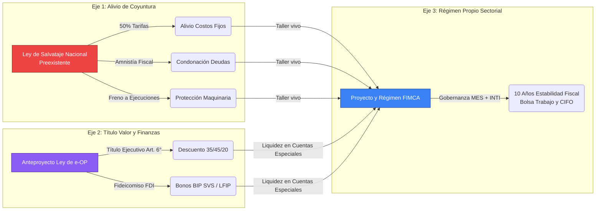
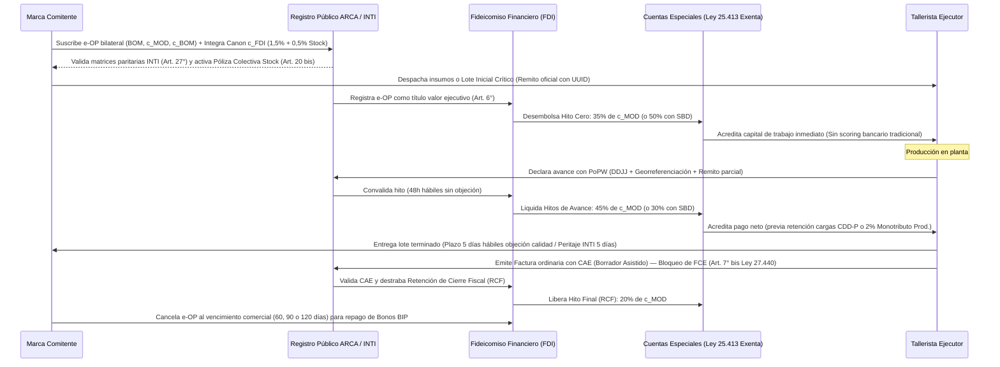

# Proyecto FIMCA: Formalización e Incentivo a la Manufactura del Calzado Argentino

*Régimen Autónomo de Formalización, Inclusión Socioproductiva e Incentivo Industrial articulado con la Ley de Salvataje Nacional y la Ley de e-OP*

## Resumen Ejecutivo

La presente propuesta articula una respuesta integral ante la crisis de la manufactura nacional mediante la convergencia estratégica de tres instrumentos normativos independientes y complementarios: (1) el **Proyecto de Ley de Salvataje Nacional de las MiPyMEs** (proyecto legislativo preexistente en el Congreso de mayo de 2026), que provee un escudo de alivio de emergencia tarifaria y fiscal; (2) el **Anteproyecto de Ley de la Orden de Producción Electrónica (e-OP)**, una ley cambiaria, comercial y financiera de alcance federal que crea e instrumenta el título valor causal de deuda, su descuento fiduciario en el FDI y la emisión bursátil de Bonos BIP; y (3) el **Proyecto y Régimen FIMCA**, un régimen autónomo y sustantivo de formalización, inclusión socioproductiva e incentivo industrial específico para el calzado, el cuero y la confección, dotado de su propia gobernanza territorial (Mesa de Enlace Sectorial - MES), estabilidad fiscal por 10 años, Promotores Territoriales (PTF), Bolsa de Trabajo y Banco de Maquinaria.

**Los 5 Ejes Estratégicos de la Propuesta**

1. **Articulación con la Ley de Salvataje Nacional (Escudo de Emergencia Preexistente):** FIMCA se apoya en este proyecto de ley de emergencia general preexistente en el Congreso, aprovechando sus herramientas de alivio de coyuntura contra la quiebra (reducción del 50% en tarifas, amnistía fiscal y suspensión de ejecuciones) como piso de supervivencia inmediata para la unidad productiva.  
2. **Instrumentación Financiera mediante la Ley de e-OP y el Fideicomiso (FDI):** Se articula con el régimen legal de la **Orden de Producción Electrónica (e-OP)** como título valor causal y ejecutivo autosuficiente (Art. 6° Ley de e-OP) y el **Fideicomiso de Desarrollo Industrial (FDI)** constituido como Fideicomiso Financiero (Ley 26.831 / Art. 1666 CCyC). El FDI custodia fondos, adelanta liquidez mediante tres tramos reglados (35% Hito Cero / 45% Avances / 20% Cierre Fiscal RCF, o 50%/30%/20% con Sello Buen Diseño) y tituliza carteras en el mercado de capitales mediante **Bonos de Inversión Productiva (BIP)** con calificación Social, Verde y Sustentable (SVS) y cupos de la Línea de Financiamiento para la Inversión Productiva (LFIP del BCRA).  
3. **Régimen FIMCA (Motor de Despegue e Institucionalidad Propia):** Proyecto y régimen autónomo de incentivo productivo e inclusión socioproductiva para unidades de hasta 30 trabajadores con estabilidad fiscal por 10 años, gobernado territorialmente por la **Mesa de Enlace Sectorial (MES)** en articulación con el Registro Público de e-OPs en **ARCA** y la auditoría técnica del **INTI**. Incluye el filtro de "Tecnología Conveniente", la Bolsa de Trabajo Sectorial, la Red CIFO, el Banco de Maquinaria y una Cláusula Federal de Adhesión para eximir de Ingresos Brutos y tasas municipales.  
4. **Protección de la Identidad Fiscal y Formalización Laboral e Impositiva:** Resuelve la informalidad estructural mediante el **Monotributo Productivo** de permanencia individual (con alta automatizada, micro-retención del 2% sobre cobranzas netas computable al SIPA y facturación asistida por borrador precargado en ARCA), el **Régimen Estatutario Permanente de Regularización Laboral** con Certificado de Diligencia Debida (CDD / CDD-P) y retención de cargas sociales en el hito (hasta el 15%), el **Crédito Fiscal Presunto de IVA del 10%** sobre la mano de obra para las comitentes, y la adopción estrictamente **optativa** de figuras societarias (SAS/SRL) acompañada por el Programa de Formalización Empresaria Tutelada (PFET) para talleres de más de 5 empleados.  
5. **Locación de Obra Industrial, Seguro de Stock y Régimen Aduanero:** Estructura el vínculo jurídico de pleno derecho sobre la **locación de obra con provisión de materiales por el comitente (Arts. 1251 y 1256 inc. a CCyC)** y el **depósito regular para transformación productiva (Art. 1356 CCyC)**. Garantiza la separación de insumos ante quiebra del taller (Art. 138 Ley 24.522), el **Privilegio Especial del tallerista sobre el lote elaborado (Art. 241 inc. 1 LCQ)**, la **Póliza Colectiva Maestra de Stock en Custodia ($c_{\text{BOM}}$)** administrada por el FDI, y un régimen de importación temporaria con arancel cero bajo trazabilidad criptográfica.

> **Figura 1.** Arquitectura de Tres Proyectos Autónomos y Articulados: La Ley de Salvataje (alivio de emergencia preexistente), la Ley de e-OP (instrumentación del título valor causal y fideicomiso financiero FDI/BIP) y el Régimen FIMCA (régimen propio de formalización, gobernanza territorial MES e incentivo industrial).

## Introducción: La Emergencia Real del Sector

La actividad manufacturera nacional, con particular impacto en el Conurbano Bonaerense, atraviesa una contracción económica agudizada por la política de apertura importadora y la caída del consumo interno. El sector calzado —que integra a diseñadores independientes, talleres de aparado y fábricas de confección a façón— no es ajeno a esta crisis: opera hoy con niveles de utilización de la capacidad instalada que, en el rubro de prendas de vestir, cuero y calzado, cayeron un 16,7% interanual en diciembre de 2025, y que en el segmento textil-confecciones llegaron al 29,2% en noviembre de 2025, el nivel más bajo de toda la industria manufacturera.[^1]

Según datos de la Superintendencia de Riesgos del Trabajo (SRT), procesados por la organización Fundar, entre noviembre de 2023 y enero de 2026 se extinguieron 24.180 unidades productivas en el país —un promedio superior a 30 cierres diarios—, de las cuales el 99,74% corresponden a empresas de hasta 500 trabajadores, con la consecuente pérdida de más de 290.000 puestos de trabajo registrados.[^2]

Este entramado productivo sobrevive mayoritariamente en la informalidad no por vocación, sino como estrategia de autodefensa frente a una presión impositiva, tarifaria y burocrática que no distingue entre una corporación multinacional y un taller familiar de tres personas. El eslabón más vulnerable de la cadena es el emprendedor individual que expone su patrimonio personal y su CUIT para sostener un proyecto colectivo, quedando a merced de ejecuciones fiscales que destruyen en días lo que se construyó en años.

La reconstrucción del sector exige la articulación sinérgica de tres instrumentos normativos independientes: un escudo inmediato de alivio coyuntural —la **Ley de Salvataje Nacional de las MiPyMEs**—, la instrumentación legal y cambiaria del financiamiento en proceso —el **Anteproyecto de Ley de e-OP**—, y un régimen sustantivo propio de formalización, gobernanza e incentivo industrial —el **Proyecto y Régimen FIMCA**—, permitiendo a la cadena formalizarse, capitalizarse y crecer desde sus propias bases.

## Sección I: La Ley de Salvataje Nacional y el Diagnóstico de la Fractura Temporal del Crédito

Ante el colapso de las micro y pequeñas empresas, el alivio de coyuntura de esta propuesta se articula con los términos del proyecto preexistente de **Ley de Salvataje Nacional de las MiPyMEs** (presentado en mayo de 2026), el cual declara la emergencia tarifaria, impositiva, productiva y laboral para todo el universo MiPyME. Sin embargo, para el sector manufacturero dicho alivio debe complementarse con la solución de fondo a la **Fractura Temporal del Crédito a la Producción** que aborda el **Anteproyecto de Ley de e-OP**: mientras que herramientas vigentes como la Factura de Crédito Electrónica MiPyME (FCE, Ley N° 27.440) tienen su hecho generador *con posterioridad* a la entrega de la mercadería terminada, la fabricación de calzado, marroquinería e indumentaria demanda entre **30 y 120 días continuos de producción desfinanciada** previos a la existencia del bien final. Durante ese ciclo crítico, el taller debe afrontar quincenas salariales, energía y alistamiento sin acceso al crédito bancario tradicional.

Las disposiciones de emergencia de la Ley de Salvataje que proveen el piso de supervivencia para que luego operen la Ley de e-OP y el Régimen FIMCA son las siguientes:

### A. Alivio Energético y Tarifario para el Taller y la Fábrica (Arts. 6 y 7)

El proceso de fabricación del calzado —marroquinería, prensado, vulcanizado y aparado— es intensivo en consumo eléctrico. El Proyecto Ley de Salvataje establece:

* Una **reducción del 50%** en las tarifas de los servicios públicos de energía eléctrica, gas y agua corriente para los sujetos alcanzados.

* Una **reducción del 50% de la alícuota del IVA** aplicable al consumo de esos servicios en procesos productivos, aliviando de inmediato los costos fijos de la fábrica de confección y del taller del aparador.

### B. Amnistía Fiscal y Cuenta Tributaria Única (Arts. 8, 11 y 12)

Para el emprendedor que asume el riesgo fiscal individual en nombre del colectivo, la ley contempla:

* Condonación del **100% de multas, intereses resarcitorios y punitorios** para microempresas, con planes de pago de hasta 60 cuotas a tasas bonificadas.

* Creación del **Sistema de Cuenta Tributaria Única (ARCA)**: compensación automática y permanente de saldos deudores y acreedores de tributos nacionales, garantizando que el fisco no drene la liquidez operativa del proyecto.

* Exención absoluta del **Impuesto sobre los Débitos y Créditos Bancarios** (impuesto al cheque) con la sola presentación del certificado MiPyME.

### C. Régimen de Reestructuración Preventiva de Pasivos (Arts. 23 a 25)

Para evitar el desmantelamiento de unidades productivas ante deudas acumuladas durante la crisis, la ley instituye un paraguas judicial de carácter preventivo:

* La sola solicitud de apertura del régimen produce la **suspensión inmediata de ejecuciones, subastas e inhibiciones** sobre bienes indispensables para la producción: inyectoras de suela, cortadoras de cuero, prensas, maquinaria de aparado.

* Se abre un **período de negociación de 90 días** (prorrogable por 45 días adicionales) para acordar con los acreedores quitas, esperas y reestructuración ordenada de pasivos, priorizando la continuidad del giro y la preservación del empleo.

## Sección II: Sistema de Adelantos Productivos (Factoring Sectorial)

Como herramienta complementaria al escudo de protección que propone la Ley de Salvataje (Sección I), este sistema tiene como objetivo sistematizar y escalar instrumentos de mercado que ya poseen un recorrido probado en el sector corporativo, tales como los 'Adelantos a proveedores' y el 'Financiamiento de órdenes de compra', adaptándolos a la realidad de la micro y pequeña industria. El objetivo es dotar a estas herramientas de una estructura pública que garantice condiciones equitativas, permitiendo que el microemprendedor acceda al mismo pulmón financiero que hoy solo manejan las grandes estructuras.

**El diagnóstico: ¿Por qué estos instrumentos son hoy inaccesibles?**  
En la lógica bancaria tradicional, el financiamiento depende de la confianza en el comprador y no en el valor del trabajo del vendedor. Un tallerista o una pyme de barrio enfrentan hoy tres 'muros' que los excluyen del sistema financiero formal:

* **1. El Muro de la Documentación:** La banca exige instrumentos con 'fuerza ejecutiva' (como la Factura de Crédito Electrónica o cheques). La informalidad estructural, caracterizada por remitos simples o acuerdos verbales, deja al tallerista sin documentos válidos para el sistema financiero.  
* **2. El Muro del Perfil de Riesgo:** Los bancos utilizan algoritmos de 'scoring' que requieren balances, declaraciones juradas e historial de ventas. Al no poseer este 'traje' formal, el tallerista es invisible para el algoritmo o catalogado como riesgo máximo, cerrándole las puertas de entrada.  
* **3. El Muro del Costo Transaccional:** Las comisiones, gastos de mantenimiento y tasas de las operaciones tradicionales están diseñadas para grandes volúmenes. Para un taller de barrio, los costos fijos de estas operaciones absorben el margen de ganancia, haciendo el financiamiento financieramente suicida.

**Nuestra propuesta: La Orden de Producción Electrónica (e-OP) como Título Valor Causal**  
El Sistema de Adelantos Productivos, instrumentado jurídicamente a través del **Anteproyecto de Ley de e-OP**, rompe este paradigma al instituir la **Orden de Producción Electrónica (e-OP)** como un **título valor causal, nominativo y divisible** (Arts. 1815, 1820, 1834 y 1839 CCyC) y **título ejecutivo autosuficiente** (Art. 6° de la Ley de e-OP y Art. 521 inc. 7 CPCCN). Al suscribirse bilateralmente y registrarse en el **Registro Público de e-OPs en el ámbito de ARCA (Art. 10°)**, la sola firma de la e-OP perfecciona de pleno derecho el contrato de locación de obra industrial (Art. 1251 CCyC) y desplaza el hecho generador del crédito al momento de inicio del ciclo productivo, sustituyendo el scoring patrimonial bancario tradicional por el **Sistema de Evaluación de Trayectoria Productiva (SETP)** y la custodia fiduciaria escalonada.

> **Figura 2.** Arquitectura Transaccional de la e-OP y el Fideicomiso de Desarrollo Industrial (FDI). El FDI adelanta la liquidez escalonada al tallerista (35% Hito Cero, 45% Avances y 20% RCF — o 50%/30%/20% con SBD) en Cuentas Especiales exentas del Impuesto al Cheque, fondeándose en el mercado de capitales mediante Bonos BIP (60-180 días) y líneas LFIP, mientras la marca cancela al vencimiento comercial convenido.

## El Fideicomiso de Desarrollo Industrial (FDI) y la Titulización en el Mercado de Capitales (Bonos BIP)

Para superar la exclusión crediticia bancaria y canalizar el ahorro institucional y privado hacia la producción real sin depender de subsidios discrecionales del Tesoro, el sistema se estructura sobre el **Fideicomiso de Desarrollo Industrial (FDI)**, constituido como **Fideicomiso Financiero** bajo el régimen de los Artículos 1666 a 1700 del Código Civil y Comercial de la Nación y la Ley N° 26.831 de Mercado de Capitales (Art. 15° de la Ley de e-OP). Su patrimonio constituye un patrimonio fiduciario separado e inembargable de pleno derecho (Art. 1685 CCyC) que opera bajo una ingeniería financiera rigurosa:

* **Emisión de Bonos de Inversión Productiva (BIP) con Etiquetado SVS (Arts. 17° y 19°):** El FDI empaqueta carteras homogéneas de e-OPs registradas y emite valores de deuda fiduciaria negociables en oferta pública denominados **Bonos BIP**, con plazos de **60 a 180 días corridos** estrictamente calzados con el vencimiento comercial de las e-OPs subyacentes. Los BIP cuentan con régimen abreviado de oferta pública ante la CNV, tramos minoristas en ALyCs y calificación como **Instrumentos de Financiamiento Social, Verde y Sustentable (SVS)** bajo la RG CNV N° 917/2021, respaldada por el dictamen vinculante de un Revisor Externo Independiente que certifica la formalización laboral y trazabilidad en planta.  
* **Elegibilidad en la Línea de Financiamiento para la Inversión Productiva (LFIP del BCRA):** Las entidades financieras pueden descontar e-OPs y suscribir series de Bonos BIP computándolos dentro de los cupos obligatorios de la LFIP MiPyME del BCRA, gozando de una ponderación de riesgo crediticio preferencial del 20% en las normas sobre Capitales Mínimos (Anexo Regulatorio I).  
* **Reserva Líquida de Garantía Comitente (5%) y Canon Fiduciario ($c_{\text{FDI}}$) (Art. 16°):** Las empresas comitentes integran una **Reserva Líquida de Garantía equivalente al 5%** del monto nominal acumulado de sus e-OPs activas para responder exclusivamente por su propio riesgo crediticio de impago. Adicionalmente, al registrar cada orden, la comitente abona el **Canon Fiduciario Total ($c_{\text{FDI}}$)** a su exclusivo cargo, compuesto por: (i) una **alícuota operativa general de hasta el 1,5%** sobre el valor neto de mano de obra ($c_{\text{MOD}}$), destinada de forma indivisible al Fondo de Afectación Específica Laboral (FAEL: 0,5%), al INTI y programa PFET (0,2%), y a costos administrativos y **Reserva por Mora Operativa (0,8%)**; y (ii) una **alícuota de cobertura de stock ($c_{\text{STK}}$) de hasta el 0,5%** sobre el valor declarado de insumos ($c_{\text{BOM}}$) para financiar la **Póliza Colectiva Maestra de Stock en Custodia (Art. 20 bis)**. Asimismo, el FDI cuenta con una **Facilidad de Liquidez Contingente (Línea Revolvente del 5% del programa)** para absorber descalces transitorios por logística justo a tiempo o peritajes técnicos sin afectar el repago puntual de los Bonos BIP.

**Circuito Operativo del Sistema y Cuentas Especiales Manufactureras:**

La operatoria se instrumenta a través de **Cuentas Especiales de Compensación y Liquidación Manufacturera (Art. 14° de la Ley de e-OP)** abiertas de oficio y sin costo en entidades bancarias oficiales, vinculadas al CUIT/CUIL del ejecutor. Estas cuentas operan con CBU/CVU, pagos QR y Echeqs sin descubierto, gozan de inembargabilidad frente a débitos o compensaciones bancarias por deudas preexistentes (Art. 1685 CCyC y asimilación protectoria al Art. 147 LCT), poseen un encuadramiento especial en la **Central de Deudores del Sistema Financiero (CENDEU)** reglamentado por el BCRA para que demoras operativas cubiertas por el FDI no generen reclasificaciones negativas automáticas, y se encuentran **100% exentas del Impuesto sobre los Créditos y Débitos Bancarios (Ley N° 25.413)**.

* **Paso 1 — Emisión y Registración Bilateral de la e-OP (Marca Comitente + Tallerista → Registro Público en ARCA):** La marca comitente y el tallerista suscriben digitalmente (con Clave Fiscal Nivel 3 o biometría RENAPER, gozando de presunción legal de autoría del Art. 7°) la **Orden de Producción Electrónica (e-OP)** en el **Registro Público de e-OPs que funciona en el ámbito de ARCA (Art. 10°)**. La orden detalla el UUID único, CUIT/CUIL de las partes, hash determinista de la receta técnica (BOM), el monto neto de mano de obra directa ($c_{\text{MOD}}$), el valor declarado de insumos en custodia ($c_{\text{BOM}}$), el canon fiduciario ($c_{\text{FDI}}$) a cargo de la comitente y la fecha cierta de vencimiento comercial (60, 90 o 120 días corridos). El sistema valida automáticamente que las tarifas no sean inferiores a las matrices técnicas paritarias elaboradas semestralmente por el **INTI (Art. 27°)** y el FDI verifica el cupo crediticio en una ventana de **48 horas hábiles (Art. 11° inc. 1)**. La suscripción bilateral perfecciona de pleno derecho el contrato de locación de obra industrial (Art. 3°) y constituye un título ejecutivo autosuficiente (Art. 6°).

* **Paso 2 — Hito Cero: Anticipo de Arranque Operativo (FDI → Tallerista):** El FDI desembolsa de forma directa e inmediata el **Hito Cero**, equivalente exactamente al **treinta y cinco por ciento (35%)** del valor neto de mano de obra ($c_{\text{MOD}}$) —o al **cincuenta por ciento (50%)** cuando el producto cuente con el **Sello Buen Diseño (SBD)** oficialmente certificado—, directamente en la Cuenta Especial de Compensación y Liquidación Manufacturera del tallerista (Art. 12° inc. 1). Este desembolso se ejecuta sin scoring bancario patrimonial tradicional ni exigencia de balances, rigiéndose por el **Sistema de Evaluación de Trayectoria Productiva (SETP)**, una vez verificados copulativamente tres requisitos: (a) el registro bilateral de la e-OP; (b) la acreditación del ingreso físico de insumos (o del **Lote Inicial Crítico** ≥ 20% del $c_{\text{BOM}}$ en esquemas de Logística Justo a Tiempo) mediante remito oficial con el UUID de la e-OP; y (c) la vigencia automática de la **Póliza Colectiva Maestra de Stock en Custodia (Art. 20 bis)**. En este acto, la suscripción por el tallerista importa el reconocimiento expreso e incondicional de deuda líquida y exigible por el Hito Cero ante abandono culpable, habilitando la vía ejecutiva directa del FDI (Art. 6° in fine) y la absorción transitoria de liquidez por la Reserva por Mora Operativa (0,8%).

* **Paso 3 — Producción: Hitos de Avance contra Prueba de Trabajo Productivo (PoPW):** El tallerista ejecuta la manufactura y declara el avance de curva en la plataforma mediante la **Prueba de Trabajo Productivo (PoPW)**, integrada concurrentemente por: (a) declaración jurada digital de avance; (b) georreferenciación satelital cifrada de la unidad productiva; y (c) remito electrónico o constancia de entrega parcial conformada (Art. 12° inc. 2). Transcurridas **48 horas hábiles** desde la notificación sin objeción técnica fundada del comitente, el hito queda convalidado y el FDI libera los tramos de **Hitos de Avance**, que totalizan el **cuarenta y cinco por ciento (45%)** del $c_{\text{MOD}}$ —o el **treinta por ciento (30%)** en órdenes con Sello Buen Diseño—. En órdenes encadenadas multitaller (Art. 5°), la liquidación es totalmente desacoplada por etapa. En esquemas de **Logística Justo a Tiempo (Art. 5° bis)**, toda demora de la marca en proveer insumos suspende y prorroga automáticamente el plazo del tallerista sin penalidad en el SETP, posterga el vencimiento comercial con un **tope máximo improrrogable de 30 días corridos** (con interés compensatorio a cargo exclusivo de la comitente), genera a partir del quinto día hábil una **compensación por parada de planta (standby) equivalente a un (1) jornal diario de SMVM (8 horas) por día hábil de mora** por puesto afectado a favor del taller, y cumplidos **15 días hábiles de mora** habilita al tallerista a declarar la resolución contractual de pleno derecho cobrando el 100% de los hitos iniciados.

* **Paso 4 — Entrega Física, Peritaje INTI, Bloqueo de FCE y Liquidación del Hito Final (RCF del 20%):** El tallerista entrega el lote terminado y la comitente dispone de un plazo perentorio de **cinco (5) días hábiles** para deducir objeciones fundadas por vicios aparentes o discordancias técnicas con la BOM (Art. 11° inc. 2); en caso de controversia, interviene el **INTI** emitiendo un **Dictamen Técnico Pericial vinculante en el plazo de cinco (5) días hábiles (Art. 13°)**. El tramo final equivalente al **veinte por ciento (20%)** del $c_{\text{MOD}}$ (de modo que la suma de los tres tramos es siempre 35% + 45% + 20% = 100%, o 50% + 30% + 20% = 100% con SBD) permanece inmovilizado en la cuenta fiduciaria estanca bajo el estado de **Retención de Cierre Fiscal (RCF)** (Art. 12° inc. 3). Para su liberación dentro de los 10 días hábiles, el sistema verifica por interoperabilidad con ARCA la emisión de la factura electrónica ordinaria con CAE (en el caso de prestadores del Monotributo Productivo, mediante la simple confirmación con un clic del **Borrador Asistido de Factura C precargado de oficio por ARCA**, Art. 24° inc. 5). En ese mismo acto, conforme al **Artículo 7° bis incorporado a la Ley N° 27.440 por el Art. 9° de la Ley de e-OP**, los sistemas de ARCA **bloquean de pleno derecho la emisión o derivación del comprobante como Factura de Crédito Electrónica (FCE)**, evitando la doble titulación ejecutiva sobre el mismo lote. Constatado el CAE, el FDI libera instantáneamente el 20% de la RCF al tallerista y habilita a la comitente el cómputo del **Crédito Fiscal Presunto de IVA del 10%** sobre el $c_{\text{MOD}}$ (Art. 23° inc. 1).

* **Paso 5 — Cancelación al Vencimiento Comercial y Fuerza Ejecutiva (Marca → FDI):** Al cumplirse la fecha cierta de vencimiento comercial pactada en la e-OP (60, 90 o 120 días corridos), la marca comitente cancela al FDI el capital anticipado más el interés compensatorio (tasa BADLAR privada más hasta 300 puntos básicos, Art. 16° inc. 5), fondos con los cuales el fiduciario amortiza la serie respectiva de Bonos BIP. En caso de mora o falta de pago de la comitente, el FDI ejecuta de inmediato su **Reserva Líquida de Garantía del 5%** y promueve la **acción ejecutiva directa del Artículo 6°** —ya que la constancia registral de la e-OP constituye título ejecutivo autosuficiente (Art. 521 inc. 7 CPCCN) sin necesidad de protesto ni preparación de la vía ejecutiva, con inoponibilidad de defensas personales sobre hitos certificados (Art. 8°)—, sin afectar jamás la liquidez ya percibida por el tallerista ni su calificación en el SETP o en la CENDEU.

> **Principio Rector — Autonomía Crediticia del Tallerista y Eficacia Ejecutiva (Arts. 3°, 6° y 12°):**  
> Una vez suscripta bilateralmente y registrada la e-OP en la plataforma oficial de ARCA, el **tallerista goza del derecho autónomo e irrenunciable de percibir del FDI el desembolso del Hito Cero (35% / 50% SBD), los Hitos de Avance (45% / 30% SBD) y el Hito Final (20% RCF)** contra el cumplimiento objetivo de los requisitos legales y técnicos, sin requerir autorizaciones discrecionales adicionales de la marca comitente. Esta autonomía emancipa al eslabón productivo y le permite construir una trayectoria verificable propia en el **Sistema de Evaluación de Trayectoria Productiva (SETP)**. Toda e-OP requiere siempre la firma digital válida de ambas partes (Art. 7°) para perfeccionar el contrato de locación de obra y adquirir fuerza de título valor ejecutivo.

**Marco regulatorio articulado (Anexos Regulatorios I, II y III de la Ley de e-OP):** La plena operatividad se respalda en las tres normas reglamentarias integradas al Anteproyecto de Ley de e-OP: (1) la **Comunicación "A" [XXXX] del BCRA**, que admite la e-OP para su descuento y cómputo en la Línea de Financiamiento para la Inversión Productiva (LFIP), fija una ponderación de riesgo crediticio preferencial del 20% y reglamenta las Cuentas Especiales de Compensación y Liquidación Manufacturera exentas de la Ley 25.413; (2) la **Resolución General [XXXX]/2026 de la CNV**, que establece el régimen abreviado de oferta pública para los Bonos BIP, tramos minoristas en ALyCs y etiquetado SVS con Revisor Externo Independiente (RG 917/2021); y (3) la **Resolución General [XXXX]/2026 de ARCA**, que pone en marcha el Registro Público de e-OPs, el bloqueo automático de FCE (Art. 7° bis Ley 27.440), la Retención de Cierre Fiscal (RCF), el borrador asistido de Factura C y la Libreta Digital de Trabajo a Domicilio (Ley 12.713).

### Blindaje Jurídico, Gestión de Riesgos y Gobernanza Sectorial

Para garantizar la integridad del sistema y proteger a las partes y a los inversores de los Bonos BIP contra el riesgo de fraude o incumplimiento, el sistema articula la institucionalidad pública de **ARCA** y el **INTI** con la gobernanza territorial de la **Mesa de Enlace Sectorial (MES)** bajo cuatro pilares operativos:

1. **Fideicomiso de Desarrollo Industrial (FDI) con Reservas Paramétricas y Acción Ejecutiva:** El FDI (Ley 26.831 / Art. 1666 CCyC) cuenta con patrimonio separado e inembargable (Art. 1685 CCyC) y separa rigurosamente los riesgos: el riesgo comercial de la marca está cubierto por su **Reserva Líquida de Garantía del 5%**; el riesgo de mora o abandono del taller está cubierto por la **Reserva por Mora Operativa (0,8% del $c_{\text{MOD}}$)** y el reconocimiento ejecutivo de deuda líquida del Hito Cero (Art. 6°); el riesgo de siniestro sobre materiales está cubierto por la **Póliza Colectiva Maestra de Stock ($0,5\%$ del $c_{\text{BOM}}$, Art. 20 bis)**; el riesgo laboral cuenta con el **Fondo FAEL ($0,5\%$ del $c_{\text{MOD}}$, Art. 22° inc. 22.6)**; y los descalces temporales cuentan con la **Facilidad de Liquidez Contingente del 5%**.  
2. **Gobernanza Armonizada (ARCA, INTI y MES):** La administración técnica del **Registro Público de e-OPs** está a cargo de **ARCA (Art. 10°)** con estándares de datos abiertos y resguardo del secreto comercial (Ley 25.326). El **INTI (Art. 27°)** elabora y actualiza semestralmente las matrices técnicas de tiempos estándar y costos directos paritarios —disparando Alertas Tempranas de Inconsistencia si una orden pacta tarifas inferiores a paritarias— y actúa como órgano pericial prejudicial vinculante en un plazo de **5 días hábiles (Art. 13°)**. Por su parte, la **Mesa de Enlace Sectorial (MES)** conduce la gobernanza territorial del Régimen FIMCA: homologa los planes sectoriales de "Tecnología Conveniente", coordina a los Promotores Territoriales (PTF), administra la Bolsa de Trabajo, la Red CIFO y el Banco de Maquinaria, y sustancia la tutela sindical territorial.  
3. **Custodia Fiduciaria Escalonada y Prueba de Trabajo Productivo (PoPW):** Los fondos se administran bajo la modalidad de **Custodia Fiduciaria Escalonada (Art. 12°)** en tres tramos exactos (35% / 45% / 20%, o 50% / 30% / 20% con SBD). La liberación de los tramos de avance se gatilla contra la **PoPW** (declaración jurada + georreferenciación satelital cifrada + remito parcial) con convalidación automática a las 48 horas hábiles, mientras que el 20% final (RCF) se libera de forma instantánea contra la emisión de la factura electrónica ordinaria con CAE y el bloqueo de la FCE.  
4. **Trazabilidad Criptográfica y Programa Piloto Gradual (Art. 29°):** Cada e-OP lleva asociado un resumen criptográfico determinista (hash de árbol de Merkle y firmas digitales con presunción de autoría del Art. 7°). Asimismo, para asegurar una implementación fiscal y financieramente ordenada, durante los primeros **dieciocho (18) meses** de vigencia el régimen operará como **Programa Piloto** con un cupo máximo de **5.000 e-OPs activas simultáneas** o un monto agregado en custodia fiduciaria de hasta **USD 100.000.000**, con evaluación de impacto bienal ante el Congreso de la Nación.

## Sección III: El Régimen FIMCA — Motor de Despegue Planificado

Si la macroeconomía oficial diseña un **Régimen de Incentivo a las Grandes Inversiones (RIGI) nacional** para eximir de impuestos por décadas a corporaciones multinacionales extractivas, la justicia social productiva exige un **Régimen de Incentivo a las MiPyMEs y Talleres Territoriales** que capture la capilaridad del empleo real y la agregación de valor local. Este régimen no es una exención pasiva; es una **herramienta de planificación activa**.

Esta propuesta demanda la creación de dicho régimen diferencial para unidades productivas de hasta treinta (30) trabajadores registrados que integren la cadena de valor del calzado, la indumentaria y el cuero en el Conurbano Bonaerense, unificando el límite con la matriz federal multisectorial establecida en el Anexo I de la presente norma. El acceso se estructurará bajo los siguientes pilares:

* **Gobernanza Condicionada:** El acceso a la estabilidad fiscal (10 años) y al arancel cero es por adhesión al Plan Sectorial validado por la MES.  
* **Cláusula Federal de Adhesión:** La ley nacional invitará a la Provincia de Buenos Aires y Municipios a adherir al régimen, comprometiéndose a no incrementar tasas locales sobre las unidades alcanzadas. Como contrapartida, el Estado Nacional garantizará a las jurisdicciones adherentes prioridad en la asignación de Fondos Fiduciarios de fomento.  
* **Tecnología Conveniente:** La MES actúa como organismo de homologación. El arancel cero para maquinaria solo aplica a bienes que la MES dictamine como "salto tecnológico" no disponible localmente.  
* **Encadenamiento Forzoso:** Como condición para homologar la importación, las marcas proveedoras extranjeras deben licenciar el servicio técnico y mantenimiento a pymes metalúrgicas locales, bajo auditoría de la MES.

### A. Estabilidad Fiscal Absoluta por 10 Años

El marco normativo nacional garantizará la estabilidad fiscal por el término de una década respecto a los tributos de competencia federal para todas las unidades adheridas al régimen. A los fines de extender este beneficio a las jurisdicciones locales y resguardar las autonomías consagradas en el artículo 121 de la Constitución Nacional, el Poder Ejecutivo Nacional promoverá la suscripción de un "Pacto Fiscal Productivo para el Conurbano" con la Provincia de Buenos Aires y los Municipios del territorio. La ley nacional invitará expresamente a dichas jurisdicciones a adherir al régimen, comprometiéndose mediante ley provincial y ordenanzas municipales a no incrementar la presión tributaria existente ni crear nuevas tasas de abasto o circulación sobre las unidades alcanzadas. Como contrapartida y compensación por la resignación de recursos fiscales locales, el Estado Nacional garantizará a las jurisdicciones adherentes prioridad en la asignación de los Fondos Fiduciarios de fomento productivo y programas de infraestructura industrial contemplados en este régimen.

### B. Régimen Estatutario Permanente de Regularización Laboral y Retención en el Hito (Art. 22° inc. 22.2 bis de la Ley de e-OP)

Para desarmar de manera sostenible el círculo de la informalidad laboral sin generar un costo fiscal directo de subsidios presupuestarios, el Régimen FIMCA se articula con el **Régimen Estatutario Permanente de Regularización Laboral** instituido en el Artículo 22° inciso 22.2 bis del Anteproyecto de Ley de e-OP:

* **Alta Temprana con Amnistía Previsional y Laboral:** Al suscribir su primera e-OP, el tallerista con personal dependiente registra el Alta Temprana de su dotación productiva en la plataforma interoperable con ARCA, accediendo de pleno derecho a: (i) la extinción total de multas y sanciones administrativas por empleo no registrado previo; (ii) la condonación de hasta el **100% de las deudas históricas por aportes y contribuciones patronales** al SIPA, INSSJP y Fondo Nacional de Empleo; (iii) la exclusión definitiva del **REPSAL**; y (iv) el reconocimiento para los trabajadores regularizados de hasta **sesenta (60) meses de servicios con aportes computables al SIPA** sobre la base del SMVM.
* **Retención de Cargas Sociales en el Hito y Puerto Seguro Provisorio (CDD-P):** Durante los primeros doce (12) meses de operación (prorrogables hasta 18 meses), la plataforma emite el **Certificado de Diligencia Debida Laboral Provisorio (CDD-P)** —que otorga a la marca comitente presunción legal *iuris tantum* de cumplimiento del deber de control del Art. 30 LCT—, y el FDI **retiene directamente en la fuente de cada Hito de Avance y del Hito Final (RCF) las cargas sociales del período** (SIPA, obra social y ART), ingresándolas de oficio a ARCA con un **tope máximo del quince por ciento (15%) del hito bruto**, conforme a las matrices técnicas del INTI. De este modo, el Estado condona deuda pretérita incobrable y pasa a recaudar de forma genuina y automática en cada flujo productivo.

### C. Arancel Cero para la Incorporación de Bienes de Capital (Art. 22 de la Ley de Salvataje)

Se propone la eliminación total de derechos de importación, IVA aduanero y tasas portuarias para la adquisición de bienes de capital destinados a la actualización tecnológica del sector. La selección de esta tecnología no responde a una lógica de mercado irrestricta —donde suele imponerse la tecnología simplemente disponible (a menudo obsoleta o incompatible con nuestra escala)—, sino a una estrategia de **tecnología conveniente**. Entendemos por tal aquella que, cumpliendo con estándares internacionales de eficiencia, se subordina a nuestra ecología cultural, fortalece las capacidades de nuestras pymes metalúrgicas locales y garantiza la autonomía técnica de nuestros talleres de calzado, evitando la dependencia recurrente de servicios técnicos externos. A fin de garantizar la complementariedad industrial, neutralizar conflictos de interés con la industria nacional y asegurar que este filtro soberano sea efectivo, este beneficio se estructurará bajo los siguientes criterios de exclusión, blindaje y asociatividad:

* **Principio de No Competencia:** El régimen de arancel cero aplicará de forma exclusiva a posiciones arancelarias de bienes de capital que **no posean producción nacional sustituta**, o cuya oferta local sea insuficiente en escala, plazos de entrega o estándares de automatización requeridos para competir en mercados internacionales.

* **Mesa de Enlace de Homologación:** La elegibilidad de los bienes será dictaminada de manera ágil por la mesa de enlace territorial con la participación técnica del **INTI**, validando de forma objetiva si la tecnología solicitada califica como "salto tecnológico no disponible en el mercado interno".

* **Licenciamiento y Delegación del Servicio Técnico Local:** Como condición para homologar la importación de maquinaria usada o líneas tecnológicas complejas, se exigirá que las marcas proveedoras extranjeras **deleguen y licencien el servicio de reacondicionamiento inicial, la garantía de origen y el mantenimiento por falla en talleres electromecánicos y pymes metalúrgicas nacionales** que se postulen y certifiquen a tal fin. Esto generará un encadenamiento productivo hacia atrás, dinamizando el empleo calificado local en las ramas de la automatización, tornería y mantenimiento industrial dentro del propio territorio bonaerense.

* **Destino y Uso Final Vinculado:** Los bienes importados bajo este régimen quedarán sujetos a una restricción de transferencia (inmovilización patrimonial) por un plazo mínimo de 5 años, garantizando que su uso esté estrictamente ligado al proceso productivo del taller adherido y evitando la especulación comercial o la reventa de maquinaria importada.

## Sección IV: Protección de la Identidad Fiscal del Emprendedor

La cadena de valor del calzado convive con una forma de informalidad estructural que no nace de la evasión deliberada sino de la ausencia de instrumentos jurídicos y fiscales accesibles para organizar colectivamente la producción. Dos fenómenos concretos ilustran esta realidad:

### A. El Préstamo de Identidad Fiscal: Un Riesgo Silencioso

El primero y más extendido es el de la identidad fiscal prestada. Ante la imposibilidad de facturar la totalidad de su actividad bajo un único CUIT —ya sea porque supera los topes del régimen simplificado o porque la complejidad regulatoria hace inviable la inscripción en el régimen general—, el industrial o el diseñador distribuye su facturación entre familiares, empleados de confianza o conocidos que se inscriben como monotributistas para emitir comprobantes en nombre del proyecto.

Esta práctica, aunque frecuente y comprensible como respuesta adaptativa a un sistema tributario que no contempla la escala real del microemprendimiento colectivo, genera un riesgo fiscal de primer orden para todos los involucrados:

* **El monotributista prestado** figura ante ARCA/AFIP como el responsable fiscal de una actividad que no es suya, quedando expuesto a recategorizaciones, exclusiones del régimen simplificado, determinaciones de oficio y ejecuciones sobre su patrimonio personal.

* **El industrial o diseñador que organiza el esquema** queda expuesto a imputaciones por simulación, interposición de personas y evasión fiscal agravada si el esquema es detectado en una fiscalización.

* **El fisco cobra Ganancias e IVA** calculados sobre bases imponibles que no reflejan la estructura real del negocio: el industrial tributa en exceso porque no puede deducir los costos que sus proveedores informales no facturan, y los monotributistas prestados tributan por ingresos que no percibieron.

El eslabón más débil de esta cadena de informalidades es siempre el familiar o el conocido que prestó su CUIT: carece de asesoramiento, no conoce el alcance real de su responsabilidad fiscal, y ante cualquier litigio no tiene recursos para defenderse.

### B. El Proveedor que No Factura y el Crédito Fiscal Presunto de IVA del 10% (Art. 23° inc. 1 de la Ley de e-OP)

El segundo fenómeno es el del proveedor informal: el aparador de barrio, el cortador a destajo, el matricero que cobra en efectivo y no emite comprobante. Para la pyme de diseño que los contrata, estos costos son absolutamente reales —representan entre el 30% y el 50% del costo de producción— pero son fiscalmente inexistentes: al no contar con factura oficial, no pueden deducirse del Impuesto a las Ganancias ni computarse como crédito fiscal del IVA.

El resultado es que el emprendedor formal tributa sobre una utilidad ficticia, considerablemente mayor a la real, porque el sistema impositivo no reconoce los costos que estructuralmente no se pueden documentar. Paga Ganancias e IVA no correspondidos, subsidiando con su carga fiscal la informalidad de un sistema que él mismo no eligió.

**Ejemplo ilustrativo y solución mediante la e-OP:** una pyme de diseño vende $ 1.000.000 en calzado. Su costo real de producción es $ 700.000, de los cuales $ 300.000 corresponden a servicios de aparado y cortado ($c_{\text{MOD}}$). Antes del régimen, al abonarse en efectivo sin factura, ante el fisco el costo computable era solo $ 400.000 (duplicando la base imponible de Ganancias) y se perdía la totalidad del crédito fiscal de IVA. Bajo la articulación del Régimen FIMCA y el **Artículo 23° inciso 1 de la Ley de e-OP**, al instrumentarse la orden mediante e-OP y emitirse al cierre fiscal (RCF) la Factura C asistida del Monotributo Productivo o del taller en transición bajo CDD-P: (1) el costo de $ 300.000 queda **100% documentado por factura electrónica oficial con CAE**, siendo íntegramente deducible en el Impuesto a las Ganancias sin necesidad de recurrir a deducciones presuntas de gastos no documentados; y (2) aunque la Factura C del monotributista o taller con CDD-P no discrimina IVA, la marca comitente computa un **Crédito Fiscal Presunto de IVA del diez por ciento (10%) sobre el valor neto de la mano de obra contratada ($c_{\text{MOD}}$)** ($ 30.000 en el ejemplo), imputable en sus declaraciones juradas mensuales de IVA una vez liberada la Retención de Cierre Fiscal (RCF), sujeto al cupo fiscal anual fijado por el Congreso de la Nación. Cuando el taller ejecutor tribute como Responsable Inscripto y emita Factura A, la comitente computará el crédito fiscal ordinario discriminado en el comprobante.

### C. Acompañamiento Tutelado en Crecimiento (PFET) y Carácter Estrictamente Optativo de las Figuras Societarias (Arts. 24° y 24 bis de la Ley de e-OP)

Frente a la problemática de los talleres que escalan su producción y emplean personal, esta propuesta establece —en plena armonía con los **Artículos 24° inciso 4 y 24 bis de la Ley de e-OP**— que **el Monotributo Productivo es un régimen de permanencia para el prestador individual y en ningún caso presupone ni impone la migración forzosa a persona jurídica**. La constitución de una **Sociedad por Acciones Simplificada (SAS)**, **Sociedad de Responsabilidad Limitada (SRL)** u otra figura societaria es de carácter **estrictamente optativo y voluntario**, recomendada únicamente para aquellos talleres empleadores consolidados (que hayan completado el CDD Definitivo del Art. 22° inc. 22.2 y superen los **cinco (5) trabajadores registrados** en nómina estable durante al menos 6 meses) que deseen escindir su patrimonio personal del riesgo productivo, incorporar socios o acceder a cupos de mayor escala.

Para los talleres empleadores que alcancen dicha escala y opten voluntariamente por constituir una SAS o SRL (o deban transicionar al Régimen General como Responsables Inscriptos al superar el tope máximo del Monotributo), el **Programa de Formalización Empresaria Tutelada (PFET, Art. 24 bis)** provee acompañamiento contable gratuito durante 12 meses y modelos estatutarios estandarizados, garantizando la **transferencia íntegra de su historial en el SETP y de su Certificado de Diligencia Debida (CDD)** desde el CUIL humano al nuevo CUIT societario. En esos casos, la figura de la SAS ofrece ventajas concretas:

* **Constitución íntegramente digital** ante el Registro Público, sin necesidad de escribano ni de capital mínimo elevado —basta con el equivalente a dos Salarios Mínimos, Vitales y Móviles de capital suscripto—.

* **Responsabilidad limitada al capital aportado:** los socios no responden con su patrimonio personal por las deudas comerciales o fiscales de la sociedad, eliminando la necesidad de recurrir a CUITs prestados de familiares.

* **Continuidad de trayectoria productiva (SETP y CDD):** la sociedad conserva sin quitas el puntaje acumulado en el Sistema de Evaluación de Trayectoria Productiva (SETP) y la cobertura de puerto seguro laboral frente a las marcas comitentes (Art. 24 bis inc. 4).

* **Inscripción en el régimen general y Diferimiento del IVA (Art. 23° inc. 2):** el taller o sociedad en el régimen general computa todos sus créditos fiscales y goza de la modificación al **Artículo 5° inciso b) de la Ley de IVA**, por la cual el hecho imponible del IVA se difiere y perfecciona exclusivamente con la entrega definitiva del lote conforme y la liberación de la RCF, sin devengar impuesto sobre el Hito Cero ni sobre los Hitos de Avance.

### D. Régimen de Inclusión en Monotributo Productivo y Facturación Asistida (Art. 24° de la Ley de e-OP)

Para los prestadores humanos individuales que realizan servicios manuales o artesanales de transformación con medios propios (aparadores, cortadores y costureros autónomos), el régimen implementa el **Monotributo Productivo (Art. 24° de la Ley de e-OP)** bajo cuatro pilares operativos:

* **Alta de Oficio con Validación RENAPER (Art. 24° inc. 1):** La registración de la primera e-OP que asigne tareas al CUIL del prestador individual posibilita su alta de oficio en la plataforma de ARCA mediante validación de identidad con DNI digital ante el RENAPER y consentimiento expreso del titular, de forma remota y sin costo fijo mensual.  
* **Micro-Retención del 2% Computable al SIPA y Cero Deuda en Inactividad (Art. 24° incs. 2 y 3):** Se sustituye la cuota fija mensual por una **micro-retención única del dos por ciento (2%) sobre las cobranzas netas efectivas** que el FDI liquide en su Cuenta Especial de Compensación y Liquidación Manufacturera, destinada a la seguridad social. Cada mes en que las retenciones alcancen el componente previsional de la Categoría A del Monotributo General, se computa **un (1) mes de servicios con aportes en el SIPA** (pudiendo acumularse saldos para consolidación semestral o anual dentro del ejercicio). En períodos sin e-OPs activas ni liquidaciones de cobro, **no se devenga deuda líquida ni cargo tributario alguno**.  
* **Permanencia Individual sin Migración Societaria Compulsiva (Art. 24° inc. 4):** El Monotributo Productivo es un régimen de permanencia individual. Cuando el prestador supere el límite de facturación anual de su categoría, ARCA lo notificará con 30 días de anticipación y asistirá su recategorización dentro de las escalas del régimen simplificado general, sin obligación alguna de constituir una SAS o SRL.  
* **Facturación Simplificada por Borrador Asistido (Art. 24° inc. 5):** Para eliminar la barrera de la brecha digital y el analfabetismo contable en el cierre de la orden, **ARCA genera y precarga de oficio el borrador electrónico de la Factura C** con todos los datos fiscales, montos netos y retenciones de la e-OP cumplida. El prestador titular (por sí o asistido por el PTF) solo debe confirmar digitalmente el borrador con un clic en la aplicación para asignar el código CAE y liberar instantáneamente el **20% de la Retención de Cierre Fiscal (RCF)**, sin parametrización de puntos de venta ni carga manual, y quedando eximido del cargo de mora a tasa BADLAR (Art. 12° inc. 3).

### E. Arquitectura de Sostenibilidad Previsional, Regularización Laboral y Fondo FAEL (Art. 22° de la Ley de e-OP)

La transición hacia la formalidad del entramado manufacturero exige desarmar la asimetría de costos y la litigiosidad solidaria sin desfinanciar al sistema previsional. En consonancia con el **Artículo 22° de la Ley de e-OP**, el régimen estructura un esquema autosustentable donde el propio flujo transaccional de las e-OPs financia la seguridad social y protege los créditos laborales:

**A. Régimen del Monotributo Productivo (Prestadores Individuales Autónomos — Art. 24° y Art. 22° inc. 22.5.b)**

* **Acreditación de Autonomía (Art. 23 LCT mod. Ley 27.742):** Los artesanos y microtalleres con herramientas propias que operan bajo Monotributo Productivo acreditan autonomía prestacional mediante la locación de obra formalizada en la e-OP, la emisión de comprobantes por borrador asistido y el cobro en Cuentas Especiales, desvirtuando presunciones de dependencia laboral.
* **Inyección Previsional por Flujo Real (2%):** La micro-retención del **2% sobre cobranzas netas** se deriva directamente al SIPA para el cómputo de años jubilatorios reales, con cobertura de salud garantizada y obligación cero en meses sin producción.

**B. Régimen para Talleres Empleadores (CDD / CDD-P) y Trabajo a Domicilio (Ley 12.713) — Art. 22°**

* **Rampa de Regularización Laboral Permanente y Retención del 15% (Art. 22° inc. 22.2 bis):** Los talleres con trabajadores en relación de dependencia que ingresan al sistema registran el Alta Temprana con condonación del 100% de deuda previsional histórica, extinción de multas, baja del REPSAL y reconocimiento de hasta 60 meses de aportes SIPA para sus operarios. Durante los primeros 12 meses operan bajo el **Certificado de Diligencia Debida Provisorio (CDD-P)** —pasando al **CDD Definitivo** a partir del mes 13 con presentación autónoma del F.931—, mientras el FDI **retiene en la fuente de cada hito hasta el quince por ciento (15%) del monto bruto** para cancelar de oficio los aportes y contribuciones al SIPA, obra social y ART.
* **Fondo de Afectación Específica Laboral (FAEL) y Puerto Seguro (Art. 22° incs. 22.3 y 22.6):** La tenencia del CDD o CDD-P otorga a la marca comitente presunción legal *iuris tantum* de cumplimiento del deber de control del Art. 30 LCT. Ante mora salarial o insolvencia del tallerista, el trabajador dependiente cobra sus acreencias líquidas de manera inmediata a través del **FAEL** —patrimonio fiduciario financiado con el **0,5% del $c_{\text{MOD}}$** integrado en el canon fiduciario ($c_{\text{FDI}}$) a cargo de las marcas comitentes más una póliza de caución laboral del 1% del stock activo—, garantizando el **pago inmediato sin dilación de previa excusión de bienes**.
* **Libreta Digital de Trabajo a Domicilio (Ley N° 12.713 — Art. 22° inc. 22.5.a):** Para las personas humanas que realizan tareas manuales en su vivienda particular sin estructura empresaria ni personal dependiente, rige plenamente el estatuto de la Ley 12.713 mediante la **Libreta Digital de Trabajo a Domicilio** instrumentada en ARCA, con tarifas paritarias obligatorias, retención automática de cargas sociales por el FDI y responsabilidad solidaria directa de la comitente.

**F. Desburocratización, PFET y Ventanilla Única**

Para complementar el acompañamiento técnico y societario (Art. 24 bis de la Ley de e-OP):

* **Programa de Formalización Empresaria Tutelada (PFET):** Financiado con la transferencia anual del **0,2% del $c_{\text{MOD}}$** integrada en el canon fiduciario ($c_{\text{FDI}}$, Art. 27°), brinda asistencia contable durante 12 meses a través de colegios profesionales y modelos estatutarios estandarizados para aquellos talleres de más de 5 empleados que superen el Monotributo o decidan optar por constituir una SAS o SRL.
* **Ventanilla Única y Continuidad de Historial:** Coordinación con registros públicos locales para la inscripción ágil en 48 horas y transferencia automática del legajo en el **SETP** y del **CDD** al nuevo CUIT societario.

## Sección V: Vínculo Jurídico, Tutela Concursal, Seguro de Stock y Régimen Aduanero (Arts. 20°, 20 bis y 21° de la Ley de e-OP)

**Locación de Obra Industrial y Depósito Regular de Insumos (Art. 20° inc. 20.1):** Para blindar jurídicamente la relación entre la pyme de diseño —propietaria de las materias primas y del diseño— y el taller que presta el servicio de transformación, el régimen estructura el vínculo de pleno derecho sobre la **locación de obra con provisión de materiales por el comitente (Artículos 1251 y 1256 inciso a del Código Civil y Comercial de la Nación)** y el **depósito regular con exclusiva finalidad de transformación productiva (Artículo 1356 del CCyC)**. La sola suscripción bilateral de la e-OP en la plataforma oficial instrumenta y perfecciona el contrato subyacente (Art. 3°). Las materias primas, telas, cueros, matrices y avíos entregados permanecen bajo el dominio exclusivo del comitente durante todo el ciclo productivo, documentándose su traslado mediante remitos oficiales (tipos A, B, C o R) con consignación expresa del UUID de la e-OP (Art. 20° inc. 20.2).

**Separación Concursal de Bienes y Privilegios Especiales (Arts. 20° inc. 20.4 y 21°):**
* **Ante el concurso o quiebra del tallerista ejecutor (Art. 20° inc. 20.4):** Los insumos y materias primas en custodia de transformación no integran la masa concursal del taller, gozando el comitente del **derecho directo e inmediato a la restitución y separación de bienes de terceros amparado en el Artículo 138 de la Ley de Concursos y Quiebras (Ley N° 24.522)**.
* **Ante el concurso o quiebra de la marca comitente (Art. 21°):** Los pagos y desembolsos de e-OPs gozan de **presunción legal *iuris tantum* de acto ordinario a título oneroso frente al período de sospecha (Art. 119 *in fine* de la Ley 24.522)**, y los créditos de los talleres por mano de obra prestada y del FDI gozan de **Privilegio Especial sobre el lote físico elaborado (Art. 241 inciso 1 y Art. 242 de la Ley N° 24.522)** y del **derecho de retención preferencial (Art. 2587 del CCyC)**.

**Póliza Colectiva Maestra de Stock en Custodia ($c_{\text{BOM}}$) (Art. 20 bis):** El Fideicomiso de Desarrollo Industrial (FDI) contrata centralizadamente una **Póliza Colectiva Maestra de Stock en Custodia** con aseguradoras habilitadas por la SSN (o subcuenta de auto-seguro), financiada mediante la alícuota fiduciaria de stock ($c_{\text{STK}}$) de hasta el **0,5% sobre el valor declarado de insumos ($c_{\text{BOM}}$)** a cargo exclusivo de la comitente. La registración de la e-OP otorga **cobertura asegurativa automática e inmediata al lote** contra incendio, robo calificado y siniestro total, cumpliendo de pleno derecho el requisito para el desembolso del Hito Cero sin exigir pólizas individuales ni inspecciones previas al taller.

**Régimen de Importación Temporaria para Transformación:** Se implementa en el marco del Régimen FIMCA un esquema de importación temporaria con arancel cero, exención de IVA aduanero y tasas portuarias para materias primas e insumos destinados a la transformación industrial bajo trazabilidad de la e-OP. Es fundamental diferenciar que el contrato de locación de obra industrial (Art. 1251 CCyC) constituye el vínculo civil y comercial de servicio entre comitente y tallerista, mientras que la Importación Temporaria funciona como la herramienta aduanera de fomento para el ingreso de los materiales sin carga tributaria.

**Plazos de Cancelación y Parámetros de Operación Aduanera:** La plena operatividad de este beneficio aduanero se regirá bajo las siguientes condiciones estrictas de operación:

* **Plazo Duro de Permanencia:** Los insumos ingresados bajo este régimen gozarán de un plazo máximo improrrogable de trescientos sesenta (360) días de permanencia en el territorio nacional para ser efectivamente transformados, exportados o re-expedidos bajo la e-OP correspondiente. Ante cuellos de botella logísticos o baches estacionales de demanda debidamente acreditados, la Comisión de Homologación Técnica de la MES local podrá autorizar una prórroga extraordinaria única de hasta ciento ochenta (180) días adicionales.  
* **Tolerancia Técnica de Mermas y Residuos:** Reconociendo el descarte físico propio del proceso de matricería, corte y confección de la indumentaria y el calzado, el **INTI** establecerá las tablas oficiales de descarte tolerable por rama industrial, fijando un tope de hasta el diez por ciento (10%) del volumen físico ingresado en concepto de mermas y residuos no exportables. La destrucción o descarte de dichos residuos dentro del territorio nacional no devengará penalidades aduaneras ni cargos tributarios retroactivos.  
* **Canal Especial de Nacionalización de Emergencia:** Ante la rescisión fortuita de contratos o la quiebra del comitente que paralice de forma definitiva la exportación del lote escuela o la mercadería en proceso, el tallerista o la SAS asociada podrán solicitar ante la MES local la nacionalización de emergencia de los bienes terminados. El sistema liquidará los derechos de importación correspondientes al valor de la materia prima en origen pesificado, quedando el productor exceptuado de la aplicación de multas aduaneras por dolo o desvío de stock, condicionado a que las unidades se comercialicen mediante canales aprobados por el Sello de Buen Diseño (SBD).

## Sección VI: Estandarización de Procesos y Gobernanza Sectorial

La informalidad en la cadena del calzado no es solo consecuencia de la presión fiscal; es resultado de la fragmentación operativa y la falta de planificación. Una cadena que no planifica, no puede formalizarse. Para trascender la supervivencia, debemos integrar la tecnología con la comunidad organizada.

### A. Acceso a Tecnología de Gestión Integrada (Arts. 16 y 17 de la Ley de Salvataje)

La Ley de Salvataje prevé el **"Fondo de Asistencia para la Transformación Digital MiPyME"** (créditos a tasa cero y aportes no reembolsables) y bonos fiscales equivalentes al 50% de las inversiones en proyectos de innovación conjunta con instituciones del sistema científico-tecnológico. Esta propuesta plantea aplicar esos recursos —provenientes de la optimización y reasignación de fondos fiduciarios nacionales de fomento productivo— para:

* Implementar una plataforma de gestión en la nube (SaaS nacional) que integre facturación electrónica ARCA/AFIP, control de inventario de insumos y gestión de ventas en canales digitales. La meta no es el control burocrático, sino la transparencia: saber cuánto insumo entra y cuánta unidad sale.

* Cargar la receta de materiales (Bill of Materials) de cada modelo para que cada proyección de venta genere automáticamente un plan de compra de insumos agrupado, reduciendo costos de aprovisionamiento.

### Cláusula de Convocatoria Pública para el Desarrollo Tecnológico Soberano

* **Llamado Nacional e Intersectorial:** Autorízase al Consejo Superior de la MES Federal, en coordinación con la Jefatura de Gabinete de Ministros y el Ministerio de Ciencia y Tecnología de la Nación, a efectuar una Convocatoria Pública y Abierta dentro de los noventa (90) días de promulgada la presente ley, destinada al diseño, desarrollo, testeo e implementación de la infraestructura informática centralizada, la plataforma de Órdenes de Producción ("e-OP"), el sistema de Escrow digitalizado y las interfaces de Inteligencia Artificial Algorética del régimen.  
* **Criterios de Prioridad y Reserva de Mercado Nacional:** El proceso de selección y adjudicación de los módulos de software priorizará de forma absoluta y por ministerio de la ley a los siguientes actores del ecosistema técnico nacional:  
  * **Polos Tecnológicos y Universidades Públicas:** Consorcios integrados por los departamentos de ingeniería en sistemas, informática y diseño industrial de las Universidades Nacionales con asiento en el Conurbano Bonaerense y las provincias adheridas.  
  * **PyMEs Tecnológicas Locales:** Empresas de software nacionales constituidas bajo leyes argentinas que cuenten con certificado MiPyME vigente.  
  * **Células de la Economía del Conocimiento Comunitario:** Cooperativas de tecnología y desarrollo de código abierto debidamente registradas.  
* **Financiamiento y Transferencia de Activos:** Los fondos para el financiamiento de este desarrollo se detraerán de forma específica del Fondo de Asistencia para la Transformación Digital MiPyME y de los recursos de organización del FDI local, bajo la modalidad de Aportes No Reembolsables (ANR) contra cumplimiento de metas de entrega de código.  
* **Garantía de Soberanía Tecnológica (Código Abierto):** Se establece como condición de elegibilidad irrenunciable que la totalidad del software, algoritmos, bases de datos y arquitecturas informáticas resultantes de esta convocatoria sean entregados al Estado Nacional bajo licencias de código abierto y acceso irrestricto (*Open Source*), prohibiéndose expresamente el licenciamiento privado, la contratación de patentes restrictivas o el almacenamiento de datos sensibles del entramado industrial en servidores o nubes corporativas radicadas fuera del territorio nacional.

### B. Gobernanza Armonizada: Registro en ARCA, Fiscalización del INTI y Mesa de Enlace Sectorial (MES)

La **Mesa de Enlace Sectorial (MES)** se constituye como el **órgano de conducción territorial y tutela socioproductiva** del Régimen FIMCA, articulando sus competencias en perfecta armonía con las atribuciones institucionales que la Ley de e-OP asigna a **ARCA** y al **INTI**:

* **ARCA como Administrador del Registro Público de e-OPs (Art. 10° Ley de e-OP):** La plataforma registral oficial de las e-OPs funciona en el ámbito de ARCA con estándares de datos abiertos, interoperabilidad automatizada con el BCRA, la CNV y el FDI, y resguardo de la confidencialidad comercial de los montos ($c_{\text{MOD}}$ y $c_{\text{BOM}}$) conforme a la Ley 25.326. De este modo, el registro y flujo cambiario de las órdenes no padece cuellos de botella ni filtros discrecionales previos.
* **El INTI como Árbitro Técnico de Costos Paritarios y Peritajes Prejudiciales (Arts. 13° y 27° Ley de e-OP):** El INTI elabora y actualiza semestralmente (en consulta con cámaras y sindicatos de la MES) las **matrices técnicas de referencia sobre tiempos estándar de confección y costos directos de mano de obra paritaria**. Si una e-OP se suscribe con valores inferiores a los pisos paritarios, el sistema dispara una **Alerta Temprana de Inconsistencia de Costos** que inhabilita el Crédito Fiscal Presunto del 10% y el puerto seguro laboral (CDD) de la comitente, sin suspender los desembolsos al tallerista. Asimismo, ante divergencias sobre calidad o mermas en la entrega, el INTI interviene emitiendo un **Dictamen Técnico Pericial vinculante en el plazo perentorio de cinco (5) días hábiles (Art. 13°)**. Estas funciones se financian con la transferencia anual del **0,2% del $c_{\text{MOD}}$** integrada en el canon fiduciario ($c_{\text{FDI}}$).
* **La MES como Comité Técnico, de Fomento y de Auditoría Territorial del Fideicomiso (FDI):** Mientras la entidad fiduciaria financiera (autorizada por la CNV conforme al Art. 15° de la Ley de e-OP) ejerce la administración patrimonial fiduciaria, emite los Bonos BIP y liquida automáticamente los desembolsos cambiarios, **la Mesa de Enlace Sectorial (MES) y sus comisiones especializadas funcionan jurídicamente como los Comités Técnicos, de Fomento y de Auditoría Territorial dentro del Reglamento de Gestión del FDI para el Régimen FIMCA**, además de constituir el ámbito consultivo intersectorial permanente previsto en los Artículos 1° y 27° de la Ley de e-OP. Liberada de la carga registral burocrática, la MES concentra su conducción territorial en nivelar las asimetrías históricas del sistema productivo: homologa los planes de "Tecnología Conveniente", administra los cupos de arranque en frío y fomento en el SETP, dirige el despliegue de los Promotores Territoriales (PTF), cogestiona la Red CIFO y el Banco Comunitario de Maquinaria, administra la Bolsa de Trabajo Sectorial y sustancia las instancias de tutela sindical territorial ex-post.

**1. Dinámica de Acompañamiento en la MES**

* **Los Diseñadores Industriales (Nodo Creativo)**: Aportan la innovación y la identidad (accediendo al anticipo preferencial del 50% en Hito Cero con el Sello Buen Diseño - SBD), planificando la demanda para evitar el desperdicio.  
* **Los Talleristas de Barrio (Nodo Productivo)**: Son la columna vertebral. Su participación paritaria en la MES garantiza la adecuación territorial de los procesos productivos y el acceso al Banco de Maquinaria y a la Bolsa de Trabajo.  
* **Los Comercializadores de Marcas (Nodo de Mercado)**: Garantizan la salida comercial y el fondeo de la Reserva Líquida de Garantía (5%) y el canon fiduciario ($c_{\text{FDI}}$) en el FDI.  
* **El Rol Tutelar (INTI y Sindicato)**: El INTI garantiza la soberanía tecnológica ("Tecnología Conveniente"), la auditoría semestral de matrices de costos y el peritaje técnico en 5 días hábiles. El Sindicato actúa como garante del empleo digno, la capacitación en los CIFO y la auditoría territorial ex-post.

**2. La MES como Motor del "Saber Hacer"**

La MES es la respuesta organizativa a la fragmentación. Su rol principal es **acompañar la transición de la informalidad a la soberanía productiva**. En articulación con el Registro Público en ARCA y la custodia fiduciaria escalonada del FDI, el ecosistema institucionaliza reglas objetivas para que el esfuerzo individual del trabajador se transforme en una potencia industrial colectiva.

## Sección VII: Los Consensos de la Comunidad Organizada

El lema doctrinario "un gobierno esclavo de un pueblo libre" llevado a la práctica manufacturera significa que el Estado sirve y formaliza las alianzas productivas que los trabajadores y el capital ya construyen en el territorio. Para que esta cadena trascienda de la mera supervivencia a un motor industrial sustentable, esta propuesta identifica tres consensos que deben construirse de manera simultánea:

* **El Consenso de la Productividad Compartida:** La rentabilidad de la marca de calzado es directamente proporcional a la tecnificación y el bienestar del taller. A través de la **Mesa de Enlace Sectorial** **(MES)**, este consenso deja de ser una intención para ser una norma operativa: la voz vinculante del tallerista garantiza que la cadena no se estanque en la subsistencia, equilibrando la distribución de valor.

* **El Consenso del Consumo Interno:** el salario del trabajador de cualquier sector es el poder de compra que dinamiza la venta del calzado nacional. Defender el salario real es defender el mercado interno.

* **El Consenso del Desarrollo Soberano:** el Estado debe delegar la planificación sectorial en quienes conocen la aguja, el cuero y la horma. Cuando las organizaciones MiPyME y los sindicatos definen las metas productivas y el Estado ejecuta la desregulación burocrática y el fomento correspondiente, el pueblo se organiza libremente.

## Síntesis de Demandas Legislativas y Operativas

### Demandas legislativas urgentes (Tres Proyectos Autónomos y Complementarios)

* Sanción del proyecto preexistente de **Ley de Salvataje Nacional de las MiPyMEs** (alivio de emergencia tarifaria, impositiva y suspensión preventiva de ejecuciones).

* Sanción del **Anteproyecto de Ley de la Orden de Producción Electrónica (e-OP) como Título Valor Causal y su Titulización en el Mercado de Capitales**, que instituye el título ejecutivo autosuficiente (Art. 6°), el bloqueo de la FCE para evitar doble titulación (Art. 7° bis Ley 27.440), la custodia fiduciaria escalonada 35%/45%/20% (o 50%/30%/20% con SBD), el Fideicomiso Financiero (FDI) emisor de Bonos BIP (SVS), la locación de obra industrial con separación concursal de insumos (Art. 138 LCQ), privilegios especiales (Art. 241 inc. 1 LCQ) y Póliza Colectiva Maestra de Stock (Art. 20 bis), el Régimen de Diligencia Debida Laboral (CDD/CDD-P) y Fondo FAEL (Art. 22°), el Crédito Fiscal Presunto de IVA del 10% y diferimiento del IVA (Art. 23°), y el Monotributo Productivo con micro-retención del 2% y facturación asistida (Art. 24°).

* Sanción y creación del **"Proyecto y Régimen FIMCA"** como régimen autónomo de formalización, inclusión socioproductiva e incentivo industrial sectorial (estabilidad fiscal por 10 años, gobernanza territorial de la MES, filtro de Tecnología Conveniente, Promotores Territoriales PTF, Bolsa de Trabajo, Red CIFO y Banco de Maquinaria) con **Cláusula de Adhesión Federal**.

### Demandas regulatorias y operativas inmediatas (Anexos Regulatorios I, II y III)

* Emisión de la **Comunicación "A" del BCRA** (Anexo Regulatorio I de la Ley de e-OP): admisión de la e-OP para descuento y cómputo en la **Línea de Financiamiento para la Inversión Productiva (LFIP)**, ponderación de riesgo crediticio preferencial del 20% y habilitación de las **Cuentas Especiales de Compensación y Liquidación Manufacturera** con encuadramiento CENDEU especial y **exención del 100% del Impuesto al Cheque (Ley 25.413)**.

* Emisión de la **Resolución General de la CNV** (Anexo Regulatorio II): régimen abreviado de oferta pública para **Bonos de Inversión Productiva (BIP)** (60 a 180 días), tramos minoristas en ALyCs y etiquetado SVS con dictamen vinculante de Revisor Externo Independiente (RG CNV 917/2021).

* Emisión de la **Resolución General de ARCA** (Anexo Regulatorio III): puesta en marcha del **Registro Público de e-OPs**, bloqueo automático de FCE, Retención de Cierre Fiscal (RCF del 20%), servicio de **Borrador Asistido de Factura C** y módulo de **Libreta Digital de Trabajo a Domicilio (Ley 12.713)**.

* Adhesión provincial y municipal al **Pacto Fiscal Productivo Federal (Art. 25°)**: exención de Ingresos Brutos y Sellos, y bloqueo de retenciones bancarias automáticas (SIRCREB/ARBA) sobre las Cuentas Especiales Manufactureras.

* Constitución de la Mesa de Enlace Sectorial (MES) y publicación semestral de las matrices técnicas de tiempos estándar y costos paritarios por el **INTI (Art. 27°)**.

No pedimos privilegios sectoriales. Pedimos reglas jurídicas, financieras y productivas justas para quienes sostienen el empleo real en cada rincón del país.

## ANEXO I: Matriz de Escalabilidad Federal y Multisectorial

**"Régimen Federal Manufacturero y Red de Despliegue de la Comunidad Organizada"**

### 1. Objeto del Anexo

El presente anexo establece los lineamientos técnicos, jurídicos y operativos para la extensión progresiva del Régimen de Incentivo Productivo ("Proyecto FIMCA") y el Sistema de Adelantos Productivos al conjunto de las provincias de la República Argentina y a las diversas ramas de la industria manufacturera nacional, garantizando la preservación del empleo real y la soberanía tecnológica bajo el principio de equidad distributiva territorial.

### 2. Gobernanza Rediseñada: La Mesa de Enlace Sectorial Federal (MES Federal)

Para absorber el volumen operativo de una escala nacional sin burocratizar la toma de decisiones ni perder el control del fraude documental, se instituye un esquema de gobernanza en red de dos niveles:

* **A. Consejo Superior (MES Federal):** Órgano central de conducción política y técnica, integrado por representaciones nacionales de cámaras empresarias MiPyME, federaciones sindicales de la industria, el Instituto Nacional de Tecnología Industrial (INTI), el Banco Central (BCRA) y los ministerios nacionales competentes.  
  * *Funciones:* Definición de cupos presupuestarios anuales del FDI por región, homologación de la matriz de "Tecnología Conveniente" global y dictamen de posiciones arancelarias nacionales excluidas de competencia.  
* **B. Nodos Regionales y Sectoriales (MES Locales):** Unidades territoriales con voz vinculante encargadas del acompañamiento en el territorio productivo. Se constituirán mesas específicas atendiendo a la especialización real de cada territorio (ej. Nodo Metalmecánica \- Región Centro, Nodo Maderas y Muebles \- NEA, Nodo Textil y Calzado \- Conurbano Bonaerense).  
  * *Funciones:* Auditoría directa y validación de viabilidad de las Órdenes de Producción (OP) locales, mediación de cumplimiento y certificación digital de hitos productivos para la liberación de fondos.

### 3. Matriz de Segmentación Industrial para la Inclusión al Régimen Federal

A fin de respetar las asimetrías de escala, uso de mano de obra y densidad de capital de las distintas industrias manufactureras, los criterios de acceso a la estabilidad fiscal de 10 años, arancel cero para bienes de capital y financiamiento patronal se segmentan bajo la siguiente matriz regulatoria:

**Rama Industrial: Textil, Calzado e Indumentaria**

* **Escala Máxima de la Unidad (FIMCA):** Hasta 30 trabajadores registrados.  
* **Filtro de "Tecnología Conveniente" Homologable por INTI:** Automatización de corte, aparado y software de diseño digital integrado.  
* **Condición de Encadenamiento Forzoso hacia el Territorio:** Licenciamiento y delegación de mantenimiento técnico en pymes locales.

**Rama Industrial: Metalmecánica, Autopartes y Maquinaria**

* **Escala Máxima de la Unidad (FIMCA):** Hasta 50 trabajadores registrados.  
* **Filtro de "Tecnología Conveniente" Homologable por INTI:** Centros de mecanizado CNC, brazos robóticos de soldadura y entornos CAD/CAM.  
* **Condición de Encadenamiento Forzoso hacia el Territorio:** Co-desarrollo de matrices, automatización nacional y transferencia de know-how.

**Rama Industrial: Alimentos Procesados y Economías Regionales**

* **Escala Máxima de la Unidad (FIMCA):** Hasta 40 trabajadores registrados.  
* **Filtro de "Tecnología Conveniente" Homologable por INTI:** Líneas de envasado al vacío automatizadas, pasteurizadoras de alta eficiencia energética.  
* **Condición de Encadenamiento Forzoso hacia el Territorio:** Proveeduría obligatoria de envases, etiquetas y servicios metalúrgicos locales.

**Rama Industrial: Madera, Muebles y Plásticos**

* **Escala Máxima de la Unidad (FIMCA):** Hasta 30 trabajadores registrados.  
* **Filtro de "Tecnología Conveniente" Homologable por INTI:** Secaderos automatizados, pantógrafos computarizados e inyectoras de polímeros eficientes.  
* **Condición de Encadenamiento Forzoso hacia el Territorio:** Integración de diseño industrial nacional (Universidades) y matricería local.

### 4. Arquitectura Financiera Federal del FDI: Titulización de "e-OP" y Bonos BIP

Para federalizar el Sistema de Adelantos Productivos con transparencia y solvencia en el mercado de capitales, el Fideicomiso de Desarrollo Industrial (FDI) operará bajo la estructura fiduciaria de los Artículos 15° a 19° de la Ley de e-OP:

* **Emisión de Bonos de Inversión Productiva (BIP) y Fondeo LFIP:** El FDI estructura series de Bonos BIP (60 a 180 días) con calificación Social, Verde y Sustentable (SVS) bajo revisión externa independiente (RG CNV 917/2021), suscriptos por inversores institucionales, fondos PyME, aseguradoras y ahorristas minoristas a través de ALyCs, complementados con los cupos de la Línea de Financiamiento para la Inversión Productiva (LFIP) del BCRA.  
* **Reservas de Garantía (5%), Canon Fiduciario ($c_{\text{FDI}}$) y Facilidad Contingente (5%):** Las marcas comitentes integran la Reserva Líquida de Garantía del 5% sobre sus e-OPs activas y abonan el canon fiduciario ($c_{\text{FDI}}$: hasta 1,5% del $c_{\text{MOD}}$ para el Fondo FAEL, INTI/PFET y Reserva por Mora Operativa, más hasta 0,5% del $c_{\text{BOM}}$ para la Póliza Colectiva Maestra de Stock), contando el fideicomiso con una Facilidad de Liquidez Contingente del 5% del programa global.  
* **Interoperabilidad Federal de la "e-OP" y Cuentas Especiales:** La Orden de Producción Electrónica registrada en el Registro Público de ARCA funciona como título valor causal e instrumento ejecutivo en todo el territorio nacional, liquidando los desembolsos (35% / 45% / 20%, o 50% / 30% / 20% con SBD) en las **Cuentas Especiales de Compensación y Liquidación Manufacturera** abiertas en bancos oficiales, **100% exentas del Impuesto al Cheque (Ley 25.413)**.

### 5. Articulación Normativa: El Pacto Fiscal Productivo Federal

A los efectos de garantizar la estabilidad fiscal absoluta por 10 años respecto a los tributos nacionales, y resguardar en simultáneo las autonomías provinciales consagradas por el artículo 121 de la Constitución Nacional, el Poder Ejecutivo Nacional promoverá la suscripción de un "Pacto Fiscal Productivo Federal". Las Provincias y Municipios que adhieran voluntariamente mediante ley provincial y ordenanza local se comprometerán a:

* 1. Eximir del Impuesto sobre los Ingresos Brutos a las cuentas operativas de los talleristas e industrias alcanzadas.  
* 2. Eliminar tasas locales de abasto, circulación o inspección sobre las unidades productivas integradas en el régimen.

**Cláusula de Compensación Federal:** Como contrapartida por la resignación de recursos fiscales locales, el Estado Nacional garantizará a las jurisdicciones firmantes la prioridad absoluta en la asignación de los Fondos Fiduciarios de fomento, créditos para la transformación digital y partidas presupuestarias para infraestructura de parques industriales.

### 6. Propuesta de Artículo de Extensión Legislativa (Para ser incluido en el cuerpo principal del Proyecto de Ley)

**Artículo X.- Facultades de Extensión y Progresividad Multisectorial.** Facúltese al Poder Ejecutivo Nacional, a propuesta de la Mesa de Enlace Sectorial Federal (MES Federal) y en coordinación con los gobiernos provinciales que suscriban el "Pacto Fiscal Productivo Federal", a extender de manera gradual los beneficios del presente Régimen de Incentivo y el Sistema de Adelantos Productivos a las diversas ramas de la industria manufacturera nacional. A tal efecto, la autoridad de aplicación queda facultada para redefinir los límites de dotación de personal registrado, los criterios de "Tecnología Conveniente" y las condiciones de "Encadenamiento Forzoso" estipuladas en el Anexo I del presente marco normativo, atendiendo con especificidad técnica a la densidad de capital, la escala territorial y la productividad media de cada cadena de valor, priorizando aquellos sectores que presenten altos índices de informalidad estructural o emergencia sociolaboral.

### Notas y Referencias

[^1]: INDEC, Utilización de la Capacidad Instalada en la Industria, enero 2026; CIAI citando INDEC, publicado en ANDigital, marzo 2026.
[^2]: SRT / Fundar, abril 2026. Confirmado por Infobae, 16/04/2026, y BAE Negocios, mayo 2026.
