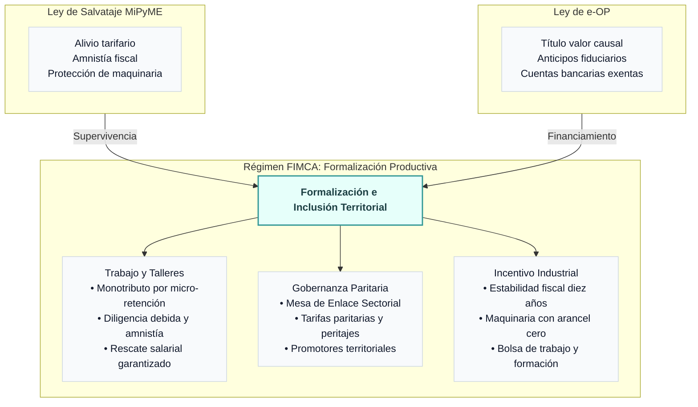
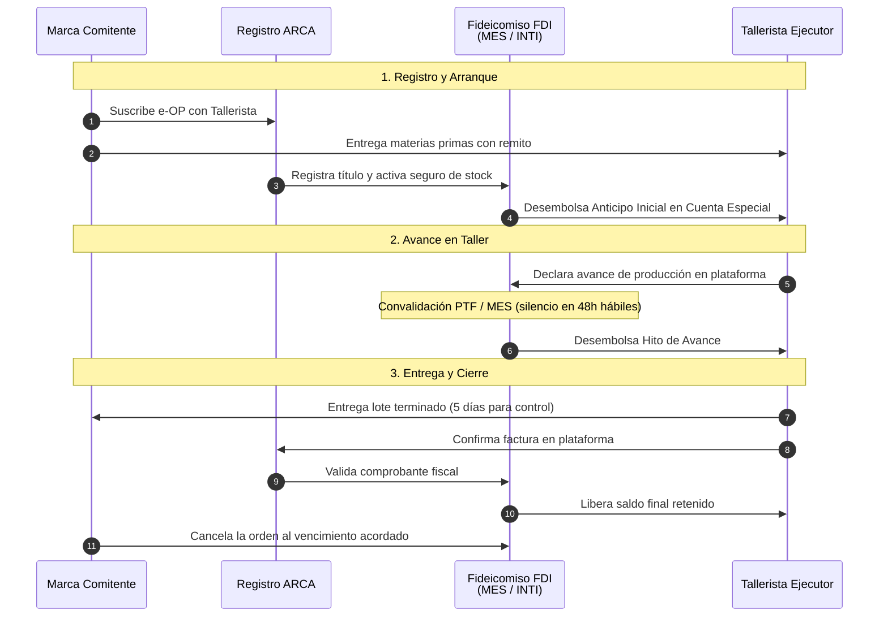

# Proyecto FIMCA: Formalización e Incentivo a la Manufactura del Calzado Argentino

*Régimen de Formalización, Inclusión Socioproductiva e Incentivo Industrial articulado con la Ley de Salvataje Nacional y el Régimen de la Orden de Producción Electrónica*

## Visión General de la Propuesta

> *Para una síntesis directiva de lectura rápida orientada a legisladores y asesores de comisión, consúltese el Documento Ejecutivo del Proyecto FIMCA.*

La presente propuesta articula una respuesta integral ante la crisis de la manufactura nacional mediante la convergencia estratégica de tres herramientas complementarias:

1. **Ley de Salvataje Nacional de las MiPyMEs:** iniciativa preexistente orientada a la emergencia que provee un escudo inmediato de alivio tarifario, amnistía impositiva y suspensión preventiva de ejecuciones judiciales.
2. **Ley de la Orden de Producción Electrónica (e-OP):** marco cambiario, comercial y financiero que instituye la orden de producción como título valor causal con fuerza ejecutiva, habilitando su descuento en el sistema financiero a través del Fideicomiso de Desarrollo Industrial (FDI) y su titulización bursátil mediante Bonos de Inversión Productiva (BIP).
3. **Régimen FIMCA:** programa sustantivo de formalización, inclusión socioproductiva e incentivo industrial específico para la cadena del calzado, el cuero y la confección. Cuenta con gobernanza territorial propia a través de la Mesa de Enlace Sectorial (MES), estabilidad fiscal por diez años, Promotores Territoriales de Formalización, Bolsa de Trabajo y Banco Comunitario de Maquinaria.

**Los 5 Ejes Estratégicos de la Propuesta**

1. **Escudo de Emergencia:** FIMCA se apoya en la Ley de Salvataje Nacional para frenar de inmediato la destrucción de talleres y puestos de trabajo mediante tarifas energéticas reducidas a la mitad, condonación de pasivos históricos y paralización de embargos sobre maquinaria productiva.
2. **Financiamiento en Proceso:** Resuelve la fractura temporal del crédito manufacturero apoyándose en la e-OP. El Fideicomiso de Desarrollo Industrial adelanta liquidez en tres tramos objetivos (35% de anticipo inicial, 45% por hitos de avance y 20% al cierre fiscal, o 50%, 30% y 20% en productos con Sello Buen Diseño) y emite Bonos BIP con calificación sustentable en el mercado de capitales a plazos calzados de 60 a 120 días.
3. **Despegue y Gobernanza Territorial:** Instituye un régimen de fomento productivo para unidades de hasta 30 trabajadores, administrado territorialmente por la Mesa de Enlace Sectorial junto a la Agencia de Recaudación y Control Aduanero (ARCA) y el Instituto Nacional de Tecnología Industrial (INTI). Incorpora el criterio de Tecnología Conveniente, la Red de Centros de Innovación y Formación Operativa (CIFO) y un esquema de adhesión provincial para eliminar Ingresos Brutos y tasas locales.
4. **Formalización Laboral e Inclusión Tributaria:** Desarma la informalidad estructural combinando el Monotributo Productivo individual (con micro-retención previsional del 2% sobre cobranzas reales y facturación asistida), un estatuto permanente de regularización laboral para talleres empleadores con Certificado de Diligencia Debida (CDD), un crédito fiscal presunto de IVA del 10% sobre la mano de obra para las empresas comitentes y la constitución estrictamente optativa de figuras societarias como SAS o SRL.
5. **Certeza Jurídica, Cobertura de Stock y Aduana:** Encuadra la relación productiva en la locación de obra y el depósito regular de materiales. Garantiza la restitución directa de los insumos ante la quiebra del taller, el privilegio especial del tallerista sobre el lote físico terminado, una póliza colectiva maestra de cobertura de stock administrada por el fondo y un régimen ágil de importación temporaria con arancel cero para insumos de transformación.

> **Figura 1.** Articulación de herramientas: la Ley de Salvataje aporta el escudo de supervivencia inmediata, la Ley de e-OP instrumenta el título valor causal y el financiamiento bursátil, y el Régimen FIMCA despliega la formalización, gobernanza territorial e incentivos sectoriales.

## Introducción: La Emergencia Real del Sector

La actividad manufacturera nacional, con particular impacto en los cordones industriales del país, atraviesa una profunda contracción agudizada por la apertura importadora y la caída del consumo interno. El sector del calzado —que articula a diseñadores independientes, talleres de corte y aparado, y fábricas integradas— opera con niveles críticos de utilización de capacidad instalada, ubicándose entre las ramas con mayor caída de la industria.

Entre fines de 2023 y principios de 2026 se extinguieron más de 24.000 unidades productivas en la Argentina, en su inmensa mayoría micro y pequeñas empresas de hasta 500 trabajadores, con la consecuente pérdida de cientos de miles de puestos de trabajo registrados.[^1]

Este entramado sobrevive mayoritariamente en la informalidad no por vocación, sino como mecanismo de autodefensa frente a una presión impositiva, tarifaria y regulatoria diseñada para grandes estructuras. El eslabón más vulnerable es el emprendedor individual que compromete su patrimonio personal para sostener un proyecto colectivo, quedando expuesto a ejecuciones que desmantelan en semanas años de trabajo.

La reactivación de la cadena productiva exige coordinar una respuesta en tres tiempos: frenar las caídas mediante la **Ley de Salvataje Nacional**, fondear el proceso productivo con la **Ley de e-OP** y ordenar la formalización y el crecimiento con el **Régimen FIMCA**.

## Sección I: Alivio de Emergencia y Diagnóstico de la Fractura Temporal del Crédito

El piso de supervivencia inmediata para las unidades productivas se apoya en las disposiciones de la **Ley de Salvataje Nacional de las MiPyMEs**, que declara la emergencia tarifaria, fiscal y laboral.

Sin embargo, el alivio de pasivos no resuelve el problema dinámico del taller: la **fractura temporal del crédito a la producción**. Los instrumentos comerciales tradicionales, como la Factura de Crédito Electrónica MiPyME (FCE), nacen *después* de que el producto fue entregado. En cambio, fabricar calzado o indumentaria demanda entre 30 y 120 días continuos de trabajo previos a la entrega. Durante ese intervalo, el taller debe pagar salarios, insumos y energía de su propio bolsillo o recurrir a financiamiento informal usurario. La e-OP nace justamente para cerrar esa brecha temporal, mientras la Ley de Salvataje sostiene en pie las instalaciones mediante tres medidas:

### A. Alivio Tarifario para Talleres y Fábricas
El proceso de fabricación del calzado —corte, prensado, vulcanizado y aparado— es intensivo en energía eléctrica. Se contemplan:
* Reducción del cincuenta por ciento (50%) en las tarifas de servicios públicos esenciales (electricidad, gas y agua).
* Reducción del cincuenta por ciento (50%) en la alícuota de IVA sobre dichos consumos productivos.

### B. Amnistía Fiscal y Cuenta Tributaria Única
Para desahogar al titular del taller frente a las contingencias tributarias:
* Condonación total de multas e intereses resarcitorios y punitorios para microempresas, con planes de pago de hasta 60 cuotas a tasas bonificadas.
* Compensación automática de saldos a favor y deudas fiscales mediante el sistema de Cuenta Tributaria Única en ARCA.
* Exención integral del Impuesto sobre los Créditos y Débitos Bancarios para las cuentas afectadas al régimen.

### C. Reestructuración Preventiva de Pasivos
Para impedir el remate de bienes de capital indispensables para la producción (inyectoras, cortadoras de cuero, prensas, máquinas de coser y aparar):
* Suspensión automática de embargos, ejecuciones judiciales e inhibiciones generales de bienes por la sola apertura del trámite.
* Período de negociación de noventa (90) días, prorrogable por cuarenta y cinco (45) días adicionales, para acordar reestructuraciones ordenadas que garanticen la continuidad del empleo.

## Sección II: Sistema de Adelantos Productivos mediante la e-OP

El objetivo central es llevar a la micro y pequeña industria herramientas de financiamiento que hoy solo utilizan las grandes corporaciones, como los adelantos de órdenes de compra, pero sin los costos burocráticos y bancarios tradicionales.

### El diagnóstico: Los tres muros del crédito bancario
1. **Falta de documento ejecutivo previo:** El banco sólo descuenta facturas por bienes entregados o pagarés abstractos. El remito simple o la orden de compra habitual no tienen fuerza ejecutiva.
2. **Evaluación patrimonial inadecuada:** Los bancos exigen balances auditados, inmuebles en garantía e historiales impositivos inaccesibles para un taller de barrio.
3. **Costo transaccional desproporcionado:** Comisiones fijas de apertura, mantenimiento de cuenta y tasas bancarias que consumen la rentabilidad de la orden.

### La solución: La Orden de Producción Electrónica (e-OP)
Instrumentada a través de la Ley de e-OP, este documento adquiere la naturaleza de **título valor causal con fuerza ejecutiva autosuficiente**. Su suscripción bilateral en el Registro Público oficial perfecciona el contrato de locación de obra industrial y desplaza el hecho crediticio al momento del acuerdo productivo. El historial patrimonial clásico se sustituye por el **Sistema de Evaluación de Trayectoria Productiva (SETP)** y un esquema de custodia fiduciaria en tres tramos.

> **Figura 2.** Circuito operativo de la e-OP y el Fondo Fiduciario. El FDI canaliza liquidez escalonada hacia Cuentas Especiales exentas de gravámenes bancarios, fondeándose mediante Bonos BIP (60 a 120 días) y líneas productivas del BCRA, mientras la comitente cancela al vencimiento comercial pactado.

### El Fideicomiso de Desarrollo Industrial (FDI) y los Bonos BIP

Para asegurar liquidez sin recurrir a transferencias discrecionales del Estado, la ingeniería financiera descansa en el **Fideicomiso de Desarrollo Industrial (FDI)**, constituido como fideicomiso financiero con patrimonio inembargable:

* **Emisión de Bonos de Inversión Productiva (BIP):** Títulos de deuda fiduciaria emitidos por oferta pública abreviada ante la Comisión Nacional de Valores (CNV) a plazos de **60 a 120 días corridos**, en estricto calce con el ciclo comercial de las órdenes subyacentes. Califican como valores Sociales, Verdes y Sustentables (SVS) mediante dictamen de revisor externo independiente, canalizando fondos de aseguradoras, fondos comunes PyME y pequeños inversores.
* **Canalización de Líneas Bancarias del BCRA (LFIP):** Los bancos pueden descontar e-OPs y suscribir Bonos BIP computándolos dentro de los cupos obligatorios de inversión productiva para MiPyMEs, con ponderación de riesgo preferencial.
* **Estructura de Reservas y Gestión de Riesgos:**
  - *Reserva Líquida del Comitente:* Cada comitente integra una garantía del cinco por ciento (5%) sobre el monto de sus órdenes vivas para responder exclusivamente por su riesgo de pago comercial.
  - *Canon Fiduciario:* A cargo exclusivo de la comitente, compuesto por una alícuota operativa general de hasta el 1,5% sobre la mano de obra contratada (destinada al fondo de contingencias laborales FAEL, al INTI y al fondo de reserva por mora) y una alícuota de cobertura de hasta el 0,5% sobre los materiales para financiar la póliza colectiva de stock.
  - *Facilidad de Liquidez:* Línea revolvente de hasta el 5% del programa para absorber desfases transitorios por prórrogas logísticas o peritajes de calidad, asegurando el cobro puntual de los Bonos BIP.

### Cuentas Especiales y Pasos Operativos

Los fondos se canalizan a través de **Cuentas Especiales de Compensación y Liquidación Manufacturera** abiertas en bancos públicos, sin costos de mantenimiento, operadas con CBU/CVU y cheques electrónicos, protegidas contra débitos automáticos por deudas previas y exentas del Impuesto al Cheque:

1. **Emisión y Registro Bilateral:** Comitente y tallerista firman digitalmente la e-OP en la plataforma pública de ARCA con Clave Fiscal o validación de identidad. Se detallan las partes, la receta técnica (BOM), el monto neto de mano de obra, el valor de los insumos entregados, el canon fiduciario y la fecha de vencimiento. El sistema verifica que las tarifas respeten las escalas paritarias elaboradas por el INTI y valida la solvencia en cuarenta y ocho (48) horas hábiles. La firma perfecciona la locación de obra y confiere fuerza ejecutiva al título.
2. **Hito Cero (Anticipo de Arranque):** El fondo desembolsa el **treinta y cinco por ciento (35%)** del valor neto de mano de obra —o el **cincuenta por ciento (50%)** si el producto posee el Sello Buen Diseño— directamente en la cuenta del tallerista. No requiere balances ni avales patrimoniales; se liquida al verificar el registro de la orden, el ingreso físico de los insumos en planta documentado por remito oficial y la vigencia automática de la póliza de stock. La suscripción del tallerista constituye reconocimiento voluntario de deuda líquida por el capital anticipado ante abandono culpable, habilitando su recupero directo.
3. **Hitos de Avance:** Durante la confección, el tallerista acredita el progreso físico mediante la Prueba de Trabajo Productivo (declaración jurada digital, georreferenciación de planta y remitos de entregas parciales). Sin observaciones en cuarenta y ocho (48) horas hábiles, el fondo libera los tramos de avance, que completan el **cuarenta y cinco por ciento (45%)** de la mano de obra —o el **treinta por ciento (30%)** con Sello Buen Diseño—. En esquemas de logística secuencial, las demoras de la comitente en proveer materiales prorrogan automáticamente los plazos del taller sin afectación en su calificación, postergan el vencimiento de pago hasta un tope improrrogable de 30 días con interés a cargo de la marca, devengan compensación por parada de planta a partir del quinto día hábil de mora y permiten resolver el contrato al día quince hábil.
4. **Entrega, Control de Calidad y Cierre Fiscal (RCF del 20%):** Con la entrega del lote, la comitente dispone de cinco (5) días hábiles para plantear objeciones fundadas de calidad; en caso de controversia, interviene el INTI emitiendo dictamen técnico vinculante en cinco (5) días hábiles. El **veinte por ciento (20%)** restante permanece en custodia preventiva bajo la modalidad de Retención de Cierre Fiscal (RCF). Al verificarse la entrega conforme, el tallerista dispone de diez (10) días hábiles para emitir la factura ordinaria con CAE (en monotributistas, mediante la simple aceptación del borrador precargado de ARCA). La deducción tempestiva de una objeción de calidad suspende este plazo hasta la resolución del peritaje. Constatado el comprobante fiscal, se libera instantáneamente el saldo final y los sistemas de ARCA bloquean la derivación del comprobante como Factura de Crédito Electrónica para impedir duplicaciones de títulos sobre el mismo lote.
5. **Cancelación al Vencimiento Comercial:** Cumplido el plazo acordado (60 o 90 días, con tope máximo de 120 días corridos computando eventuales prórrogas causales), la comitente cancela al fondo el capital anticipado y el interés compensatorio convenido, con el cual el fondo cancela las series de Bonos BIP. Ante falta de pago de la comitente, el fiduciario ejecuta su reserva líquida de garantía y promueve acción ejecutiva directa, sin perjudicar jamás los fondos ya cobrados por el taller ni su calificación en el sistema financiero.

## Sección III: El Régimen FIMCA como Motor de Despegue Productivo

Frente a regímenes de incentivo macroeconómicos orientados a grandes inversiones de capital intensivo, la reactivación industrial demanda un **Régimen de Incentivo a las Unidades Territoriales y Talleres Manufactureros** que movilice el empleo local.

FIMCA crea un marco diferencial para unidades de hasta treinta (30) trabajadores que integren la cadena de valor del calzado, la marroquinería y la confección:

* **Estabilidad Fiscal por 10 Años:** Garantía de inalterabilidad tributaria en gravámenes nacionales para los talleres adheridos. El Estado Nacional promoverá un Pacto Fiscal Productivo con las provincias y municipios para acordar la exención del Impuesto sobre los Ingresos Brutos y tasas locales de abasto e inspección sobre las cuentas y movimientos productivos.
* **Tecnología Conveniente y Arancel Cero:** Eliminación de aranceles y gravámenes de importación para bienes de capital modernos (líneas automatizadas de corte, aparado o inyección) que no cuenten con sustitutos de fabricación nacional. La Mesa de Enlace Sectorial y el INTI evalúan la procedencia y exigen que los proveedores externos licencien el servicio técnico y repuestos a talleres metalmecánicos locales, fomentando la industria auxiliar.
* **Encadenamiento Productivo:** La maquinaria incorporada queda sujeta a restricción de venta por cinco años para asegurar su destino exclusivo a la producción.

## Sección IV: Protección de la Identidad Fiscal y Formalización Progresiva

El sector convive cotidianamente con dos situaciones nacidas de la asimetría tributaria:

1. **El préstamo de identidad fiscal:** Ante la complejidad o el costo de registrar una empresa formal, se fragmenta la facturación en CUITs de familiares o empleados. Esto expone a personas inocentes a reclamos impositivos y priva al organizador de defensas legales claras.
2. **El proveedor sin factura:** Los servicios de aparado o corte cobrados informalmente no pueden deducirse de Ganancias ni computarse para el IVA, forzando a la marca formal a tributar sobre márgenes ficticios.

### Soluciones estructurales del régimen

* **Crédito Fiscal Presunto de IVA del 10%:** Las comitentes que contraten mano de obra con prestadores del Monotributo Productivo o talleres en transición (cuyas facturas no discriminan gravamen) computan un crédito fiscal presunto del diez por ciento (10%) sobre el valor neto de mano de obra contratada, formalizando la deducción de costos y eliminando la necesidad de maniobras fiscales informales.
* **Monotributo Productivo para el Prestador Individual:** Régimen simplificado de permanencia que no exige armar sociedades. La primera orden formal da el alta automática con validación de identidad. Se reemplaza la cuota mensual fija por una micro-retención del dos por ciento (2%) sobre cobros reales, que se computa mes a mes para la jubilación ordinaria en el SIPA. En meses sin producción, no se genera deuda tributaria. ARCA genera automáticamente el borrador de Factura C para su aceptación digital en un clic.
* **Acompañamiento Tutelado para Talleres Empleadores:** Para talleres consolidados con más de cinco trabajadores registrados que deban o elijan pasar a Responsables Inscriptos o constituir personas jurídicas (SAS o SRL), el régimen brinda tutoría contable gratuita por doce meses y modelos estatutarios simplificados. La constitución de sociedades es siempre optativa, y el historial de cumplimiento en el SETP y el CDD se transfiere sin pérdida de antigüedad al nuevo CUIT societario.
* **Estatuto Permanente de Regularización Laboral y Retención en la Fuente:** Al ingresar al sistema con personal dependiente, el tallerista registra su dotación formal accediendo a la condonación de deudas previsionales históricas, baja de sanciones laborales y reconocimiento de aportes para los operarios. Durante los primeros doce meses opera con el Certificado Provisorio (CDD-P) y el fondo retiene en cada hito hasta un quince por ciento (15%) del monto bruto para derivarlo directamente a las cargas sociales del mes (jubilación, obra social y ART).
* **Puerto Seguro de Diligencia Debida y Fondo FAEL:** El cumplimiento de las pautas del CDD otorga a la marca comitente presunción de diligencia debida en su deber de control laboral. Los créditos de los trabajadores quedan respaldados por el Fondo de Afectación Específica Laboral (FAEL), solventado con una contribución de las comitentes dentro del canon fiduciario (0,5% de la mano de obra) más un seguro de caución colectivo, garantizando el cobro salarial inmediato ante cualquier contingencia del tallerista empleador.
* **Trabajo a Domicilio Diferenciado:** Para quienes realizan labores manuales en su propia vivienda sobre materiales ajenos rige con plenitud el estatuto del trabajo a domicilio (Ley N° 12.713), implementándose la Libreta Digital en ARCA con tarifas paritarias mínimas y retenciones previsionales automáticas.

## Sección V: Vínculo Jurídico, Tutela Concursal y Régimen Aduanero

* **Locación de Obra y Depósito Regular:** La suscripción bilateral de la e-OP perfecciona de pleno derecho el contrato de locación de obra con provisión de materiales. Los insumos entregados por la comitente permanecen bajo su dominio exclusivo durante toda la confección; el tallerista actúa como depositario regular para transformación.
* **Protección ante Quiebras:** Si quiebra el tallerista, los insumos y cueros no forman parte de su masa concursal y la comitente tiene derecho a su restitución inmediata como bienes de terceros. Si quiebra la comitente, los pagos recibidos por el tallerista y el fondo se presumen legítimos frente al período de sospecha, y el tallerista goza de privilegio especial y derecho de retención sobre el lote elaborado por los servicios impagos.
* **Cobertura Colectiva de Stock:** La orden cuenta con una póliza colectiva de seguro contratada por el FDI, financiada por la alícuota de cobertura de materiales, que ampara las materias primas en el taller contra incendio, robo y pérdidas por siniestro desde el primer día, sin inspecciones patrimoniales complejas.
* **Importación Temporaria para Transformación:** Ingreso sin aranceles ni IVA aduanero de insumos especiales para su procesamiento en el país bajo el amparo de la e-OP, con un plazo de permanencia de 360 días (prorrogable por 180 días adicionales ante baches de demanda), contemplando tablas de descarte técnico tolerable por el INTI de hasta el 10% y mecanismos de nacionalización de emergencia en caso de fuerza mayor.

## Sección VI: Infraestructura Compartida y Gobernanza Territorial

La coordinación de la cadena productiva no se logra con burocracia abstracta, sino organizando a los actores directos de la producción:

### A. Gobernanza de la Mesa de Enlace Sectorial (MES)
La Mesa de Enlace Sectorial funciona como el órgano de articulación territorial del régimen, integrando paritariamente a:
* **Diseñadores y marcas:** que planifican colecciones, aportan tracción comercial y fondean las garantías fiduciarias.
* **Talleres y unidades de confección:** que aportan la capacidad instalada, reciben el financiamiento y acceden a maquinaria moderna.
* **Sindicatos y trabajadores:** que tutelan las condiciones laborales, la capacitación paritaria y el empleo registrado.
* **INTI y organismos técnicos:** que elaboran semestralmente las matrices de costos de referencia, administran las pericias técnicas y homologan la tecnología conveniente.

### B. Herramientas Territoriales Compartidas
* **Bolsa de Trabajo Sectorial:** canaliza la demanda laboral hacia personal capacitado, articulando con programas de empleo y formación.
* **Red CIFO (Centros de Innovación y Formación Operativa):** espacios de perfeccionamiento en patronaje digital, aparado fino, modelado y mantenimiento mecánico.
* **Banco Comunitario de Maquinaria:** pool de equipamiento tecnológico avanzado de uso rotativo o leasing social para talleres en proceso de escalamiento que aún no pueden adquirir equipamiento propio.
* **Software de Gestión Abierto:** plataforma digital integrada con ARCA para el control de inventario de materiales, cálculo de recetas técnicas (BOM) y compras agrupadas de insumos para abaratar costos.

## Síntesis de Demandas Operativas e Institucionales

1. **Aprobación de la Ley de e-OP:** consagración del título valor causal ejecutivo, el bloqueo de FCE, la custodia fiduciaria escalonada, el régimen fiduciario emisor de Bonos BIP a plazos de 60 a 120 días, la diligencia debida laboral y los incentivos tributarios de fomento.
2. **Sanción de la Ley de Salvataje Nacional:** puesta en vigencia de las tarifas energéticas subsidiadas, amnistía de pasivos y suspensión de ejecuciones sobre bienes de uso.
3. **Puesta en marcha del Régimen FIMCA:** institucionalización de la Mesa de Enlace Sectorial, estabilidad fiscal por diez años, Banco de Maquinaria y Cláusula Federal de Adhesión.
4. **Normativa Complementaria:** dictado de las resoluciones del BCRA (cómputo en LFIP y Cuentas Especiales exentas del Impuesto al Cheque), de la CNV (oferta pública abreviada y etiquetado sustentable de Bonos BIP) y de ARCA (operatividad del Registro Público de e-OPs, retención de cierre y facturación asistida).

---

## ANEXO I: Matriz de Escalabilidad Federal y Multisectorial

Lineamientos para la extensión paulatina del régimen a otras ramas y regiones del territorio nacional:

1. **Gobernanza Federal en Red:** Un Consejo Superior de Enlace Federal fija los criterios de tecnología conveniente y cupos globales, mientras los Nodos Regionales (por ejemplo, Región Centro en metalmecánica, NEA en maderas, o Conurbano en calzado y textil) administran el acompañamiento directo, la validación de órdenes y la mediación técnica en cada parque industrial.
2. **Segmentación por Ramas:**
   - *Calzado, Textil y Confección:* unidades de hasta 30 trabajadores, con prioridad en automatización de corte, costura programada y diseño digital.
   - *Metalmecánica y Maquinaria:* unidades de hasta 50 trabajadores, orientadas a centros de mecanizado CNC, soldadura robótica y matricería.
   - *Alimentos y Economías Regionales:* unidades de hasta 40 trabajadores, con foco en envasado eficiente y cadenas de frío.
   - *Madera y Muebles:* unidades de hasta 30 trabajadores, promoviendo pantógrafos y diseño industrial nacional.
3. **Pacto Fiscal Federal:** Mecanismo de adhesión por el cual provincias y municipios eximen a las Cuentas Especiales Manufactureras de Ingresos Brutos y tasas de abasto, recibiendo en contrapartida prioridad de asignación en fondos fiduciarios de infraestructura industrial y transformación tecnológica.

---

### Notas y Referencias

[^1]: Elaborado sobre la base de registros de la Superintendencia de Riesgos del Trabajo (SRT) y relevamientos de capacidad instalada del Instituto Nacional de Estadística y Censos (INDEC) correspondientes al período 2024-2026.
