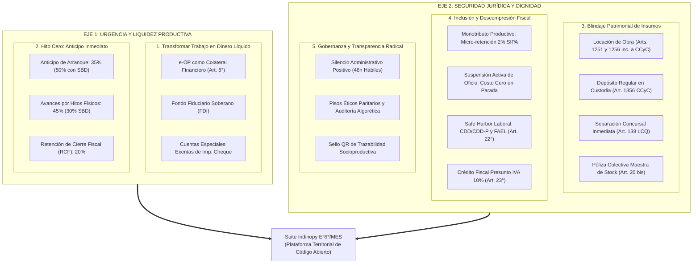
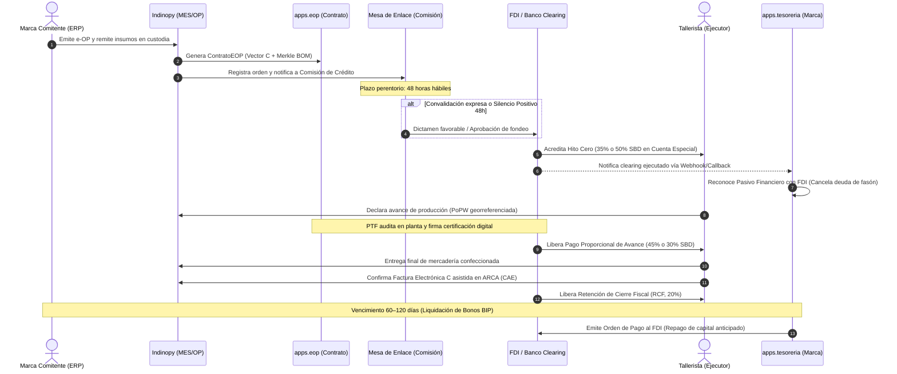
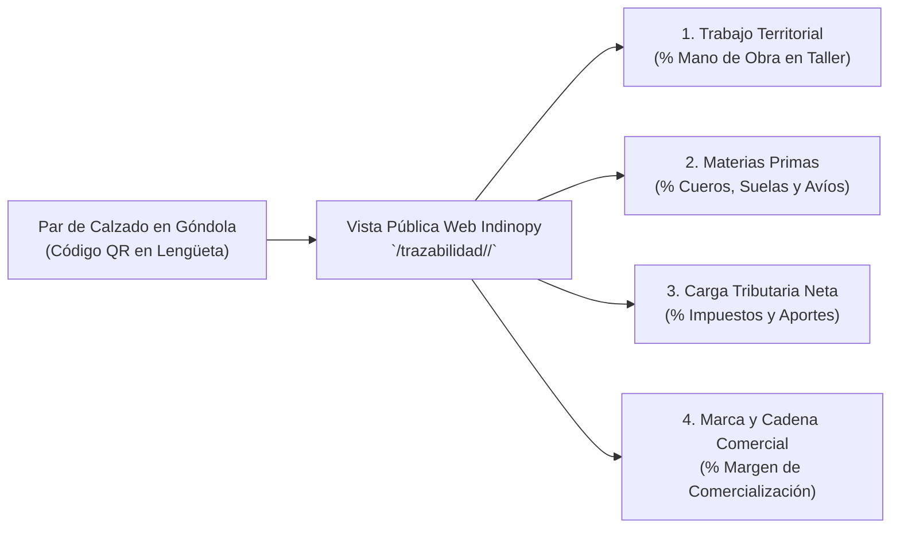

⚙️ Especificación Técnica &amp; Visión de Ingeniería
# Explicación Técnica y Análisis de Implementación FIMCA en Indinopy

> **Sistema Destino:** **Indinopy** — ERP & MES Industrial para Manufactura de Calzado, Cuero e Indumentaria  
> **Repositorio Oficial (Open Source):** [github.com/sarthouse/indinopy](https://github.com/sarthouse/indinopy)  
> **Marco Doctrinario y Normativo:** [Dossier Proyecto FIMCA](dossier_proyecto_fimca_2026.html) &middot; Ley Nacional de Orden de Producción Electrónica (e-OP)  
> **Fecha:** Septiembre de 2026  
> **Estado:** Documento Maestro Consolidado de Visión, Diagnóstico, Dispositivos Territoriales y Mapeo en Django  

---

## 1. Visión y Diagnóstico: ¿De qué estamos hablando?

### 1.1. La Falla Estructural
El problema central de la manufactura de calzado, marroquinería e indumentaria en la Argentina (con epicentro en los distritos productivos de La Matanza, San Martín, Lanús y Tres de Febrero) no radica en la falta de capacidad técnica de sus operarios ni en la ausencia de demanda comercial de mano de obra. 

Radica en una **falla estructural de arquitectura institucional, patrimonial y financiera**:
1. **La Trampa de Stiglitz (Colateral Inaccesible):** La banca comercial tradicional solo otorga financiamiento contra garantías patrimoniales reales (inmuebles, rodados o balances con utilidades auditadas). Un aparador, cortador o armador de barrio carece de bienes registrables para hipotecar; su único capital es su **fuerza de trabajo calificada**.
2. **El "Purgatorio Fiscal":** Los talleres satélites cobran en efectivo o utilizan CUITs prestados de terceros para eludir embargos bancarios o la asfixia de regímenes generales que devengan cuotas fijas de impuestos aun en meses de parálisis de planta.
3. **Pérdida de Crédito Fiscal y Utilidades Ficticias:** Al no contar con facturación formal del taller, la marca comitente formal no puede computar el crédito fiscal de IVA ni deducir los costos de mano de obra (que representan del 30% al 50% del valor del producto) en el Impuesto a las Ganancias, tributando sobre utilidades ficticias y descapitalizándose.
4. **Financiamiento Asimétrico del Capital de Trabajo:** Las marcas comitentes financian su propio capital de trabajo postergando los pagos de la confección a 60, 90 o 120 días, transfiriendo el riesgo y el costo financiero a los eslabones más vulnerables del entramado fabril.

### 1.2. La Respuesta Doctrinaria de la Comunidad Organizada
En el marco del **Proyecto FIMCA** y el anteproyecto de **Ley de Salvataje Nacional**, **Indinopy** asume el pragmatismo de las **Organizaciones Libres del Pueblo (OLP)**: articular al Estado (a través de la solvencia técnica del INTI y el arraigo de los Municipios), a los sindicatos del sector, a las marcas comerciales y a los talleristas periféricos bajo una gobernanza común desintermediada:

* **Mesa de Enlace Sectorial (MES):** Cuerpo colegiado paritario de 7 sillas ad-honorem que conduce la política de precios y capacidades de la cadena, constituido legalmente como los **Comités Técnicos, de Fomento y de Auditoría Territorial dentro del Reglamento de Gestión del Fideicomiso (FDI)** y el órgano consultivo permanente de actualización paritaria semestral coordinado por el INTI (Arts. 1°, 15° y 27° Ley de e-OP).
* **Fideicomiso de Desarrollo Industrial (FDI):** Fideicomiso financiero y de garantía (Ley 26.831 / Art. 1666 CCyC) que emite **Bonos de Inversión Productiva (BIP)** con etiqueta SVS (RG CNV 917/2021) y cupo de la Línea de Financiamiento para la Inversión Productiva (LFIP) del BCRA, operando sobre **Cuentas Especiales de Compensación y Liquidación Manufacturera (Art. 14° Ley de e-OP)** 100% exentas del Impuesto al Cheque (Ley 25.413).
* **La Orden de Producción como Título Ejecutivo de Crédito (e-OP):** Conforme al Art. 6° de la Ley de e-OP (y Art. 523 inc. 7 CPCCN), la orden registrada con firmas digitales Ed25519 constituye título causal ejecutivo y autoliquidable; el fideicomiso financia el trabajo en curso tomando la e-OP como colateral productivo.

---

## 2. Los 5 Objetivos Estratégicos del Protocolo

### Cuadro Comparativo: Sistema Tradicional vs. Protocolo Indinopy

| Dimensión | Sistema Tradicional / Banca Comercial | Protocolo Indinopy ERP/MES + FIMCA |
| :--- | :--- | :--- |
| **Garantía Exigida** | `Patrimonial` (Inmuebles, rodados, balances de 3 años). | `Flujo Productivo` (e-OP colateralizada con stock en custodia). |
| **Plazo de Cobro Taller** | `60 a 120 días` (Diferido arbitrario transferido al taller). | `Inmediato por Hitos` (Hito 0 al 35%/50% + Avances 45%/30% + RCF 20%). |
| **Repago de la Marca** | Obligación a la vista o descuento usurero de cheques. | `60 a 120 días` calzados con la liquidación de los Bonos BIP. |
| **Riesgo Burocrático** | Cajoneo administrativo y discrecionalidad de funcionarios. | `Timelock 48h` con Silencio Administrativo Positivo por sistema. |
| **Seguridad Jurídica** | Embargos judiciales traban materias primas de terceros. | `Inembargabilidad y Separación Concursal` (Arts. 1251/1356 CCyC y 138 LCQ). |
| **Régimen Fiscal Taller** | Deuda acumulativa mensual en monotributo o régimen general. | `Monotributo Productivo (2%)` y `Suspensión Activa` (\$0 en parálisis). |
| **Cómputo Fiscal Marca** | Pérdida de deducibilidad en Ganancias y pérdida de IVA. | `Deducción 100% Ganancias` + `Crédito Fiscal Presunto IVA 10%`. |
| **Fijación de Precios** | Imposición de tarifas de subsistencia por debajo de costo. | `Pisos Éticos de Convenio` auditados por la MES e indexados en UCI. |

---

## 3. Los 5 Dispositivos Territoriales del FIMCA

Para que la digitalización no quede en un esquema abstracto de oficina, el proyecto institucionaliza cinco dispositivos operativos de base territorial:

### 3.1. Inclusión Tributaria, Regularización Laboral (CDD/FAEL) y Asesoría Societaria (PFET)
El régimen establece vías de formalización según la escala real de cada unidad productiva, reservando la constitución de sociedades (SAS o SRL) como una alternativa **estrictamente voluntaria**:
* **Prestadores Individuales sin Empleados (Art. 24° Ley de e-OP):** Rige con carácter permanente el **Monotributo Productivo**, con micro-retención bancaria del **2%** computable a aportes jubilatorios SIPA y obra social, devengamiento cero en períodos sin órdenes activas y **Borrador Asistido de Factura C en un solo clic** precargado por ARCA.
* **Talleres Empleadores Consolidados (Art. 22° Ley de e-OP):** Para unidades con operarios en relación de dependencia (hasta 30 trabajadores), rige el **Estatuto Permanente de Regularización Laboral**, con condonación total de deuda histórica SUSS, exclusión del REPSAL, retención en la fuente del **15%** sobre cada hito para el F.931/LSD, **Certificado de Desempeño Digno (CDD/CDD-P)** como *Safe Harbor* probatorio del Art. 30 LCT, autonomía técnica (Art. 23 LCT mod. Ley 27.742) y respaldo directo del **Fondo de Afectación Específica Laboral (FAEL — 0,5% de la mano de obra)** sin beneficio de excusión.
* **Alta de Oficio en la Primera e-OP:** El trabajador no debe desplazarse a agencias fiscales. Al firmar digitalmente su primera e-OP desde el celular, el sistema cruza identidad con RENAPER y genera el alta fiscal automática en ARCA, abriendo en el mismo acto su **Cuenta Especial de Compensación y Liquidación Manufacturera (Art. 14°)** exenta del Impuesto al Cheque bajo principio de no retroactividad por etapas informales pasadas.
* **Diferimiento de IVA al Cierre y Crédito Fiscal Presunto del 10% (Art. 23°):** Los anticipos financieros (Hito Cero y Avances) no perfeccionan el hecho imponible de IVA; el impuesto se devenga íntegramente al momento de la entrega final del lote y liberación del Hito de Cierre Fiscal (RCF, 20%). A su vez, la marca Responsable Inscripta computa un **Crédito Fiscal Presunto de IVA del 10%** sobre la mano de obra documentada con Factura C y deduce el **100% del gasto en Ganancias** (quedando la factura de cierre bloqueada de oficio para emitir FCE bajo el Art. 9° Ley de e-OP).
* **Programa Federal de Extensión Tecnológica (PFET, Art. 24 bis):** Provee asesoría contable y jurídica gratuita. Si un taller supera los 5 operarios y desea voluntariamente transformarse en SAS o SRL, el PFET gestiona el trámite en 48 horas transfiriendo intactos su legajo, su historial de cumplimiento en el **SETP** y su CDD.

### 3.2. Tutelaje Administrativo e Inmunidad Territorial
* **Habilitación Simplificada en 48 Horas:** El municipio adherente emite de pleno derecho la habilitación productiva y la exención de tasas comerciales e industriales por 10 años ante el registro de la primera e-OP.
* **El Promotor Territorial (PTF):** Técnico y maestro de oficio territorial que acompaña al tallerista en su taller, constata los hitos físicos mediante la aplicación móvil y labra los dictámenes de transición asistida.
* **Canal Criptográfico de Denuncias:** Permite denunciar de forma anónima extorsiones burocráticas, pedidos de coimas o abusos comerciales. Su radicación activa una **inmunidad fiscal de 180 días hábiles** que suspende inspecciones y ejecuciones presenciales en el taller.
* **Orden de Restricción Administrativa:** Si un agente público es denunciado con prueba verosímil, el sistema bloquea su usuario y le prohíbe el acceso inspectivo al cuadrante territorial del taller.

### 3.3. Red CIFO y Banco Comunitario de Maquinarias
* **Centros CIFO (Financiados con el 3% inembargable del FDI):** Co-gestionados por el sindicato, las cámaras y el INTI/Municipio. Brindan formación técnica irrestricta (sin exigencia de secundario previo), otorgan becas a los aprendices y reparten el **50% de la renta neta de los Lotes Escuela** terminados con Sello Buen Diseño (SBD).
* **Banco Comunitario de Maquinarias:** Incorpora bienes de capital en desuso ofreciendo condonación de deudas históricas de ARCA a quienes los cedan en comodato productivo por 36 meses. Se calibran en los CIFO y se ceden a egresados o talleres que completen con éxito tres e-OPs.
* **Muletto Técnico en 24 Horas y Compensación por Parada:** Provisión de auxilio de maquinaria en 24 horas ante roturas fortuitas. Si la marca comitente demora más de 48 horas hábiles la entrega Just-in-Time de materias primas de la siguiente etapa, se devenga automáticamente una compensación por parada de planta equivalente a **un (1) jornal diario del SMVM por puesto afectado** (tope de 0,5 SMVM mensual, Art. 5° bis inc. 5 Ley de e-OP).

### 3.4. Supervisión Algorética y Soberanía Tecnológica
* **Pisos Éticos de Convenio:** Bloqueo sistemático de órdenes que coticen mano de obra por debajo de las tablas paritarias de la MES homologadas con el INTI.
* **Detección de Talleres Espejo:** Detección de patrones anómalos de fraccionamiento societario mediante cruce de telemetría, IPs y geolocalización satelital para impedir que grandes fábricas eludan convenios colectivos.
* **Supremacía Humana Indeleble:** Ningún algoritmo tiene facultades para sancionar o inhabilitar talleres; las decisiones sancionatorias o regulatorias corresponden de forma exclusiva a los miembros humanos de la MES.

### 3.5. Régimen de Tecnología Conveniente y Arancel Cero (Art. 22 Ley de Salvataje)
* **Arancel Cero e IVA Aduanero 0%:** Beneficio exclusivo para bienes de capital sin producción nacional equivalente.
* **Criterios Objetivos de Exclusión (INTI):** La importación solo procede si la industria local: (1) no entrega en $\le 90$ días corridos; (2) ofrece garantía técnica menor a 12 meses; o (3) supera en más de un 30% el valor CIF del bien puesto en planta.
* **Silencio Positivo Aduanero en 15 Días Hábiles:** Si el perito del INTI no se expide en dicho plazo, se emite de pleno derecho la autorización aduanera.
* **Encadenamiento Forzoso e Inmovilización:** Proveedores internacionales deben transferir planos y repuestos a talleres metalúrgicos y centros CIFO locales, rigiendo una prohibición de reventa de la maquinaria importada por 5 años.

---

## 4. Matriz de Correspondencia: Proyecto FIMCA vs. Módulos Indinopy

| Eje del Proyecto FIMCA | Concepto Operativo | Aplicación / Módulo Indinopy | Estado de Implementación |
| :--- | :--- | :--- | :--- |
| **Ley e-OP Art. 6°** | Orden como activo financiero interoperable | `apps.eop` (`ContratoEOP`) / `apps.produccion` | **Implementado:** Desacople fiduciario, sellado de Merkle Root y ciclo de Timelock 48h. |
| **Ley e-OP Arts. 12° y 14°** | Hito Cero (35%/50%) y Cuentas Especiales | `apps.eop` (`EOPHitoEscrow`) / `apps.tesoreria` | **Implementado:** Generador de lotes batch BAPRO y conciliación con `ComprobanteTesoreria`. |
| **Ley e-OP Arts. 20° y 20 bis** | Separación concursal y Póliza de Stock | `apps.inventario` (`StockService`) | **Implementado:** Inyección legal automática en remitos `TRA-...` (Arts. 1251/1356 CCyC y 138 LCQ). |
| **Ley e-OP Arts. 22° y 24°** | Monotributo (2%), CDD/FAEL (15%) y ARCA | `apps.contabilidad` / `apps.contactos` | **Implementado:** Partida doble, liquidación de retenciones, diferimiento de IVA y Libro IVA Digital. |
| **FIMCA Sección VIII.B** | Bolsa Sectorial y Scoring de Capacidad | `apps.contactos` (`PerfilTallerista`) | **En desarrollo:** Registro de capacidad semanal (pares/sem) y prevención de cuellos de botella. |
| **FIMCA Sección V** | Tolerancia de Mermas INTI y Aduana | `apps.produccion` / `apps.inventario` | **En desarrollo:** Campo `porcentaje_merma_tolerada` en `RecetaInsumo` y control de permanencia temporaria. |
| **FIMCA Sección VIII.M** | Sello QR de Trazabilidad Socioproductiva | `apps.ventas` / `apps.produccion` | **Especificado:** Endpoint `/trazabilidad/<lote>/` con descomposición porcentual en 4 factores. |
| **FIMCA Integración PyME** | Arquitectura Headless (ERP Gateway) | `apps.produccion` (`POST /api/v1/headless/e-op/`) | **Implementado:** Ingesta de órdenes crudas con `bom_headless` salteando el stock local. |

---

## 5. Especificación de Ingeniería y Flujo Documental-Financiero

### 5.1. Desacople Arquitectónico: Planta Física vs. Título de Crédito
Indinopy separa de manera estricta dos capas que en los ERPs tradicionales se encuentran solapadas:
1. **Capa de Planta (`apps.produccion`):** `OrdenProduccion` gestiona la receta técnica (BOM), las curvas de talles (`OPVariacion`), los insumos comprometidos (`OPInsumoRequerido`) y el seguimiento por etapas a façón (`OPEtapaTracking`), garantizando la trazabilidad material del taller.
2. **Capa Fiduciaria (`apps.eop`):** `ContratoEOP` modela el activo financiero negociable en la Red Federada FIMCA, almacenando el Vector C de costos indexados en UCI, el Merkle Root inmutable de la receta y los hitos de liberación en custodia (`EOPHitoEscrow`).

### 5.2. Secuencia de Clearing Fiduciario y Ciclo de Repago
La tesorería comitente **no desembolsa liquidez propia de arranque**; los pagos son transferidos por el **FDI** a través del banco agente de liquidación (ej. BAPRO / Interbanking):

### 5.3. Modelado de Datos Centrales en Django

#### A. Título de Crédito y Escrow (`apps.eop`)
* **`ContratoEOP`:** Activo financiero que contiene los hashes criptográficos (Ed25519), la referencia a la OP local o externa (`orden_produccion_local`), el hash de Merkle del BOM y el estado del ciclo fiduciario.
* **`EOPHitoEscrow`:** Tramos de desembolso (`HITO_0_ANTICIPO`, `AVANCE_PARCIAL`, `RCF_CIERRE_FISCAL`). Vincula la convalidación del PTF (`firma_ptf`), la comprobación de tiempo transcurrido (Timelock) y la verificación automática de factura electrónica con CAE en ARCA.

#### B. Tesorería y Conciliación (`apps.tesoreria`)
* **`ComprobanteTesoreria`:** En el nodo de la Marca, vincula `escrow_asociado = ForeignKey(ContratoEOP)` para programar la cancelación fiduciaria a 60–120 días. En el nodo del Tallerista, asienta la cobranza neta recibida en su Cuenta Especial.

#### C. Directorio Productivo (`apps.contactos`)
* **`PerfilTallerista`:** Modelo satélite vinculado al contacto que almacena la figura tributaria FIMCA, estado dinámico (Activo vs. Suspensión Activa de Oficio), dotación de máquinas, capacidad semanal en pares y tutor territorial (PTF) asignado.

#### D. Ficha Técnica y Rendimiento (`apps.produccion`)
* **`RecetaInsumo.porcentaje_merma_tolerada`:** Parámetro técnico INTI (default 10.00%). Si los descartes reales superan este umbral, el sistema emite una *Alerta de Desvío de Materia Prima* auditada.

---

## 6. Sello QR de Trazabilidad Socioproductiva y Desglose Ético

El proyecto consagra la transparencia radical ante el consumidor final. Cada lote de calzado incorpora un código QR escaneable en la lengüeta o caja que conduce a la vista pública de Indinopy (`/trazabilidad/<lote>/`), sin login requerido:

### Descomposición Porcentual Matemática:
$$\% \text{Mano de Obra} = \frac{\text{Costo Total Façón}}{\text{Precio Venta Sugerido}} \times 100$$
$$\% \text{Materiales} = \frac{\text{Costo Total Insumos}}{\text{Precio Venta Sugerido}} \times 100$$
$$\% \text{Impuestos} = \frac{\text{Carga Impositiva Neta}}{\text{Precio Venta Sugerido}} \times 100$$
$$\% \text{Comercialización} = 100\% - (\% \text{Mano de Obra} + \% \text{Materiales} + \% \text{Impuestos})$$

---

## 7. Topología de Red y Modelos de Despliegue

Para adaptarse tanto a talleres unipersonales como a fábricas estructuradas con firewalls y sistemas legacy, Indinopy implementa tres modalidades de despliegue:

### 7.1. Estructura Oficial de Dominios y Delegación DNS (`.ar`)
Toda la red opera bajo el dominio de soberanía nacional:
* **Nivel 1 (Autoridad Raíz):** `indinopy.ar` (protocolo y gobernanza central).
* **Nivel 2 (Nodo de Gobernanza MES):** `{municipio}-mes.indinopy.ar` (ej. `sanmartin-mes.indinopy.ar`).
* **Nivel 3 (Nodos de Marca o Taller):** `{marca}.{municipio}-mes.indinopy.ar`.

### 7.2. Modelos Tecnológicos de Operación
1. **SaaS Comunitario Multi-Tenant:** Modelo sugerido para el 90% de las PyMEs y talleres. Alojado en servidores institucionales de cámaras o CIFO. La empresa accede vía navegador web con aislamiento criptográfico total y procesamiento asincrónico resiliente ante picos de demanda (Celery + Redis).
2. **Nodo On-Premise (Servidor Local en Galpón):** Diseñado para fábricas que exigen mantener su base de datos físicamente dentro de sus instalaciones. Resuelve la conectividad sin requerir IP fija mediante:
   * *Polling Asincrónico ("El Cartero"):* Tarea periódica de Celery Beat que consulta a la red federada periódicamente.
   * *Túneles Seguros Inversos (Zero Trust):* Conexión cifrada de salida mediante Cloudflare Tunnels o Ngrok sin abrir puertos en el router.
3. **Portal Centralizado de Marca (Fallback Ligero):** Para talleres sin equipamiento que interactúan como usuarios delegados en el nodo comitente para firmar órdenes y cargar partes de avance.
4. **Gateway Criptográfico Headless (SAP / Tango / Odoo):** Endpoint `POST /api/v1/headless/e-op/` para que grandes empresas integren Indinopy como un broker fiduciario y de trazabilidad territorial sin modificar su ERP corporativo.

---

## 8. Conclusión y Valor Estratégico

La arquitectura de **Indinopy** demuestra que el software libre y la ingeniería de datos pueden constituirse en una **herramienta estratégica de política industrial soberana**. 

Al transformar la orden de producción en un título causal con liquidez anticipada (Hito Cero al 35%/50%), blindar los insumos contra contingencias concursales ajenas (Arts. 1251/1356 CCyC y 138 LCQ), desarticular el estrangulamiento fiscal y visibilizar el valor real del trabajo ante el consumidor final, Indinopy edifica un ecosistema donde la tecnología no profundiza la exclusión, sino que organiza y jerarquiza a la comunidad productiva nacional.
