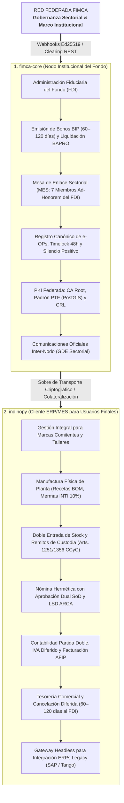

# Plan de Implementación y Roadmap Técnico — Indinopy & FIMCA-Core

**Versión:** 0.2.0 | **Fecha:** Septiembre 2026  
**Autor:** Tiago Gabriel Sarthou  
**Estado:** Documento Maestro de Ingeniería Interna y Estado de Desarrollo  

---

## 1. Visión y Dualidad Arquitectónica del Ecosistema

El proyecto no es un monolito confuso, sino un ecosistema compuesto por **dos aplicaciones desacopladas e interconectadas**:



### Principios Rectores Armonizados
* **La e-OP como Activo Inmutable:** Una vez firmada digitalmente con Ed25519, sus términos fiduciarios en UCI y su receta (Merkle Root) son inalterables.
* **Silencio Administrativo Positivo (48h Hábiles):** Si el cuerpo colegiado no emite veto fundado en 48 horas hábiles, el contrato gatilla la convalidación automática por omisión.
* **La MES como Comité ad-honorem del FDI:** No es un organismo burocrático independiente con cargos salariales; está constituida legalmente como los **Comités Técnicos, de Fomento y de Auditoría Territorial dentro del Reglamento del Fideicomiso (FDI)** (7 miembros: INTI, Sindicato, Talleristas Mono, Talleristas SAS, Cámaras/Marcas, Municipio y Fiduciaria).
* **El PTF como Auditor Técnico y Tutor:** Valida avance físico en planta mediante prueba georreferenciada (PoPW PostGIS) y tutela la formalización del taller de base.
* **Calce Financiero de Repago (60 a 120 días):** La Marca cancela los fondos anticipados por el FDI al vencimiento convenido calzado con los **Bonos BIP** (60–120 días).

---

## 2. Resumen Ejecutivo de Estado (Implementado vs. Pendiente)

```
[MÓDULOS DEL ECOSISTEMA]
├─ fimca-core (Gobernanza / Fiduciaria)
│  ├─ PKI Federada (Ed25519 / PyNaCl / CRL)      ───► [100% OPERATIVO]
│  ├─ Timelock 48h con Silencio Positivo (Celery) ───► [100% OPERATIVO]
│  ├─ Tarifario Convenio & Boletín Sectorial     ───► [100% OPERATIVO]
│  ├─ Clearing BAPRO & Dashboard Fiduciario      ───► [100% OPERATIVO]
│  └─ Permisos de rol OficialFiduciario          ───► [PENDIENTE]
│
├─ indinopy (Cliente ERP/MES Fabril)
│  ├─ Desacople Fiduciario (apps.eop)            ───► [100% OPERATIVO]
│  ├─ Gateway Headless (POST /api/v1/headless/)  ───► [100% OPERATIVO]
│  ├─ Stock Doble Entrada & Cláusula Remito      ───► [100% OPERATIVO]
│  ├─ Mermas INTI en RecetaInsumo (10%)          ───► [100% OPERATIVO]
│  ├─ Facturación AFIP / ARCA & QR RG 4291       ───► [100% OPERATIVO]
│  ├─ Omnicanalidad WooCommerce con DTOs         ───► [100% OPERATIVO]
│  ├─ Contabilidad Partida Doble & Libros IVA    ───► [100% OPERATIVO]
│  ├─ Depuración residual OPEscrowHito en prod.  ───► [PENDIENTE]
│  ├─ PerfilTallerista en apps.contactos         ───► [PENDIENTE]
│  ├─ Reportes Industriales A4 en apps.produccion───► [PENDIENTE]
│  ├─ Recibos A4 & Exportador LSD en apps.nomina ───► [PENDIENTE]
│  └─ Endpoint Público QR /trazabilidad/<lote>/  ───► [PENDIENTE]
```

---

## 3. Lo que ya está Implementado (Resumen Compacto)

Para evitar duplicaciones y mantener la especificación ágil, se resume lo que ya se encuentra testeado y operativo en el repositorio:

1. **Criptografía e Integridad (`apps.base` / `fimca-core.base`):**
   * Firmas asimétricas Ed25519 con PyNaCl (`PTFService`).
   * Hashing determinista SHA-256 de payloads canónicos.
   * Árboles de Merkle para inmutabilidad del BOM de insumos.
2. **Desacople Fiduciario (`apps.eop`):**
   * Separación estricta entre la orden física (`OrdenProduccion`) y el activo fiduciario (`ContratoEOP`).
   * Estados de Escrow dinámico e inyección de `FISCAL_PENDING` para la Retención de Cierre Fiscal (RCF, 20%).
3. **Manufactura y Logística (`apps.produccion` e `apps.inventario`):**
   * Parámetro `porcentaje_merma_tolerada` (10% INTI) en `RecetaInsumo` y control estequiométrico en partes de producción.
   * Remitos de traslado a façón (`TRA-...`) con inyección automática de salvaguarda jurídica (Arts. 1251 y 1356 CCyC).
   * Modo Headless activo (`POST /api/v1/headless/e-op/`) con ingesta de `bom_headless` salteando el inventario local.
4. **Comercial, Fiscal y Omnicanal (`apps.ventas`, `apps.compras`, `apps.contabilidad`, `apps.afip`):**
   * Libros IVA Ventas y Compras en Excel, Convenio Multilateral CM05/CM03 y Comprobantes Fiscales con QR oficial ARCA.
   * Conector desacoplado de WooCommerce con normalizador DTO y webhooks asincrónicos HMAC-SHA256.
   * Compras con 3-Way Matching, RFQs y backorders tabulares.
5. **Red Federada (`fimca-core`):**
   * Clearing BAPRO/Interbanking con generador de lotes `.txt` en `/mes/fiduciaria/`.
   * Timelock de 48 horas en Celery Beat con aprobación automática por silencio positivo.
   * Boletín Oficial Sectorial y distribución de listas de revocación CRL.

---

## 4. Roadmap de Desarrollo: Tareas Pendientes Priorizadas

### 📌 Prioridad 1 — Depuración y Modelos Satélite del Ecosistema

- [ ] **Depuración Fiduciaria en `apps.produccion`:**
  - [ ] Eliminar el modelo residual `OPEscrowHito` en `indinopy/apps/produccion/models.py:1111` (reemplazado al 100% por `apps.eop.models.EOPHitoEscrow`).
  - [ ] Limpiar fieldsets fiduciarios residuales en `apps/produccion/admin.py`.
- [ ] **Modelo `PerfilTallerista` en `apps.contactos`:**
  - [ ] Crear el modelo satélite vinculado a `Contacto`:
    - `figura_tributaria`: Monotributo Productivo (2%), Taller Empleador con CDD/CDD-P (15%), Cooperativa, SAS Voluntaria (PFET).
    - `estado_fiscal_dinamico`: Activo, Suspensión Activa de Oficio (\$0 en parada), Irregular asistido.
    - `capacidad_semanal_pares`: Límite nominal de producción para prevención de cuellos de botella.
    - `tutor_ptf`: Clave foránea al promotor territorial asignado al distrito.
    - `score_cumplimiento_ucp`: Puntos históricos de cumplimiento.
- [ ] **Permisos de Roles en `fimca-core`:**
  - [ ] Implementar decorador y permiso estricto `es_oficial_fiduciario` en vistas de `/mes/fiduciaria/`.
  - [ ] Restringir firma Ed25519 en e-OP exclusivamente al apoderado legal de la marca y al PTF.

---

### 📌 Prioridad 2 — Reportes Industriales y Portales Fabriles (`indinopy`)

- [ ] **Documentos Industriales (`apps/produccion/reports/`):**
  - [ ] `OrdenProduccionPDFReport`: Hoja de Ruta de Planta (A4) con código QR de la OP, curva de talles desagregada por variación, BOM técnico y checklist de etapas operativas.
  - [ ] `BOMExplosionReport`: Explosión tabular de materias primas y avíos contrastando consumo teórico vs existencias en pañol.
  - [ ] `RendimientoProduccionExcelReport`: Matriz de desvíos y rendimiento industrial con alerta ante descarte >10% INTI.
  - [ ] `LiquidacionFasonExcelReport`: Planilla para talleres con discriminación de pares de 1ra y 2da selección.
- [ ] **Sello QR de Trazabilidad Socioproductiva Pública:**
  - [ ] Vista web móvil pública sin login (`/trazabilidad/<uuid:lote_uuid>/`).
  - [ ] Desglose matemático ético: % Mano de Obra territorial, % Insumos Nacionales, % Impuestos y % Comercialización.
- [ ] **Portal del Tallerista PWA:**
  - [ ] Interfaz web progresiva para celular con WebAuthn/Passkeys, firma Ed25519 local y ficha técnica con costos comerciales ocultos (permiso `view_costos_op`).
  - [ ] Acción de aviso anticipado de cuello de botella (72hs) para reasignación asistida por la MES sin penalidad.

---

### 📌 Prioridad 3 — Nómina, Régimen Previsional y Libro de Sueldos Digital (`apps.nomina`)

- [ ] **Documentos Oficiales:**
  - [ ] `ReciboSueldoPDFReport`: Diseño formal A4 doble vía (Original / Duplicado) desagregando conceptos remunerativos, no remunerativos, retenciones SIPA/OS y aporte al Fondo de Cese Laboral (Ley Bases).
  - [ ] `LibroSueldosDigitalTxtReport`: Exportador de longitud fija para ARCA con los 4 registros oficiales (Empleador, Bases Imponibles 1 a 10, Conceptos y Relación Laboral).
  - [ ] `LiquidacionNominaExcelReport`: Planilla consolidada mensual de costo patronal total empresa (F.931 + ART + Fondo Cese).
  - [ ] `AcreditacionHaberesTxtReport`: Archivo plano estándar de transferencias bancarias masivas a cuentas sueldo (Interbanking / Red Link).
- [ ] **Motor Previsional y Reglas Tributarias:**
  - [ ] Topes periódicos de bases imponibles mínimas y máximas de ARCA/ANSES.
  - [ ] Retención de Ganancias de 4ta Categoría / Ingresos Personales con deducciones SiRADIG (F. 572).
  - [ ] Novedades variables dinámicas (horas extras 50%/100%, feriados, premios).

---

## 5. Especificación del Contrato API entre `indinopy` y `fimca-core`

Cuando una Marca confirma una e-OP en `indinopy`, el servicio `FederacionCreditoService` transmite el sobre de red a `fimca-core` (`POST /federacion/eop/entrante/`):

### Sobre de Transporte Criptográfico (`EntradaEOPSerializer`)
```json
{
  "uuid_identificador": "e8b7c934-8fa4-4e1a-ad35-c02cd6ac65d1",
  "hash_seguridad": "a4f81c7b8e923d456102fae83912bc09148d200126d482910384729104829104",
  "comitente_cuit": "30715894128",
  "tallerista_cuit": "20184930213",
  "monto_total_uci": "3950.0000",
  "clave_publica_comitente": "7d9b01f92c3a4e5b6c7d8e9f0a1b2c3d4e5f6a7b8c9d0e1f2a3b4c5d6e7f8a9b",
  "firma_comitente": "3a8f10bc49281e...[firma Ed25519 en hex de 128 caracteres]...",
  "payload_canonico": {
    "protocolo_version": "2.0",
    "numero_op": "OP-2026-00842",
    "comitente": {
      "cuit": "30-71589412-8",
      "razon_social": "Borcegos Cruz del Sur S.R.L.",
      "plazo_cancelacion_fdi_dias": 90
    },
    "condiciones_economicas": {
      "moneda_indexacion": "UCI",
      "monto_total_uci": 3950.00,
      "es_sello_buen_diseno": false,
      "timelock_horas": 48
    },
    "cronograma_escrow_hitos": [
      {
        "id_hito": "H0",
        "nombre": "Hito Cero (Anticipo de Arranque)",
        "porcentaje_tramo": 35.0,
        "condicion_disparo": "Convalidacion_MES_o_Silencio_48h"
      },
      {
        "id_hito": "H1",
        "nombre": "Avance de Corte y Aparado",
        "porcentaje_tramo": 45.0,
        "condicion_disparo": "PoPW_Parte_Mas_Aval_PTF"
      },
      {
        "id_hito": "H2",
        "nombre": "Retención de Cierre Fiscal (RCF)",
        "porcentaje_tramo": 20.0,
        "condicion_disparo": "Recepcion_Conforme_Mas_Factura_CAE_ARCA"
      }
    ],
    "merkle_root_bom": "0x7f83b1657ff1fc53b92dc18148a1d65dfc2d4b1fa3d677284addd200126d"
  }
}
```

---

## 6. Referencias a la Documentación Consolidada

- **Arquitectura Funcional y Matriz SoD:** [`docs/md/arquitectura_funcional.md`](arquitectura_funcional.html)
- **Explicación Técnica & Análisis FIMCA:** [`docs/md/explicacion_tecnica_proyecto.md`](explicacion_tecnica_proyecto.html)
- **Gobernanza y Funcionamiento de la MES:** [`docs/md/arquitectura_mes_gobernanza.md`](arquitectura_mes_gobernanza.html)
- **Paper PoPW y Protocolo e-OP:** [`docs/md/paper_protocolo_eop_gobernanza_industrial.md`](paper_protocolo_eop_gobernanza_industrial.html)
- **Glosario de Conceptos Unificados:** [`docs/md/glosario_conceptos_proyecto.md`](glosario_conceptos_proyecto.html)

---
*Documento vivo de ingeniería interna. Refleja el estado efectivo de la base de código de Indinopy y FIMCA-Core.*
