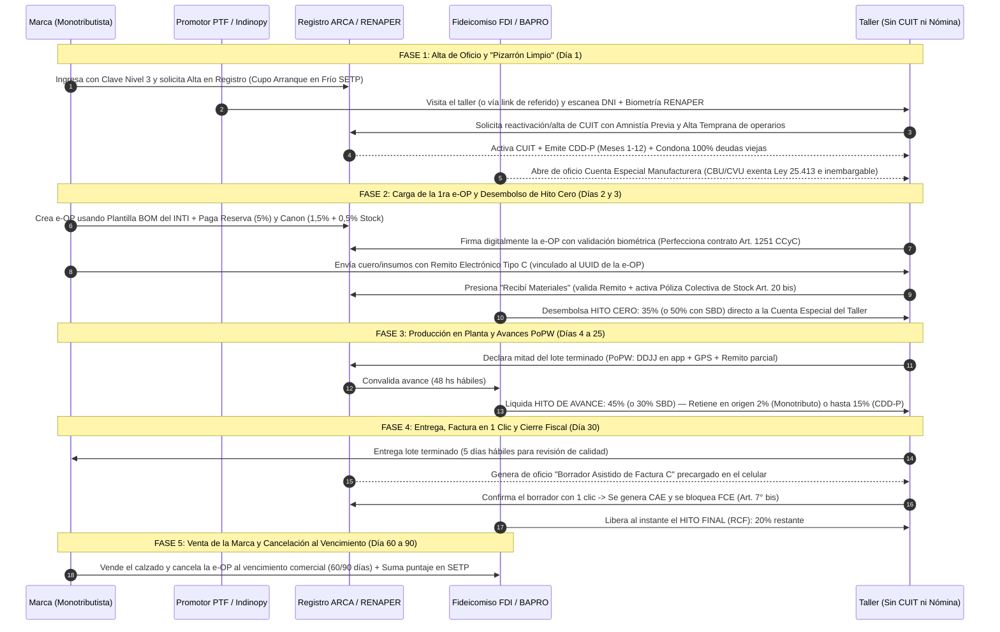

# Guía Operativa de Adhesión y Puesta en Marcha (Escenario de Base Cero / "Arranque en Frío")

*Simulación paso a paso de implementación del Ecosistema e-OP + FIMCA ya sancionado y reglamentado*

---

## 1. Definición del Caso Testigo (El Escenario Real del Conurbano)

Para probar la robustez del **Anteproyecto de Ley de e-OP** (`proyecto_ley_eop.md`) articulado con el **Régimen FIMCA** y sus tres Addendas, tomamos el escenario más adverso y frecuente de la economía real:

* **El Taller / Fábrica ("Taller El Progreso"):**
  * **Situación fiscal:** No tiene CUIT activo (o tuvo un Monotributo dado de baja de oficio por deuda hace años) y no emite facturas.
  * **Situación tecnológica:** No tiene sistema ERP ni software de gestión; se maneja con cuadernos rayados, WhatsApp y planillas de papel obsoletas.
  * **Situación laboral:** Tiene al dueño trabajando en las máquinas junto a 3 operarios (aparadores/armadores) 100% no registrados ("en negro"), o bien es un tallerista individual/familiar sin nómina declarada.
  * **Situación patrimonial:** Opera en una casa-taller sin habilitación industrial ni seguro de mercadería.
* **La Marca Comitente ("Calzados Sur" — Emprendedor / Diseñador):**
  * **Situación fiscal:** Es un emprendedor inscripto en el **Monotributo** (o recién inscripto) que acaba de lanzar su marca o venía mandando a fabricar lotes en efectivo ("en negro") con el taller.
  * **Situación financiera:** No tiene balances auditados de 3 años ni garantías hipotecarias, cuenta con capital acotado para comprar el cuero/suelas de la temporada y necesita financiar la mano de obra para no descalzarse mientras vende la producción.

---

## 2. ¿Qué necesita cada parte para empezar a operar? (Checklist de Requisitos Mínimos)

El sistema fue diseñado bajo la premisa de **Fricción Cero de Entrada**: ni el taller ni la marca necesitan contadores previos, escribanos, balances históricos, ni comprar licencias de software para dar el primer paso.

### A. Lo que necesita la Marca Comitente (Emprendedor Monotributista)

| Requisito | Qué se exige en concreto | Referencia Normativa |
| :--- | :--- | :--- |
| **1. Identidad Fiscal** | **CUIT activo en Monotributo** (cualquier categoría vigente) y **Clave Fiscal Nivel 3** en ARCA (se obtiene en 5 minutos desde el celular con la app *Mi AFIP/ARCA* mediante biometría facial RENAPER). | Art. 2° inc. 2, Art. 4° inc. 2 y Art. 7° Ley de e-OP |
| **2. Elegibilidad Crediticia ("Arranque en Frío")** | **No necesita balances ni carpeta bancaria.** Al ser un emprendedor reciente sin historial de 12 meses, entra por el régimen de **"Arranque en Frío" del SETP** con un **cupo operativo inicial garantizado** (equivalente a hasta **2 Salarios Mínimos, Vitales y Móviles por hito** durante sus primeras 3 órdenes certificadas, ampliable automáticamente al cumplir). | Art. 2° inc. 12 Ley de e-OP y Addenda II (Sección VIII.I.2) |
| **3. Fondeo Inicial al Registrar la 1ra e-OP** | Solo debe disponer en su cuenta o billetera de:  • **5% de Reserva Líquida de Garantía** sobre el valor de mano de obra ($c_{\text{MOD}}$) de la orden (se le devuelve o computa al final).  • **1,5% de Canon Operativo ($c_{\text{FDI}}$)** sobre el $c_{\text{MOD}}$ (cubre FAEL laboral, INTI y reserva por mora).  • **0,5% de Alícuota de Stock ($c_{\text{STK}}$)** sobre el valor de los materiales ($c_{\text{BOM}}$) para activar el seguro automático.  *(Ejemplo: Para encargar un lote con $ 1.000.000 de mano de obra y $ 800.000 de materiales, la marca solo desembolsa en el Día 1: $ 50.000 de reserva reembolsable + $ 15.000 de canon + $ 4.000 de seguro = **$ 69.000 en total**).* | Art. 4° inc. 4.c y Art. 16° incs. 3 y 4 Ley de e-OP |
| **4. Materias Primas (o Lote Inicial Crítico)** | Tener comprados los insumos para enviar al taller (o al menos el **Lote Inicial Crítico ≥ 20%** de los materiales de corte si opera con entregas escalonadas bajo *Logística Justo a Tiempo*) y emitir un **Remito Electrónico Tipo C** desde la web/app de ARCA consignando el código UUID de la orden. | Art. 2° inc. 14, Art. 12° inc. 1 y Art. 20° inc. 20.2 Ley de e-OP |

---

### B. Lo que necesita el Taller / Fábrica (Sin CUIT, sin sistema y sin nómina)

| Requisito | Qué se exige en concreto | Referencia Normativa |
| :--- | :--- | :--- |
| **1. Identidad Personal** | **DNI físico argentino** del titular del taller y (si tiene operarios trabajando con él) el **nombre y número de CUIL** de esos trabajadores. **Nada más.** No necesita clave fiscal previa ni ir a una agencia de ARCA. | Art. 24° inc. 1 y Art. 22° inc. 22.2 bis Ley de e-OP |
| **2. Dispositivo Básico (o Asistencia del PTF)** | Un teléfono celular básico (o usar la tablet del **Promotor Territorial de Formalización - PTF** / nodo WiFi comunitario del barrio) para sacarse la selfie de validación biométrica ante RENAPER y dar ubicación GPS del taller. | Art. 7°, Art. 12° inc. 2.b Ley de e-OP y Addenda III |
| **3. Software de Gestión (Provisto Gratis)** | **Cero costo.** Al adherir, se le habilita gratis una instancia web/móvil de **Indinopy ERP/MES** (software público y abierto del régimen) preconfigurada en modo simplificado ("Tres Botones": *Recibí Materiales* / *Declarar Avance* / *Confirmar Factura*). | Addenda I (Anexo II.B) y Dossier Base (Sección VI.A) |
| **4. Dinero para empezar** | **$ 0 (Cero pesos).** No paga inscripción, no paga cuota fija mensual de Monotributo, no paga apertura ni mantenimiento de cuenta bancaria, no paga póliza de seguro de mercadería y se le condona el 100% de cualquier deuda fiscal, previsional o eléctrica del pasado ("Pizarrón Limpio"). | Arts. 14°, 20 bis, 22° inc. 22.2 bis y 24° Ley de e-OP |

---

## 3. Hoja de Ruta Paso a Paso: De la Informalidad Total al Primer Lote Cobrado

A continuación se describe la secuencia cronológica exacta desde el momento en que la marca y el taller deciden pasar su próximo lote por el régimen aprobado:

---

### FASE 1: Alta de Oficio, "Pizarrón Limpio" y Apertura Bancaria (Día 1)

1. **Inscripción de la Marca Emprendedora (10 minutos, 100% online):**
   * El emprendedor monotributista entra al portal del **Registro Público de e-OPs en ARCA** (o desde el módulo federado de **Indinopy**) con su Clave Fiscal Nivel 3.
   * Como recién empieza o facturaba poco, el **Comité de Crédito y Fomento de la MES (FDI)** le asigna automáticamente el **Cupo Inicial Garantizado de "Arranque en Frío" en el SETP** (Art. 2° inc. 12).
2. **Formalización Instantánea del Taller sin CUIT (con asistencia del PTF o desde el celular):**
   * El tallerista recibe la visita del **Promotor Territorial (PTF)** de su municipio o ingresa por invitación de la marca.
   * Se escanea el DNI del tallerista y se valida su rostro con **RENAPER**. En ese mismo acto se abren dos caminos según cómo trabaje la fábrica:
     * **Camino 1 — Si el tallerista trabaja solo o con su grupo familiar sin empleados:** El sistema le da el **alta de oficio en el Monotributo Productivo (Art. 24° inc. 1)**. No paga cuota mensual fija (solo se le retendrá el 2% cuando cobre cada hito) y queda cubierto por la **Cláusula de No Retroactividad** (amnistía fiscal por el pasado informal).
     * **Camino 2 — Si la fábrica tiene operarios trabajando en negro (ej. 3 aparadores/armadores):** El titular reactiva su CUIT como empleador y carga en una sola pantalla el **Alta Temprana de sus 3 trabajadores** (nombre, CUIL y categoría del convenio del calzado) acogiendo al taller al **Régimen Estatutario Permanente de Regularización Laboral (Art. 22° inc. 22.2 bis)**. Automáticamente:
       1. Se le **condona el 100% de las deudas previsionales y multas pasadas** y queda excluido del REPSAL.
       2. A sus trabajadores se les reconocen hasta **60 meses de aportes jubilatorios en el SIPA**.
       3. La plataforma emite el **Certificado de Diligencia Debida Provisorio (CDD-P)** por 12 meses (prorrogables a 18), que blinda a la marca contra juicios solidarios del Art. 30 LCT.
       4. El tallerista **no tiene que liquidar F.931 ni pagar cargas sociales de su bolsillo a fin de mes**: el FDI le retendrá automáticamente hasta el **15% de cada cobro de e-OP** para pagar de oficio el SIPA, la obra social y la ART de esos 3 empleados.
3. **Apertura Automática de la Cuenta Especial Manufacturera (Art. 14°) y "Pizarrón Limpio" Eléctrico:**
   * En el mismo segundo en que ARCA valida el CUIT/CUIL del taller, el Banco Provincia (o banco público adherido) le abre de oficio y gratis su **Cuenta Especial de Compensación y Liquidación Manufacturera** con CBU/CVU: **100% exenta del Impuesto al Cheque (Ley 25.413)** e **inembargable** por deudas bancarias viejas.
   * Simultáneamente, a través de la Ventanilla Única Municipal, el taller queda exento de tasas municipales y accede al convenio de **"Pizarrón Limpio" eléctrico** (medidor con tarifa industrial reducida al 50% por Ley de Salvataje y condonación total de deudas eléctricas anteriores).

---

### FASE 2: Creación de la Primera e-OP sin Sistema Previo y Cobro del Hito Cero (Días 2 y 3)

Como ni la marca ni el taller tienen un sistema de gestión (ERP) propio, utilizan la interfaz pública gratuita de **Indinopy ERP/MES** conectada al Registro de ARCA:

1. **Armado de la Receta Técnica (BOM) con Plantillas Prearmadas del INTI:**
   * La marca no necesita un ingeniero industrial para armar la receta (BOM). En la plataforma elige una **Plantilla Estándar del INTI** (ej. *"Bota corta de cuero dama — Curva 35 al 40 — 100 pares"*).
   * La plantilla ya trae precargados los insumos base y el **piso horario paritario oficial del INTI (Art. 27°)** para que la tarifa de mano de obra ($c_{\text{MOD}}$) sea legal y justa.
   * La marca define el plazo de pago de la orden (ej. **60 o 90 días corridos**, tiempo suficiente para recibir los zapatos, venderlos en su tienda online o showroom y juntar el dinero).
   * *(Opcional)*: Si el emprendedor tramitó el **Sello Buen Diseño (SBD)** para su modelo, tilda la opción para que el taller reciba un **50% de adelanto** en lugar del 35%.
2. **Integración de la Reserva y el Canon por la Marca:**
   * La marca transfiere desde su cuenta o billetera el **5% de Reserva Líquida** (que recupera al final) + el **1,5% de canon sobre la mano de obra** + el **0,5% sobre el valor de los materiales** (Art. 4° inc. 4.c).
   * Con ese pago del 0,5%, se activa en el acto la **Póliza Colectiva Maestra de Stock en Custodia (Art. 20 bis)** del FDI: todo el cuero y las suelas que entren a la casa-taller quedan asegurados contra robo e incendio sin pedirle un solo papel ni inspección al tallerista.
3. **Firma Bilateral desde el Celular:**
   * Al tallerista le llega una notificación a su teléfono (con audio explicativo del asistente para evitar jerga técnica). Revisa la cantidad de pares y el monto neto a cobrar, y firma con su rostro (biometría RENAPER).
   * **Efecto jurídico (Art. 3° y Art. 6°):** Queda celebrado legalmente el contrato de **locación de obra con provisión de materiales (Art. 1251 CCyC)** y nace el título valor ejecutivo.
4. **Entrega de Materiales y Desembolso Instantáneo del Hito Cero (35% o 50%):**
   * La marca le lleva al taller los cueros, forros y bases (o al menos el **20% de Lote Inicial Crítico** para empezar a cortar) acompañados de un **Remito Electrónico Tipo C** emitido desde ARCA con el código UUID de la e-OP.
   * El tallerista abre la aplicación, toca el botón **"1. Recibí los Materiales"** (o escanea el QR del remito).
   * **En ese mismo instante**, el FDI le transfiere a la Cuenta Especial del taller el **35% del valor de la mano de obra** (o el **50%** si tiene Sello Buen Diseño).
   * **Resultado:** Antes de prender la máquina de cortar, el tallerista ya tiene en su cuenta bancaria el capital de trabajo para pagar la luz, comprar cemento/hilos y pagar la primera quincena a sus ayudantes.

---

### FASE 3: Producción en Planta y Cobro de los Hitos de Avance (Días 4 a 25)

1. **Gestión Simple en Planta:**
   * El taller no tiene que llevar planillas complejas. A medida que termina el corte y el aparado de la partida, el tallerista abre la app en el taller (que registra automáticamente la **georreferenciación GPS cifrada**), saca una foto o sube el remito parcial conformado por la marca y toca el botón **"2. Declarar Avance (PoPW)"** (Art. 12° inc. 2).
2. **Convalidación Rápida y Cobro del 45% (o 30% con SBD):**
   * La marca confirma el avance en la app (o si no dice nada en **48 horas hábiles**, queda aprobado automáticamente por silencio positivo).
   * El FDI libera el tramo de **Hitos de Avance (45% del total de mano de obra, o 30% si hubo SBD)**.
   * **Retención automática sin trámites:** Antes de acreditar la plata, el sistema descuenta automáticamente el **2%** (si el taller es Monotributo Productivo) o hasta el **15%** (si el taller declaró empleados bajo CDD-P) y lo manda directo a ARCA/SIPA/ART. El tallerista recibe el neto limpio en su cuenta sin tener que hacer ni un solo volante de pago (VEP).
   * *¿Qué pasa si la marca monotributista se atrasa en mandar las suelas o avíos?* Se activa sola la protección de **Logística Justo a Tiempo (Art. 5° bis)**: el plazo del taller se prorroga solo sin manchar su puntaje en el SETP; si la marca se atrasa más de 5 días hábiles, le debe pagar al taller **un (1) jornal diario de SMVM (8 horas = `$15.648` a valores de octubre 2026) por día hábil de taller parado** por puesto afectado, y a los 15 días hábiles el taller puede rescindir quedándose con el 100% de lo cobrado por las etapas iniciadas.

---

### FASE 4: Entrega del Lote, Factura con Un Solo Clic y Cobro del 20% Final (Día 30)

1. **Entrega Física de los Pares Terminados:**
   * El tallerista entrega las cajas de calzado terminadas a la marca con el remito oficial vinculado al UUID de la e-OP.
   * La marca tiene **5 días hábiles** para revisar la calidad (si hubiera una discusión técnica sobre si el pegado o la costura están bien hechos, un perito del **INTI** lo resuelve de forma vinculante en **5 días hábiles**, Art. 13°).
2. **Emisión de la Factura C sin Saber Contabilidad (Borrador Asistido — Art. 24° inc. 5):**
   * El último **20% de la mano de obra** está guardado en el FDI bajo **Retención de Cierre Fiscal (RCF)**.
   * El tallerista (que nunca antes había facturado) **no tiene que entrar a la web de ARCA a configurar puntos de venta ni calcular importes**.
   * ARCA genera de oficio el **Borrador Asistido de Factura C** con todos los datos de la marca, el detalle de la e-OP y el monto exacto. En la pantalla del celular del tallerista aparece un aviso: *"Tu Factura C por el Lote #001 está lista. Tocá aquí para confirmar y cobrar tu 20% final"*.
3. **Un Clic = CAE + Bloqueo de FCE + Cobro del 20%:**
   * El tallerista toca **"3. Confirmar Factura"**.
   * En milisegundos, ARCA otorga el código **CAE**, bloquea la generación de Factura de Crédito Electrónica (Art. 7° bis Ley 27.440) para que no haya doble deuda, y le avisa al FDI.
   * El FDI transfiere instantáneamente el **20% final (RCF)** a la Cuenta Especial del tallerista.
   * **El tallerista ya cobró el 100% de su trabajo (35% + 45% + 20%) el mismo día que entregó la mercadería.**

---

### FASE 5: Comercialización de la Marca y Cierre del Ciclo (Día 60 a 90)

1. **Oxígeno Comercial para el Emprendedor Monotributista:**
   * Aunque el tallerista ya cobró el 100% gracias al FDI (que se fondeó colocando **Bonos BIP** en el mercado de capitales y líneas **LFIP**), la marca emprendedora recién tiene que pagar la e-OP al vencimiento comercial pactado (**a los 60 o 90 días**).
   * Durante ese mes o dos meses, la marca vende los zapatos en su e-commerce, ferias o locales multimarca, cobra las ventas y reúne la liquidez.
2. **Cancelación al FDI y Crecimiento en el SETP:**
   * Llegado el día 60 o 90, la marca cancela el saldo al FDI (aplicándose a su favor el **5% de Reserva Líquida** que había dejado al principio, más el interés compensatorio bonificado de fomento).
   * **Doble victoria en el SETP y en la Bolsa de Trabajo:**
     * **El Taller** suma su primera estrella de cumplimiento en el **SETP (Sistema de Evaluación de Trayectoria Productiva)** y pasa a figurar como **Taller Verificado** en la **Bolsa de Trabajo Sectorial**, donde decenas de marcas de todo el país pueden contratarlo. Al cumplir 3 órdenes, ya califica para recibir máquinas en comodato del **Banco Comunitario de Maquinaria** o microcréditos para arreglar el techo de su casa-taller (**Hábitat Productivo**).
     * **La Marca Emprendedora** suma puntaje pagador en el **SETP** (lo que le amplía automáticamente el cupo de crédito para encargar lotes más grandes en la próxima temporada) y deja de operar en la clandestinidad: tiene sus costos 100% respaldados por factura oficial, su stock asegurado por la Póliza Colectiva y un **Puerto Seguro legal (CDD-P e independencia del Art. 23 LCT)** que la protege contra cualquier contingencia laboral. Si el día de mañana la marca crece y pasa a ser Responsable Inscripta en IVA, además computará el **10% de Crédito Fiscal Presunto de IVA** sobre todas las órdenes que contrate con talleres monotributistas o en transición.

---

## 4. Cuadro Comparativo: El Antes y el Después para Este Caso

| Situación | Antes del Régimen (En Negro) | Con e-OP + FIMCA (Desde el Día 1) |
| :--- | :--- | :--- |
| **CUIT y Deudas Viejas del Taller** | Dado de baja o bloqueado por deudas impagables de AFIP/ANSES y luz enganchada. | **Alta de oficio (Monotributo Prod. 2% o CDD-P 15%)**, condonación del 100% de deuda previsional histórica y **Pizarrón Limpio** eléctrico. |
| **Sistema de Gestión (ERP)** | Cuaderno de papel, audios de WhatsApp y descontrol de cortes/mermas. | **Indinopy ERP/MES gratuito** en el celular con plantillas BOM del INTI y 3 botones operativos. |
| **Empleados del Taller** | 100% en negro; miedo a inspecciones o juicios que fundan al taller y a la marca. | **Alta Temprana con 60 meses de SIPA reconocidos**, retención automática en el hito (hasta 15%), **Fondo FAEL** y **Puerto Seguro (CDD-P)** para la marca. |
| **Capital para Empezar el Lote** | El tallerista se endeuda con usureros o la marca se queda sin plata para comprar cuero. | El FDI adelanta el **35% (o 50% con SBD)** en el **Hito Cero** y el **45% (o 30%)** en el avance; la marca recién paga a los **60/90 días** tras vender. |
| **Seguro de los Materiales** | Si roban o se inunda la casa-taller, se funden los dos y terminan a las trompadas. | **Póliza Colectiva Maestra de Stock (Art. 20 bis)** automática desde el Día 1 pagando solo el 0,5% del material. |
| **Facturación al Entregar** | En efectivo sin papeles; si el tallerista tuviera CUIT no sabría cómo usar la web de ARCA. | **Borrador Asistido de Factura C precargado por ARCA**: el tallerista confirma con **1 clic** y cobra el **20% final (RCF)** en el acto. |

---

*Documento operativo elaborado para el repositorio técnico del Proyecto FIMCA e Indinopy.*  
*Ubicación: `utils/guia_implementacion_escenario_critico.md` — Octubre 2026.*

