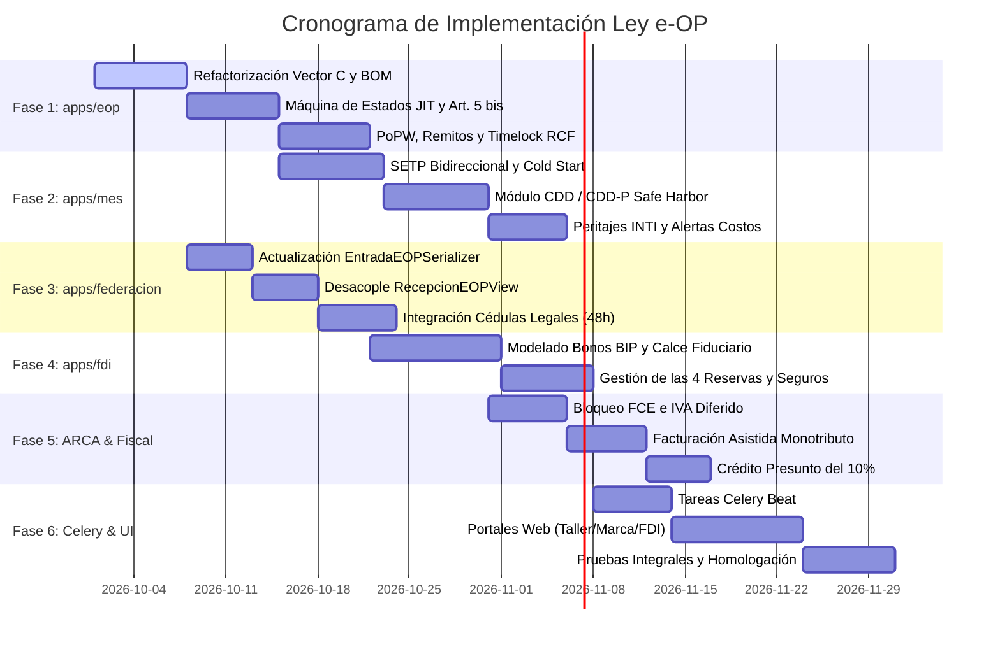

# Plan de Implementación Integral: Adecuación de Indinopy al Régimen Legal de la e-OP

**Documento Técnico de Ingeniería de Software y Arquitectura Legal**  
**Marco Normativo de Referencia:** [Anteproyecto de Ley e-OP (Octubre 2026)](../docs/md/proyecto_ley_eop.md)  
**Ubicación:** `utils/plan_implementacion_ley_eop.md`  
**Autor:** Antigravity (en colaboración con Tiago Gabriel Sarthou)  
**Fecha:** Octubre de 2026  
**Estado:** Aprobado para Ejecución Técnica  

---

## Índice General

1. [Resumen Ejecutivo y Objetivos](#1-resumen-ejecutivo-y-objetivos)
2. [Matriz de Diagnóstico y Brechas Arquitectónicas (Gap Analysis)](#2-matriz-de-diagnóstico-y-brechas-arquitectónicas-gap-analysis)
   - 2.1. [Topología de Interoperabilidad Tripartita: ARCA, Indinopy y FIMCA-Core](#21-topología-de-interoperabilidad-tripartita-arca-indinopy-y-fimca-core)
3. [Fase 1: Refactorización del Núcleo Contractual y Escrow (`apps/eop`)](#3-fase-1-refactorización-del-núcleo-contractual-y-escrow-appseop)
   - 3.1. Reestructuración del Vector C y Desacople de $c_{\text{BOM}}$
   - 3.2. Desglose del Canon Fiduciario ($c_{\text{FDI}}$ y $c_{\text{STK}}$)
   - 3.3. Máquina de Estados para Logística Justo a Tiempo (JIT) (Art. 5° bis)
   - 3.4. Desistimiento Unilateral del Comitente y Resolución (Arts. 5° bis y 5° ter)
   - 3.5. Confesión de Deuda Líquida de Hito Cero y Vía Ejecutiva (Art. 6°)
   - 3.6. Acreditación de Hitos: Remito Oficial, PoPW y Timelock RCF (Art. 12°)
   - 3.7. Nuevo Payload Canónico Determinista
4. [Fase 2: Gobernanza Productiva, MES, SETP y Diligencia Laboral (`apps/mes`)](#4-fase-2-gobernanza-productiva-mes-setp-y-diligencia-laboral-appsmes)
   - 4.1. Reubicación del Registro Oficial (ARCA vs. Nodo MES)
   - 4.2. Marco Jurídico y Estatutario de la MES como Comité Fiduciario Territorial (Arts. 1°, 15° y 27°)
   - 4.3. Sistema de Evaluación de Trayectoria Productiva (SETP) (Art. 2° inc. 12)
   - 4.4. Certificado de Diligencia Debida Laboral (CDD / CDD-P) (Art. 22°)
   - 4.5. Defensas de Calidad y Peritaje Técnico Prejudicial INTI (Arts. 11.2 y 13°)
   - 4.6. Alerta Temprana de Inconsistencia de Costos (Art. 27°)
   - 4.7. Módulo de Libreta Digital de Trabajo a Domicilio (Ley N° 12.713)
5. [Fase 3: Orquestación, Serializadores y Tareas en `fimca-core/federacion` y `comunicaciones`](#5-fase-3-orquestación-serializadores-y-tareas-en-fimca-corefederacion-y-comunicaciones)
   - 5.1. Corrección de `EntradaEOPSerializer` y Validación de Alícuotas Desglosadas
   - 5.2. Desacople y Eliminación de Duplicación en `RecepcionEOPView`
   - 5.3. Validación Copulativa en `liberar_hito_escrow_async` (Hito Cero)
   - 5.4. Desacople de Vistas ERP: Recepción de OP Espejo y Partes en `indinopy`
   - 5.5. Aislamiento del Subsistema de `Comunicaciones Oficiales y Cédulas` (Store-and-Forward Inter-Nodo)
6. [Fase 4: Infraestructura Fiduciaria y Mercado de Capitales (`apps/fdi`)](#6-fase-4-infraestructura-fiduciaria-y-mercado-de-capitales-appsfdi)
   - 6.1. Titulización Bursátil y Emisión de Bonos BIP (Arts. 17° y Anexo II)
   - 6.2. Gestión de Fondos de Cobertura y Amortiguadores de Riesgo (Art. 16°)
   - 6.3. Póliza Colectiva de Stock en Custodia (Art. 20 bis)
   - 6.4. Cuentas Especiales de Compensación y Liquidación Manufacturera (Art. 14° y Anexo I)
7. [Fase 5: Adaptador Fiscal y Regímenes Tributarios (`apps/afip` -> `apps/arca`)](#7-fase-5-adaptador-fiscal-y-regímenes-tributarios-appsafip---appsarca)
   - 7.1. Bloqueo Sistémico de la Factura de Crédito Electrónica (FCE) (Art. 9°)
   - 7.2. Facturación Asistida para Monotributo Productivo (Art. 24.5 y Anexo III)
   - 7.3. Diferimiento del Hecho Imponible del IVA (Art. 23.2)
   - 7.4. Cómputo del Crédito Fiscal Presunto del 10% (Art. 23.1)
8. [Fase 6: Automatización Asíncrona (Celery Beat) y Portales Web](#8-fase-6-automatización-asíncrona-celery-beat-y-portales-web)
   - 8.1. Tareas Asíncronas Periódicas
   - 8.2. Interfaz PWA del Tallerista
   - 8.3. Portal de la Marca Comitente
   - 8.4. Panel Fiduciario y de Supervisión MES/INTI
9. [Estrategia de Migración de Base de Datos y Testing](#9-estrategia-de-migración-de-base-de-datos-y-testing)
10. [Cronograma y Secuencia de Despliegue](#10-cronograma-y-secuencia-de-despliegue)

---

## 1. Resumen Ejecutivo y Objetivos

El presente plan establece la hoja de ruta de ingeniería de software para transformar las aplicaciones `apps/eop`, `apps/mes`, `apps/federacion`, `apps/afip`, `apps/tesoreria` y `apps/contabilidad` del ecosistema **Indinopy**, adecuándolas al marco normativo instituido por el **Anteproyecto de Ley de Régimen de la Orden de Producción Electrónica (e-OP) como Título Valor Causal y su Titulización en el Mercado de Capitales**.

### Objetivos Clave:
1. **Validez Cambiaria y Ejecutividad:** Garantizar que cada e-OP emitida sea autosuficiente como título de crédito ejecutivo conforme a los Arts. 1815 y concordantes del CCyC y el Art. 521 inc. 7 del CPCCN.
2. **Corrección Financiera Estricta:** Reclasificar el valor de los insumos en custodia ($c_{\text{BOM}}$) para evitar que infle artificialmente la obligación exigible contra la comitente.
3. **Calce Financiero Bursátil:** Alinear los plazos comerciales de la e-OP con la emisión de **Bonos de Inversión Productiva (BIP)** bajo normativa CNV (RG 917/2021).
4. **Blindaje Laboral (Safe Harbor):** Automatizar el control de Diligencia Debida (CDD/CDD-P) para conferir certeza jurídica a las marcas bajo el Art. 30 LCT y el Art. 23 LCT (modificado por Ley 27.742).
5. **Consistencia en el Bus Federado:** Asegurar que los serializers, vistas y tareas de `apps/federacion` no arrojen errores de validación criptográfica ni financiera ante el nuevo esquema de costos y hitos.
6. **Interoperabilidad Tributaria y Bancaria:** Sincronizar el sistema con los webservices de ARCA (bloqueo FCE, facturación asistida, IVA diferido y micro-retenciones previsional del 2%) y BCRA (Cuentas Especiales exentas de Ley 25.413).

---

## 2. Matriz de Diagnóstico y Brechas Arquitectónicas (Gap Analysis)

| Dimensión | Estado Actual en Indinopy | Requisito Ley e-OP | Severidad / Impacto |
| :--- | :--- | :--- | :--- | :---: |
| **Arquitectura de Nodos** | Código de taller, marcas y gobernanza MES unificado. | **Separación en 2 proyectos:** `fimca-core` (red/MES) e `indinopy` (ERP local marcas/talleres). | **CRÍTICO (RESUELTO)** |
| **Marco Jurídico de Insumos** | Insumos tratados sin tipificación concursal o bajo maquila/consignación. | **Locación de obra con provisión de materiales (Arts. 1251 y 1256 inc. a CCyC)** y **depósito regular (Art. 1356 CCyC)**. Acción directa de restitución Art. 138 LCQ; Privilegio Especial Art. 241 inc. 1 LCQ y derecho de retención Art. 2587 CCyC. | **CRÍTICO (RESUELTO)** |
| **Colateral Financiero** | `monto_total_uci` suma $c_{\text{MOD}} + c_{\text{BOM}} + c_{\text{FDI}}$. | $c_{\text{BOM}}$ **no integra la deuda exigible**. Solo colateraliza $c_{\text{MOD}} + c_{\text{FDI}} + \text{intereses}$. Base exclusiva para póliza de stock y privilegios. | **CRÍTICO (RESUELTO)** |
| **Validación Federada** | `EntradaEOPSerializer` exige estrictamente $fdi = mod \times 0.015$. | Desdobla canon en operativo ($\le 1,5\%$ s/MOD) y stock ($\le 0,5\%$ s/BOM). Confesión de deuda H0 obligatoria. | **CRÍTICO (RESUELTO)** |
| **Comunicaciones Legales** | Mezcladas en `federacion` con dependencias cruzadas. | App propia aislada `comunicaciones` en ambos nodos (cédulas Store-and-Forward de 48h). | **ALTO (RESUELTO)** |
| **Instanciación en MES** | `RecepcionEOPView` clona contratos e hitos con lógica ORM duplicada. | Eliminación de `ContratoEOP` en `fimca-core`. Consolidación en `RegistroEOP` y `EOPHitoEscrow`. Fast-Track para Scoring $\ge 90$. | **ALTO (RESUELTO)** |
| **Registro Oficial** | Centralizado en el nodo MES (`RegistroEOP`). | El registro público oficial funciona en **ARCA (Art. 10°)** con datos abiertos no sensibles bajo Ley 25.326. Interoperabilidad tripartita. | **ALTO** |
| **Estatuto y Gobernanza MES** | Concebida como ente burocrático o estructura independiente. | **Comité de Conducción, Fomento y Seguimiento Territorial dentro del Reglamento de Gestión del FDI** (Arts. 1666-1700 CCyC, Arts. 1°, 15° y 27° Ley e-OP). Mesa única de 7 miembros ad-honorem y 3 agendas de trabajo sin costo fiscal. | **CRÍTICO** |
| **Logística Justo a Tiempo** | Inexistente. El plazo es estático. | Régimen Art. 5° bis: prórrogas automáticas (tope 30d / máx 120d absoluto), standby (1 jornal SMVM/día por operario a partir del día 6) y rescisión (15d). | **ALTO (RESUELTO)** |
| **Desistimiento Unilateral** | Sin contemplación de la rescisión de la marca comitente. | Art. 5° ter (en armonía con Art. 1261 CCyC): cancelación obligatoria de hitos devengados, pago proporcional de piezas en proceso y canon no repetible; retiro de insumos remanentes. | **ALTO (RESUELTO)** |
| **Hito Cero** | Liberación por simple firma o aprobación. | Exige copulativamente: firma bilateral N3, remito oficial A/B/C/R con UUID (o Lote Crítico >=20%) y póliza colectiva de stock activa (Art. 20 bis). | **ALTO (RESUELTO)** |
| **Hito Final (RCF)** | Estado `fiscal_pending` sin plazos perentorios. | Plazo de 10 días hábiles para factura fiscal; 5 días de gracia; luego mora a tasa BADLAR privada (exento monotributo asistido). | **MEDIO** |
| **Titulización Bursátil** | Escrow local / Clearing informal. | Emisión de **Bonos BIP** (60-120 días), etiqueta SVS con Revisor Externo CNV (RG 917/2021) y 4 fondos de reserva fiduciarios. | **ALTO (RESUELTO)** |
| **Diligencia Laboral** | Control informal de PTF. | Módulo formal de **CDD y CDD-P** (F.931, ART, SIPA) que otorga *Safe Harbor* Art. 30 LCT y autonomía Art. 23 LCT (Ley 27.742) + FAEL. | **ALTO** |
| **Interoperabilidad Fiscal** | Facturación estándar AFIP (WSFE). | Bloqueo expreso de derivación a FCE (Ley 27.440 Art. 7 bis), facturación asistida en 1 clic (Art. 24.5) y micro-retención SIPA 2%. | **ALTO** |

---

### 2.1. Topología de Interoperabilidad Tripartita: ARCA, Indinopy y FIMCA-Core

Conforme a los Artículos 3°, 4°, 7°, 8°, 10°, 11°, 12° y 14° de la Ley de e-OP, el sistema no opera como una cadena lineal de dependencias ni exige infraestructura redundante en cada eslabón productivo. Se articula bajo un esquema tripartito de responsabilidades diferenciadas donde **no es necesario que el tallerista o proveedor monte una instancia propia de Indinopy**: basta con que la **marca comitente** opere su propio ERP Indinopy y provea acceso a su **Portal Extranet de Talleristas y Proveedores**.

#### Arquitectura y Roles de los Componentes:

1. **Registro Público Oficial en ARCA (Art. 10° - Fe Pública Notarial y Fiscal):**
   - **Competencia:** Es la autoridad de registro público del régimen. No administra procesos industriales ni cronogramas de confección.
   - **Funciones Críticas:**
     * Emite y certifica el **UUID Oficial** de la e-OP (Art. 4° inc. 1), otorgándole fecha cierta y oponibilidad *erga omnes* frente a terceros y masa concursal (Art. 138 LCQ).
     * Toma razón de las firmas digitales bilaterales estampadas con Clave Fiscal Nivel 3.
     * **Bloqueo Sistémico de FCE (Art. 9° / Ley 27.440):** Al registrarse la e-OP, ARCA inhabilita la emisión paralela de Facturas de Crédito Electrónicas MiPyME sobre la misma operación para evitar doble financiamiento o duplicación de títulos.
     * Valida la autenticidad y el CAE de las facturas electrónicas emitidas en la instancia de Cierre Fiscal (RCF).
     * Expone APIs públicas de consulta de estado para datos no sensibles (cumpliendo la Ley 25.326 de Protección de Datos Personales).

2. **Instancia ERP Indinopy (En la Marca Comitente con Portal Extranet para Talleres y Proveedores):**
   - **Despliegue Centralizado en la Marca:** La marca manufacturera corre su servidor/instancia de Indinopy, gestionando el núcleo operativo (diseño, curva de moldería, órdenes de producción, recetas técnicas BOM, control de inventario de rollos/avíos, compras y pagos).
   - **Portal Web / Móvil (Extranet) de Talleristas y Proveedores:**
     * **Acceso Ligero:** El taller o confeccionista externo no requiere instalar software, base de datos ni servidor; accede mediante navegador web o PWA móvil a la extranet expuesta por la marca.
     * **Firma Bilateral de la e-OP:** El tallerista revisa las condiciones técnicas, el Vector C y el cronograma de hitos, estampando su firma digital (Clave Fiscal Nivel 3 o Ed25519) de manera remota e integrada.
     * **Recepción y Conformidad de Insumos (BOM):** Valida la recepción física de rollos y avíos entregados bajo custodia de transformación ($c_{\text{BOM}}$) y reporta incidencias o demoras de logística Justo a Tiempo (JIT).
     * **Acreditación PoPW:** Reporta avances de confección con declaración jurada de avance y georreferenciación satelital en un clic (`navigator.geolocation`).
     * **Gestión Documental y de Facturación Unificada:** Permite al tallerista/proveedor no solo tramitar la e-OP, sino también cargar facturas vinculadas a Órdenes de Compra (OCs), comprobantes de servicios prestados, consultar órdenes de pago emitidas y seguir el estado de liberación de fondos en las cuentas de Escrow.

3. **FIMCA-Core (Fideicomiso Financiero FDI y Comité MES Sectorial):**
   - **Competencia:** Opera a nivel de infraestructura financiera y regulatoria de la red.
   - **Funciones Críticas:**
     * Recibe y custodia el **expediente canónico fiduciario** (`fdi.RegistroEOP`).
     * Aplica la ventana de Timelock reglamentaria (48h ordinarias o 2h Fast-Track para actores con scoring $\ge 90$).
     * Custodia e instruye los desembolsos de las subcuentas bancarias de Escrow abiertas en el Banco Central (BCRA) o bancos autorizados (Art. 14°).
     * Valida de forma copulativa el desembolso del **Hito Cero** (remito oficial con UUID + póliza colectiva de stock en custodia Art. 20 bis).
     * **Titulización Bursátil:** Agrupa carteras de órdenes y emite **Bonos BIP** calzados estrictamente a plazos de 60, 90 o 120 días en mercados regulados (BYMA/MAE).
     * Monitorea el scoring SETP, administra el Puerto Seguro Laboral (CDD / CDD-P) e interviene en la resolución prejudicial de calidad a través del INTI (Arts. 11.2 y 13°).

#### Flujo de Interoperabilidad Paso a Paso:

* **Paso 1 (Creación y Firma Bilateral):** La marca parametriza la producción en su ERP Indinopy (generando el Vector C de costos, el árbol de Merkle del BOM y el cronograma de hitos). El tallerista accede al Portal de Proveedores, revisa los términos e inserta su firma digital con Clave Fiscal Nivel 3.
* **Paso 2 (Registro y Sellado Fiscal en ARCA):** Indinopy transmite el sobre canónico multifirmado al Web Service del Registro Oficial de ARCA. ARCA verifica la autenticidad fiscal, inscribe la operación con efectos declarativos y oponibilidad frente a terceros, asigna el UUID oficial de la e-OP y activa el bloqueo sobre el régimen de Facturas de Crédito Electrónicas (FCE).
* **Paso 3 (Apertura del Expediente Fiduciario en FIMCA-Core):** Con el UUID fiscal emitido, el sobre se comunica al nodo central de FIMCA-Core, el cual registra la e-OP en `fdi.RegistroEOP`, programa los hitos de escrow (`fdi.EOPHitoEscrow`) e inicia el cómputo del timelock de oposición (48h).
* **Paso 4 (Hito Cero y Despacho JIT):** La marca entrega el lote inicial de insumos y emite el remito oficial. El tallerista acusa recibo conforme desde el Portal. Verificada la póliza de stock y el remito, FIMCA-Core libera el Hito Cero (anticipo de arranque del 35% o 50% con Sello de Buen Diseño) a la cuenta bancaria del tallerista.
* **Paso 5 (Avance Productivo PoPW):** Conforme avanza la confección, el tallerista reporta las etapas en el Portal mediante PoPW georreferenciado. El comitente supervisa las alertas JIT y remitos parciales. Tras el silencio de 48h o conformidad expresa, FIMCA-Core libera los hitos de avance.
* **Paso 6 (Entrega y Cierre Fiscal RCF):** Finalizado el lote, se entrega con remito de recepción definitiva. El tallerista confecciona la factura fiscal (Factura C asistida si es monotributista o carga su CAE en el Portal). ARCA valida el CAE y FIMCA-Core procede al desembolso final de la Retención de Cierre Fiscal (RCF), extinguiendo el escrow fiduciario.

---

## 3. Fase 1: Refactorización del Núcleo Contractual y Escrow (`apps/eop`)

### 3.1. Reestructuración del Vector C y Desacople de $c_{\text{BOM}}$

En `apps/eop/models.py`, el modelo `ContratoEOP` debe modificar sus propiedades y campos económicos:

```python
# Modificaciones en apps/eop/models.py -> ContratoEOP

class ContratoEOP(DocumentoFirmableMixin, DocumentoBase):
    # Vector C: Desglose canónico conforme a Art. 4° inc. 4
    costo_mod = models.DecimalField(
        max_digits=15, decimal_places=2, default=Decimal("0.00"),
        verbose_name=_("Mano de Obra Directa (MOD)")
    )
    costo_bom = models.DecimalField(
        max_digits=15, decimal_places=2, default=Decimal("0.00"),
        verbose_name=_("Valor Insumos en Custodia de Transformación (BOM)"),
        help_text=_("No constituye obligación exigible al comitente; base para seguros y privilegios concursales.")
    )
    costo_fdi_operativo = models.DecimalField(
        max_digits=15, decimal_places=2, default=Decimal("0.00"),
        verbose_name=_("Canon FDI Operativo (1.5% max sobre MOD)")
    )
    costo_fdi_stock = models.DecimalField(
        max_digits=15, decimal_places=2, default=Decimal("0.00"),
        verbose_name=_("Alícuota Cobertura de Stock (0.5% max sobre BOM)")
    )

    # Denominación y cláusulas de indexación (Art. 18°)
    MONEDA_CHOICES = [
        ("uci", _("Unidad de Cuenta Industrial (UCI - IPIM/Paritaria)")),
        ("uva", _("Unidad de Valor Adquisitivo (UVA)")),
        ("ars", _("Pesos Argentinos (ARS)")),
        ("usd", _("Dólares Estadounidenses (USD - Art. 765 CCyC)")),
    ]
    moneda_denominacion = models.CharField(
        max_length=10, choices=MONEDA_CHOICES, default="uci",
        verbose_name=_("Moneda / Unidad de Cuenta")
    )

    # Plazo comercial y vencimiento (Art. 4° inc. 6)
    plazo_comercial_dias = models.PositiveIntegerField(
        default=60, choices=[(60, "60 días"), (90, "90 días"), (120, "120 días")],
        verbose_name=_("Plazo Comercial de Repago")
    )
    fecha_vencimiento_comercial = models.DateField(
        null=True, blank=True, verbose_name=_("Vencimiento Comercial Original")
    )
    fecha_vencimiento_recalculada = models.DateField(
        null=True, blank=True, verbose_name=_("Vencimiento Comercial Recalculado (JIT/Prórrogas)")
    )

    @property
    def costo_fdi(self):
        """Canon total fiduciario a cargo de la comitente."""
        return self.costo_fdi_operativo + self.costo_fdi_stock

    @property
    def monto_total_uci(self):
        """
        Monto exigible del título valor causal:
        Capital de trabajo (MOD) + Canon fiduciario estructurado.
        Excluye expresamente el valor de los insumos provistos (BOM).
        """
        return self.costo_mod + self.costo_fdi

    @property
    def valor_declarado_custodia_bom(self):
        """Refleja los bienes de dominio de la marca entregados en custodia."""
        return self.costo_bom
```

### 3.2. Desglose del Canon Fiduciario ($c_{\text{FDI}}$ y $c_{\text{STK}}$)

En `apps/eop/services.py`, modificar `ParametrosFDIService` para calcular de forma independiente:
1. **Alícuota Operativa General:** $\alpha_{\text{MOD}} \le 1,5\%$:
   - $0,5\%$ Fondo FAEL + caución laboral.
   - $0,2\%$ INTI y asistencia PFET.
   - $0,8\%$ Administración fiduciaria y Reserva por Mora Operativa.
2. **Alícuota de Stock:** $\alpha_{\text{STK}} \le 0,5\%$ sobre $c_{\text{BOM}}$ para la prima colectiva de seguros.

### 3.3. Máquina de Estados para Logística Justo a Tiempo (JIT) (Art. 5° bis)
 
Crear el modelo `IncidenciaLogisticaJIT` en `apps/eop/models.py`:
 
```python
class IncidenciaLogisticaJIT(TimeStampedModel):
    contrato = models.ForeignKey(ContratoEOP, on_delete=models.CASCADE, related_name="incidencias_jit")
    etapa_afectada = models.CharField(max_length=100)
    fecha_entrega_esperada = models.DateField()
    fecha_entrega_real = models.DateField(null=True, blank=True)
    dias_demora = models.PositiveIntegerField(default=0)
    
    # Efectos económicos conforme a Art. 5° bis inc. 5
    compensacion_standby_devengada = models.DecimalField(
        max_digits=12, decimal_places=2, default=Decimal("0.00"),
        help_text=_("1 jornal diario del SMVM por día hábil por operario afectado tras 5 días de mora (tope 0.5 SMVM mensual/día).")
    )
    resolucion_ejercida_por_taller = models.BooleanField(default=False)
```
 
**Reglas de Servicio en `LogisticaJITService`:**
* **Día 1 a 30:** Prórroga automática día a día de la fecha de entrega física del taller sin penalidad ni demérito en SETP.
* **Tope de postergación comercial:** Máximo 30 días corridos de diferimiento del vencimiento comercial de la marca (límite absoluto: 120 días desde la emisión de la e-OP, calzado con la serie de Bonos BIP). El diferimiento devenga intereses compensatorios a tasa BADLAR privada + spread fiduciario a cargo de la marca comitente.
* **Demérito en SETP:** Cada día de demora no justificada de la marca en logística JIT se computa automáticamente como demérito en su score del SETP.
* **Día 6 hábil (más de 5 días hábiles de mora):** Se gatilla el cálculo automático de standby por parada de planta:
  $$\text{Compensación Diaria} = \text{Días mora hábiles} \times \text{Jornal Diario SMVM} \times \text{Operarios Afectados}$$
  (con un tope máximo de $0,5 \text{ SMVM}$ mensual por día hábil de demora).
* **Día 16 hábil (15 días continuos de mora):** La plataforma habilita en el panel del taller el botón de **"Declarar Resolución Contractual de Pleno Derecho"**, reconociendo el cobro del 100% de la mano de obra presupuestada para los hitos iniciados o ejecutados y habilitando el derecho de retención preferencial sobre las piezas físicas (Art. 2587 CCyC).

### 3.4. Desistimiento Unilateral del Comitente (Art. 5° ter)

En concordancia con el Artículo 1261 del Código Civil y Comercial de la Nación:
* La empresa comitente puede desistir unilateralmente de la orden en cualquier momento previo a su conclusión definitiva mediante notificación fehaciente en la plataforma oficial.
* **Obligaciones automáticas de liquidación:**
  1. Cancelar el 100% de los anticipos e hitos desembolsados o devengados a favor del tallerista hasta la fecha de notificación.
  2. Abonar el valor proporcional de la mano de obra de las piezas en proceso de elaboración.
  3. El canon fiduciario ($c_{\text{FDI\_operativo}} + c_{\text{FDI\_stock}}$) devengado al inicio es **no repetible ni reintegrable**.
* Cumplidas estas obligaciones, la marca ejerce la restitución inmediata de los insumos no transformados bajo custodia (Art. 20 inc. 4) y queda liberada de las etapas no iniciadas.

### 3.5. Confesión de Deuda Líquida de Hito Cero y Vía Ejecutiva (Art. 6°)

Agregar en `ContratoEOP`:
* Campo `declaracion_confesion_deuda_hito_cero = models.BooleanField(default=False)`.
* Al estampar la firma del tallerista en el contrato mediante Clave Fiscal Nivel 3 o Ed25519, se inyecta en el payload la cláusula resolutoria:
  > *"La suscripción de la presente e-OP constituye reconocimiento expreso, voluntario e incondicional de deuda líquida y exigible por los fondos percibidos en concepto de Anticipo de Arranque (Hito Cero), habilitando la vía ejecutiva directa del FDI ante abandono culpable o falta injustificada de inicio del proceso productivo, previa intimación por 10 días hábiles."*
* Respaldo por Reserva por Mora Operativa ($0,8\%$ de la MOD dentro del canon fiduciario) para absorber la contingencia transitoria de liquidez.

### 3.6. Acreditación de Hitos: Remito Oficial, PoPW y Timelock RCF (Art. 12°)

En `apps/eop/models.py -> EOPHitoEscrow`:

```python
class EOPHitoEscrow(DocumentoFirmableMixin, TimeStampedModel):
    # Campos para acreditación PoPW (Hitos de Avance)
    ddjj_avance_datos = models.JSONField(default=dict, blank=True)
    georreferenciacion_satelital = models.CharField(max_length=255, blank=True, null=True)
    remito_oficial_uuid = models.CharField(max_length=64, blank=True, null=True)

    # Campos para Retención de Cierre Fiscal (RCF - Hito Final)
    fecha_entrega_lote_conforme = models.DateTimeField(null=True, blank=True)
    fecha_limite_facturacion = models.DateTimeField(null=True, blank=True)
    cargo_mora_badlar_devengado = models.DecimalField(max_digits=12, decimal_places=2, default=Decimal("0.00"))
```

**Condiciones de Validación en `EOPService.liberar_hito()`:**
1. **Hito Cero (35% o 50% con Sello Buen Diseño):**
   * Verificar concurrencia de: firma bilateral + remito electrónico oficial (A, B, C) o físico oficial (R) con UUID (o comprobante "X" únicamente si el traslado fue intrafirma bajo el mismo CUIT) + constancia de vigencia del seguro colectivo de stock.
   * Si es JIT: validar ingreso del **Lote Inicial Crítico** ($\ge 20\%$ del $c_{\text{BOM}}$ o insumos base de corte).
2. **Hitos de Avance (45% o 30% con SBD):**
   * Verificación de la terna PoPW: DDJJ + georreferenciación satelital en cuadrante + remito de entrega parcial.
   * Ventana de silencio positivo de 48 horas hábiles: si la comitente no deduce objeción técnica fundada, el hito se libera automáticamente.
3. **Hito Final / RCF (20%):**
   * Al recibir mercadería con remito conforme, se inicia timelock de **10 días hábiles**.
   * Si el taller es Monotributista Productivo: la plataforma genera el borrador de Factura C asistida.
   * Si es Responsable Inscripto: transcurridos los 10 días + 5 días hábiles de gracia sin carga de CAE, la cuenta fiduciaria retiene los fondos y comienza a devengar intereses a tasa BADLAR privada a favor del FDI.

### 3.7. Nuevo Payload Canónico Determinista

Modificar `ContratoEOP.generar_payload_canonico()`:
* Protocolo versión: `"3.0-ley"`.
* Incorporar: `moneda_denominacion`, `plazo_comercial_dias`, `fecha_vencimiento_comercial`, `desglose_canon_fdi`, `remitos_insumos_ingresados`, `clausula_confesion_deuda_h0: True`.
* Excluir $c_{\text{BOM}}$ del total financiado de la orden.

---

## 4. Fase 2: Gobernanza Productiva, MES, SETP y Diligencia Laboral (`apps/mes`)
 
### 4.1. Reubicación del Registro Oficial (ARCA vs. Nodo MES)
 
* **ARCA:** Administra el Registro Público de Órdenes de Producción Electrónicas (Art. 10° Ley de e-OP) mediante APIs seguras de datos abiertos no sensibles (UUID, estado, partes y fechas). Los montos económicos, recetas y cronogramas se resguardan bajo secreto comercial conforme a la Ley N° 25.326.
* **Nodo MES:** Actúa como centro de gobernanza y auditoría:
  * Procesa los eventos emitidos por ARCA.
  * Administra el historial de cumplimiento y calificaciones en el SETP.
  * Conduce las instancias de arbitraje y peritaje con el INTI.

### 4.2. Marco Jurídico y Estatutario de la MES como Comité Fiduciario Territorial (Arts. 1°, 15° y 27°)

Conforme al régimen fiduciario (Arts. 1666 a 1700 del CCyC y Ley N° 26.831) y la Sección II (bis) de la Addenda I al Dossier FIMCA:
* **Naturaleza Estatutaria:** La Mesa de Enlace Sectorial (MES) no constituye un ente estatal autónomo ni una estructura burocrática presupuestaria. **Se constituye formalmente como el Comité de Conducción, Fomento y Seguimiento Territorial dentro del Contrato y Reglamento de Gestión del FDI**, y como órgano consultivo permanente de actualización paritaria coordinado por el INTI (Arts. 1° y 27° Ley de e-OP).
* **Mesa Única Local de 7 Miembros Ad-Honorem:**
  * 2 representantes de Talleristas (1 de Monotributo Productivo / 1 de Talleres Consolidados con CDD).
  * 2 representantes de Marcas comitentes (cámaras del sector).
  * 1 representante institucional del INTI (soberanía técnica).
  * 1 representante del Sindicato de rama (tutela laboral).
  * 1 representante de la Secretaría de Producción Municipal (Árbitro jurisdiccional y desempate).
* **Tres Agendas de Trabajo Operativas (sin duplicación burocrática):**
  1. *Agenda Técnica:* Homologación de tecnología conveniente (arancel cero aduanero) y matrices semestrales paritarias con el INTI.
  2. *Agenda de Crédito, Riesgo y Fomento:* Cupos de arranque operativo en el SETP, Banco de Maquinaria y formación CIFO (presidida por el Municipio).
  3. *Plenario Arbitral ad-hoc:* Tribunal territorial para controversias de calidad (Art. 13°) y tutela sindical de urgencia (congelamiento preventivo de 48h con fianza líquida del 100% para no frenar la logística de la marca).
* **Quórum y Cláusula de Protección:** Quórum de 5 miembros. Decisiones reservadas (tarifas paritarias, sanciones de exclusión) exigen mayoría de 5 votos + voto concurrente obligatorio de al menos un representante del taller de base.

### 4.3. Sistema de Evaluación de Trayectoria Productiva (SETP) (Art. 2° inc. 12)

Crear el modelo `EvaluacionTrayectoriaSETP` en `apps/mes/models.py`:

```python
class EvaluacionTrayectoriaSETP(TimeStampedModel):
    cuit_evaluado = models.CharField(max_length=20, db_index=True)
    tipo_actor = models.CharField(max_length=20, choices=[("taller", "Tallerista"), ("comitente", "Comitente")])
    
    # Métricas de Taller
    indice_cumplimiento_plazos = models.DecimalField(max_digits=5, decimal_places=2, default=Decimal("100.00"))
    indice_calidad_tecnica = models.DecimalField(max_digits=5, decimal_places=2, default=Decimal("100.00"))
    ops_cumplidas_exitosas = models.PositiveIntegerField(default=0)
    
    # Métricas de Marca Comitente
    indice_puntualidad_jit = models.DecimalField(max_digits=5, decimal_places=2, default=Decimal("100.00"))
    indice_pago_vencimientos = models.DecimalField(max_digits=5, decimal_places=2, default=Decimal("100.00"))
    dias_mora_historicos_acumulados = models.PositiveIntegerField(default=0)
    
    # Scoring y Régimen de Arranque en Frío
    score_setp = models.DecimalField(max_digits=5, decimal_places=2, default=Decimal("70.00"))
    es_arranque_en_frio = models.BooleanField(default=True)
    cupo_operativo_uci = models.DecimalField(max_digits=15, decimal_places=2, default=Decimal("5000.00"))
```

**Reglas de Negocio:**
* Cada día de demora no justificada de la comitente en abastecimiento JIT aplica una reducción automática de 1,5 puntos en su `indice_puntualidad_jit`.
* **Arranque en Frío:** Otorga a empresas nuevas sin historial un cupo garantizado equivalente al valor de 2 e-OPs estándar o hasta 15 trabajadores declarados.
* **Habeas Data:** Endpoints `/mes/api/v1/setp/mi-calificacion/` para visualización, rectificación y descargo fundado de calificaciones.

### 4.4. Certificado de Diligencia Debida Laboral (CDD / CDD-P) (Art. 22°)
 
Crear el modelo `CertificadoDiligenciaDebida` en `apps/mes/models.py`:
 
```python
class CertificadoDiligenciaDebida(TimeStampedModel):
    tallerista = models.ForeignKey("contactos.Contacto", on_delete=models.CASCADE, related_name="certificados_cdd")
    comitente = models.ForeignKey("contactos.Contacto", on_delete=models.CASCADE, related_name="certificados_cdd_comitente")
    eop_asociada = models.ForeignKey("eop.ContratoEOP", on_delete=models.CASCADE)
    
    TIPO_CHOICES = [
        ("cdd_provisorio", "CDD Provisorio (CDD-P - Meses 1 a 12)"),
        ("cdd_definitivo", "CDD Definitivo (Mes 13 en adelante)"),
    ]
    tipo = models.CharField(max_length=20, choices=TIPO_CHOICES, default="cdd_provisorio")
    
    periodo_mes_anio = models.CharField(max_length=7) # YYYY-MM
    f931_presentado = models.BooleanField(default=False)
    dotacion_declarada = models.PositiveIntegerField(default=0)
    poliza_art_vigente = models.BooleanField(default=False)
    bancarizacion_salarios_verificada = models.BooleanField(default=False)
    situacion_fiscal_arca_regular = models.BooleanField(default=False)
    
    estado_puerto_seguro = models.CharField(
        max_length=20,
        choices=[("vigente", "Vigente (Puerto Seguro Activo)"), ("suspendido", "Suspendido"), ("revocado", "Revocado")],
        default="vigente"
    )
    hash_verificacion_cdd = models.CharField(max_length=64, blank=True)
```
 
**Flujo Operativo del Safe Harbor:**
1. **Verificación Mensual:** Cruza F.931, constancia de ART y SIPA (dispensa de secreto fiscal Art. 23.4).
2. **CDD-P (Rampa de Formalización):** El FDI retiene hasta un 15% del valor bruto de cada hito para cancelar aportes y contribuciones patronales a ARCA y ART directamente.
3. **Protección a la Marca (Art. 22.3 y Art. 22.4):** La posesión del CDD vigente constituye presunción legal *iuris tantum* del deber de control del Art. 30 segundo párrafo LCT. En relación al primer párrafo del Art. 30 LCT, la locación de obra instrumentada en la e-OP, la facturación oficial y los pagos por Cuentas Especiales desvirtúan la presunción de dependencia laboral directa conforme al Art. 23 LCT (modificado por Ley 27.742).
4. **Subsidiaridad y FAEL:** Reclamos laborales firmes se cobran del FAEL. Si se agota, responde la marca comitente en forma subsidiaria directa, sin beneficio de excusión patrimonial previa, prorrateada según su cuota de mano de obra si el taller es multimarca (Art. 22.8).
 
### 4.5. Defensas de Calidad y Peritaje Técnico Prejudicial INTI (Arts. 11.2 y 13°)
 
* **Ventana de Objeción (Art. 11.2):** La comitente dispone de **5 días hábiles** desde la entrega física para objetar calidad, mermas o discordancias sustantivas con la receta técnica (BOM).
* **Efecto de la Objeción:** Suspende exclusivamente la liberación de la Retención de Cierre Fiscal (RCF), manteniendo ejecutables los tramos previamente certificados.
* **Instancia Prejudicial INTI (Art. 13°):** Emisión obligatoria del **Dictamen Técnico Pericial en 5 días hábiles**. Arancel: 2 Salarios Mínimos Vitales y Móviles distribuido por mitades (con exención a monotributistas productivos).
 
### 4.6. Alerta Temprana de Inconsistencia de Costos (Art. 27°)
 
Servicio `AuditoriaCostosINTIService`:
* Cruza el valor horario o tarifa por unidad de la e-OP contra las matrices semestrales de costos del INTI y convenios paritarios de rama (UTICRA, SOIVA, UOM).
* Si la tarifa pactada perfora el piso de convenio:
  * Emite **Alerta Temprana de Inconsistencia**.
  * Consecuencia exclusiva para la marca: pérdida automática del beneficio de Puerto Seguro Laboral y caducidad del Crédito Fiscal Presunto del 10%.
  * **Los desembolsos hacia el tallerista no se frenan**.
 
### 4.7. Módulo de Libreta Digital de Trabajo a Domicilio (Ley N° 12.713)

* Habilitar un sub-régimen en `apps/mes` para costureros/as y artesanos domiciliarios sin estructura de taller:
  * Sustitución digital de la libreta física de la Ley 12.713.
  * Tarifa garantizada según comisiones paritarias de salarios de trabajo a domicilio.
  * Retención de cargas sociales e integración previsional operada al 100% por el FDI.
  * Responsabilidad solidaria directa irrenunciable de la marca (Art. 4° Ley 12.713).

---

## 5. Fase 3: Orquestación, Serializadores y Tareas en `fimca-core/federacion` y `comunicaciones`

Esta fase resuelve los acoplamientos entre el nodo central de red/gobernanza (`fimca-core`) y los nodos locales de manufactura (`indinopy`), consolidando una arquitectura limpia orientada a eventos.

### 5.1. Corrección de `EntradaEOPSerializer` y Validación de Alícuotas Desglosadas

En `fimca-core/federacion/serializers.py`, se refactoriza `EntradaEOPSerializer.validate()`:
1. **Desacoplar la validación de `monto_total_uci`:** Asegurar que verifique:
   $$\text{monto\_total\_uci} == c_{\text{MOD}} + c_{\text{FDI\_operativo}} + c_{\text{FDI\_stock}}$$
   y que **no sume** $c_{\text{BOM}}$.
2. **Validar las dos alícuotas del canon fiduciario:**
   * Alícuota operativa: $c_{\text{FDI\_operativo}} \le c_{\text{MOD}} \times 0.015$ (tolerancia: $\$0.05$).
   * Alícuota de stock: $c_{\text{FDI\_stock}} \le c_{\text{BOM}} \times 0.005$ (tolerancia: $\$0.05$).
3. **Validar cláusula de confesión de deuda Hito Cero:** Exigir `clausula_confesion_deuda_h0: True` en el payload firmado por el tallerista.

### 5.2. Desacople, Eliminación de `ContratoEOP` y Consolidación Canónica en `RegistroEOP`

En `fimca-core`:
* **Eliminación definitiva de `base.ContratoEOP` y `base.EOPHitoEscrow`:** Se removieron por completo estos modelos redundantes de `fimca-core/base/models.py`. La base queda reservada estrictamente a infraestructura transversal (`ConfiguracionNodo`, `Moneda`, `Secuencia`, `DocumentoAdjunto`, `Contacto`).
* **Consolidación en `fdi.RegistroEOP` y `fdi.EOPHitoEscrow`:**
  - `RegistroEOP` en `fimca-core/fdi/models.py` asume el rol del expediente fiduciario canónico completo: almacena el desglose del Vector C (`costo_mod`, `costo_bom`, `costo_fdi_operativo`, `costo_fdi_stock`), el `merkle_root_bom`, firmas Ed25519, `payload_canonico` determinista y plazos comerciales.
  - `EOPHitoEscrow` se reubicó directamente en `fdi/models.py` vinculado a `RegistroEOP` mediante `registro_eop = models.ForeignKey(RegistroEOP, related_name="hitos", on_delete=models.CASCADE)`.
  - Todas las referencias fiduciarias foráneas (`CarteraTitulizableBIP.contratos`, `CertificadoDiligenciaDebida.eop_asociada`, `PeritajeCalidadINTI.eop`, `LibretaTrabajoDomicilio.eop_asociada`) apuntan directamente a `fdi.RegistroEOP`.
* **En `fimca-core/federacion/views.py` (`RecepcionEOPView`):**
  - Se eliminó la instanciación de `ContratoEOP`. La vista ahora valida el payload con `EntradaEOPSerializer` y crea atómicamente el `RegistroEOP` junto con sus `EOPHitoEscrow` correspondientes.
  - La ventana de Timelock (2h en Fast-Track para scoring $\ge 90$ o réplicas técnicas anuales; 48h ordinarias) se activa únicamente tras verificar la multifirma obligatoria (Comitente + Tallerista).
  - La tríada de hitos se genera con sus montos y porcentajes normativos:
    - **Hito Cero (Anticipo de Arranque):** 35% estándar o 50% con Sello de Buen Diseño.
    - **Hitos de Avance:** Calzados con el cronograma o etapas de servicios MOD homologados.
    - **Hito Final (RCF):** Retención de Cierre Fiscal (20%) con verificación ARCA obligatoria.
* **En `fimca-core/fdi/services.py`:**
  - `EOPService.liberar_hito` y `PTFService._liberar_escrow_por_eop` operan exclusivamente sobre `registro_eop.hitos`.
  - `ClearingBancarioService` y `PeritajeCalidadService` operan de forma limpia con `RegistroEOP`.
  - Se restringieron los plazos de emisión de Bonos BIP en `TitulizacionBIPService.emitir_serie_bono_bip` estrictamente a 60, 90 o 120 días.

### 5.3. Validación Copulativa y Despacho en `liberar_hito_escrow_async`

En `fimca-core/federacion/tasks.py`:
* La tarea Celery asincrónica delega la liberación del tramo de Escrow directamente en `mes.services.PTFService._liberar_escrow_por_eop()`.
* Si es Hito Cero: valida copulativamente la vigencia del remito oficial ARCA y la cobertura de póliza de stock antes de ordenar la transferencia bancaria en la subcuenta de compensación fiduciaria.

### 5.4. Desacople de Vistas ERP: Recepción de OP Espejo y Partes en `indinopy`

Se eliminó de `fimca-core/federacion/views.py` todo código residual de manufactura física local:
* **`EOPWebhookReceiverAPIView`** y **`ParteProduccionWebhookReceiverAPIView`** fueron removidas de `fimca-core` (el nodo MES no corta prendas, no gestiona recetas ni almacena rollos en custodia).
* **En el ERP `indinopy`:**
  - La recepción de la e-OP y la generación de la OP Espejo (`ESP-...`) se resuelve en `indinopy/apps/eop/views.py` (Push directo) o vía la tarea Celery de sincronización periódica (Pull mediante `GET /federacion/api/v1/novedades/` en la MES con cabecera `X-CUIT`).
  - Al recibir los insumos en el taller, `apps/inventario` genera el `MovimientoStock` de custodia (`CUST-...`) con la leyenda legal inembargable del Art. 20.2.
  - Los avances físicos con validación geodésica PoPW residen en `indinopy/apps/produccion/`.

### 5.5. Aislamiento del Subsistema de `Comunicaciones Oficiales y Cédulas` (Store-and-Forward Inter-Nodo)

Para garantizar la interoperabilidad de notificaciones legales entre cualquier tipo de nodo (MES, Marcas comitentes, Talleres satélites y Fiduciarias), se aisló la app **`comunicaciones`**:
1. **En el Nodo Central (`fimca-core/comunicaciones`):**
   - Resuelve el Domicilio Electrónico Sectorial enrutando cédulas hacia los `NodoFederado` registrados.
   - Encola en `NovedadFederada` si el nodo destinatario opera On-Premise sin IP pública fija (Store-and-Forward).
   - Tareas Celery en `comunicaciones/tasks.py`: `despachar_cedula_webhook_async` y `procesar_notificaciones_tacitas_async`.
2. **En el Nodo ERP Local (`indinopy/apps/comunicaciones` - Opción A):**
   - Identificación universal por `cuit_emisor` y `cuit_destino` con enlace opcional (`ForeignKey(null=True)`) a [`apps.contactos.models.Contacto`](file:///home/tiago/programacion/indinopy/indinopy/apps/contactos/models.py).
   - Gestión de documentos adjuntos inmutables mediante `apps.documentos.models.DocumentoAdjunto`.
   - Bandeja oficial con resguardo de destinatarios en copia oculta (CCO), emisión con firma Ed25519, acuses de recibo fehacientes y notificación tácita tras 48h de silencio.
   - Utilizado como canal formal para:
     - Objeción técnica de calidad (Art. 11.2 - 5 días hábiles).
     - Constancia de silencio positivo (Art. 12.2 - 48h).
     - Intimación prejudicial de deuda Hito Cero (Art. 6° - 10 días).
     - Rescisión contractual por mora JIT en insumos (Art. 5° bis inc. 6 - 15 días).

---

## 6. Fase 4: Infraestructura Fiduciaria y Mercado de Capitales (`fimca-core/fdi`)

Implementada en `fimca-core/fdi` como el software central del **Fondo Fiduciario de Desarrollo Industrial (FDI)** y sus Comités Estatutarios (Comité de Crédito y Riesgo, Comisiones Arbitrales e INTI), estructurando el patrimonio de afectación conforme a la Ley e-OP.

### 6.1. Titulización Bursátil y Emisión de Bonos BIP (Arts. 17° y Anexo II)

* **Modelos:** `CarteraTitulizableBIP` y `SerieBonoBIP`:
  * Series de corto plazo: **60 a 120 días corridos** (tope fiduciario absoluto), con amortización calzada estrictamente con las e-OPs subyacentes y el ciclo de cobranza comercial de las comitentes.
  * Denominación: UCI (indexada por IPIM/convenio paritario), UVA, ARS o moneda extranjera (Art. 765 CCyC mod. DNU 70/2023).
  * Habilitación legislativa expresa de indexación para órdenes > 90 días (Art. 18°).
  * Dictamen de **Revisor Externo Independiente** registrado ante CNV para etiquetado de Bonos Sociales, Verdes y Sustentables (SVS) conforme a RG CNV N° 917/2021.
  * Módulo de integración para colocación de tramos minoristas en ALyC.

### 6.2. Gestión de Fondos de Cobertura y Amortiguadores de Riesgo (Art. 16°)

Modelar las subcuentas fiduciarias de liquidez y garantía:
1. `ReservaGarantiaComitente`: Retención y registro del 5% del valor nominal de las e-OPs activas de cada marca comitente (cubre riesgo de impago comercial de la marca).
2. `ReservaMoraOperativa`: Subcuenta financiada con el 0,8% del canon $c_{\text{FDI}}$ para absorber siniestros o moras imputables a los talleres.
3. `FondoLaboralFAEL`: Subcuenta financiada con el 0,5% del canon $c_{\text{FDI}}$ + póliza de caución laboral para cancelar créditos laborales líquidos homologados (Art. 22.6).
4. `FacilidadLiquidezContingente`: Línea revolvente de tesorería de hasta el 5% del programa para absorber descalces transitorios derivados de prórrogas JIT, peritajes o demoras en la validación fiscal de la RCF.

### 6.3. Póliza Colectiva de Stock en Custodia (Art. 20 bis)

* Modelo `PolizaColectivaStock`: Administrada centralizadamente por el FDI con entidades aseguradoras autorizadas por la SSN.
* Ampara el valor declarado ($c_{\text{BOM}}$) contra incendio, robo y destrucción en tránsito o taller.
* Se activa automáticamente con el ingreso del canon $c_{\text{STK}}$ (0,5% sobre $c_{\text{BOM}}$).

### 6.4. Cuentas Especiales de Compensación y Liquidación Manufacturera (Art. 14° y Anexo I)

* Vinculación de CBU/CVU de cuentas abiertas en entidades financieras bajo la Circular del BCRA.
* Exención automática del Impuesto sobre Créditos y Débitos Bancarios (Ley N° 25.413).
* Inembargabilidad operativa frente a deudas bancarias preexistentes.

---

## 7. Fase 5: Adaptador Fiscal y Regímenes Tributarios (`apps/afip` -> `apps/arca`)

Evolucionar `apps/afip` hacia un módulo interoperable con los nuevos servicios de ARCA.

### 7.1. Bloqueo Sistémico de la Factura de Crédito Electrónica (FCE) (Art. 9°)

* Implementar validador pre-emisión: si el comprobante fiscal corresponde a una liquidación de e-OP registrada:
  * Forzar la emisión como **Factura Ordinaria Cancelatoria**.
  * Bloquear la asignación del código de derivación hacia el Registro de FCE de la Ley N° 27.440 (nuevo Art. 7° bis).

### 7.2. Facturación Asistida para Monotributo Productivo (Art. 24.5 y Anexo III)

* **Servicio `FacturacionAsistidaService`:**
  * Al confirmarse la entrega del lote, ARCA pone a disposición el borrador precargado de Factura C.
  * La plataforma solicita únicamente la confirmación digital del prestador.
  * Al validarse el CAE, el FDI aplica la **micro-retención del 2%** para el SIPA y libera instantáneamente el saldo de la custodia.

### 7.3. Diferimiento del Hecho Imponible del IVA (Art. 23.2)

* Ajustar el motor contable en `apps/contabilidad/contabilizacion.py`:
  * Los anticipos del Hito Cero y avances físicos **no perfeccionan el hecho imponible del IVA** (excepción expresa al Art. 5° inc. b de la Ley de IVA).
  * El débito fiscal se devenga únicamente contra la entrega definitiva del lote y la liberación de la Retención de Cierre Fiscal (RCF).

### 7.4. Cómputo del Crédito Fiscal Presunto del 10% (Art. 23.1)

* Registrar automáticamente en el libro IVA Compras de la empresa comitente un **Crédito Fiscal Presunto del 10%** calculado sobre el $c_{\text{MOD}}$ neto de las e-OPs cumplidas con monotributistas productivos o talleres en transición (CDD-P).
* Controlar la imputación contra el cupo presupuestario anual fijado por el Congreso.

---

---

## 8. Fase 6: Automatización Asíncrona (Celery Beat) y Portales Web (Completada)

### 8.1. Tareas Asíncronas Periódicas (Implementadas y Verificadas)

Configuradas en `indinopy/core/settings.py` y `fimca-core/core/settings.py` bajo `CELERY_BEAT_SCHEDULE`:

```python
# Programación de tareas en Celery Beat (Activas)

CELERY_BEAT_SCHEDULE = {
    # Tareas en ERP Indinopy
    "verificar-timelocks-rcf-cada-hora": {
        "task": "apps.eop.tasks.procesar_timelocks_rcf",
        "schedule": crontab(minute=0),  # Cada hora
    },
    "monitorear-logistica-jit-diario": {
        "task": "apps.eop.tasks.procesar_incidencias_jit_y_standby",
        "schedule": crontab(hour=6, minute=0),  # Diario al inicio de jornada
    },
    "procesar-cedulas-tacitas-48h": {
        "task": "apps.comunicaciones.tasks.procesar_notificaciones_tacitas_async",
        "schedule": crontab(minute="*/30"),  # Cada 30 minutos
    },
    # Tareas en Nodo Fiduciario Central FIMCA (fimca-core)
    "motor-anti-colusion-cada-hora": {
        "task": "fdi.tasks.motor_anti_colusion",
        "schedule": crontab(minute=15),
    },
    "procesar-silencio-positivo-timelock-cada-hora": {
        "task": "fdi.tasks.procesar_silencio_positivo_timelock_async",
        "schedule": crontab(minute=30),
    },
}
```

### 8.2. Portal Móvil del Tallerista (`apps/produccion/` y `apps/eop/`) (Completada)
* Implementado en `apps/produccion/templates/produccion/portal_tallerista_list.html` con Tailwind CSS y Alpine.js.
* Visualización transparente de órdenes, etapas y saldos habilitados.
* Declaración de avance físico (**PoPW**) con captura geodésica satelital en un clic (`navigator.geolocation`) persistida en PostGIS (`PointField`).
* **Módulo de Cierre Fiscal (RCF)**: Visualización del borrador de Factura C asistida con retención SIPA 2% (Art. 24.5).
* Emisión asistida 1-click vía WSFEv1 o constatación de CAE externo mediante WSCDC (ARCA).

### 8.3. Módulo de la Marca Comitente y ERP (`apps/eop/`, `apps/produccion/`) (Completada)
* Implementado en `apps/eop/templates/eop/contrato_list.html` y `contrato_detail.html`.
* Panel de **Crédito Fiscal Presunto del 10% de IVA (Art. 23.1 Ley e-OP)** computable en el Libro IVA Digital (RG 4597).
* Semáforo de entrega de insumos Justo a Tiempo (Art. 5° bis) y cálculo de compensación por lucro cesante fabril (0.5 SMVM diario).
* Trazabilidad física en `apps/produccion/templates/produccion/op_detail.html` con **mapa interactivo de Leaflet.js** para visualización territorial de talleres y partes PoPW.

### 8.4. Panel Fiduciario y Clearing (`fimca-core/fdi/`) (Completada)
* Implementado en `fimca-core/fdi/templates/fdi/fiduciaria/clearing_dashboard.html`.
* Monitoreo de hitos de Escrow habilitados para desembolso masivo.
* Exportación de lotes batch de compensación bancaria bajo protocolo COELSA / ACH Nacional.

---

## 9. Estrategia de Migración de Base de Datos y Testing

### Migraciones Seguras (Zero-Downtime)
1. **Paso 1:** Agregar nuevos campos en `ContratoEOP` permitiendo valores nulos o por defecto (`costo_fdi_operativo`, `costo_fdi_stock`, `plazo_comercial_dias`).
2. **Paso 2:** Data-migration: recalcular en contratos históricos el desglose fiduciario y actualizar `monto_total_uci` para que no compute $c_{\text{BOM}}$.
3. **Paso 3:** Aplicar restricciones `NOT NULL` en nuevas columnas y crear índices sobre CUITs y estados de hitos.

### Batería de Pruebas Unitarias y de Integración (`apps/*/tests.py`)
1. **`test_calculo_vector_costos_sin_bom`:** Verificar que el capital financiado sea estrictamente $c_{\text{MOD}} + c_{\text{FDI}}$ y que $c_{\text{BOM}}$ se registre de modo puramente colateral/asegurativo sin generar acreencia exigible contra la marca.
2. **`test_serializer_federacion_alicuota_desglosada`:** Verificar que `EntradaEOPSerializer` acepte el desglose de cánones ($c_{\text{FDI\_operativo}}$ y $c_{\text{STK}}$) y rechace firmas con alícuotas arbitrarias.
3. **`test_recepcion_eop_delegacion_servicio`:** Verificar que `RecepcionEOPView` delegue la creación en `EOPService` sin duplicar la lógica de hitos.
4. **`test_logistica_jit_prorroga_y_standby`:** Simular atraso de entrega de insumos de 8 días hábiles por la comitente; verificar prórroga de entrega del taller, recalificación en SETP a la marca y devengamiento de compensación por operario (1 jornal diario SMVM).
5. **`test_desistimiento_unilateral_comitente`:** Simular desistimiento unilateral bajo el Art. 5° ter (Art. 1261 CCyC); verificar liquidación automática de hitos devengados, proporción de piezas en proceso, retención de canon fiduciario y autorización de retiro de insumos remanentes.
6. **`test_rescisión_taller_15_dias_jit`:** Constatar que al día 15 hábil de mora continua en insumos, el tallerista pueda resolver el contrato, liquidar el 100% de la mano de obra presupuestada de hitos iniciados y emitir certificado para derecho de retención (Art. 2587 CCyC).
7. **`test_liberacion_hito_cero_concurrencia`:** Asegurar que el Hito Cero arroje excepción si falta el remito oficial con UUID, si el comprobante tipo "X" proviene de un CUIT externo o si la póliza de stock del Art. 20 bis no está activa.
8. **`test_rcf_timelock_badlar`:** Verificar que vencidos los 10 días hábiles + 5 de gracia sin CAE, el Hito Final comience a liquidar mora BADLAR privada (con exención expresa al Monotributo Productivo asistido).
9. **`test_cdd_safe_harbor_revocacion`:** Simular falta de presentación de F.931 y constatar suspensión automática del CDD y de la presunción del Art. 30 LCT.
10. **`test_bloqueo_fce`:** Verificar que el generador de comprobantes rechace la emisión de Facturas de Crédito Electrónicas asociadas a contratos de e-OP (Ley 27.440 Art. 7° bis).

---

## 10. Cronograma y Secuencia de Despliegue



---

*Documento consolidado en `utils/plan_implementacion_ley_eop.md`.*
